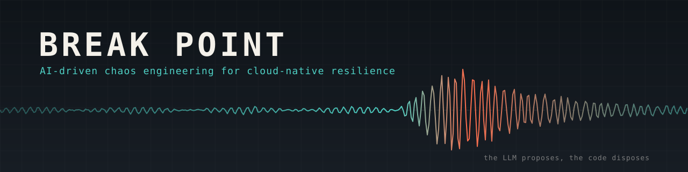
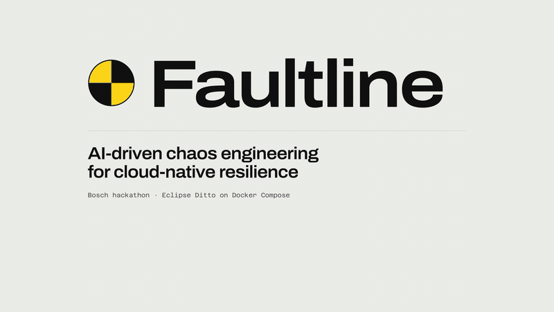
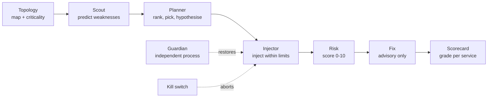

<div align="center">



<br>


**[Live replay](https://faultline-fable.vercel.app)** · **[Demo](#demo)** · **[Quickstart](#quickstart)** · **[How it works](#how-it-works)** · **[Control room](#the-control-room)** · **[Safety](#safety-first)** · **[Docs](#documentation)**

</div>

---

Faultline breaks a cloud-native application on purpose, safely, and tells you what it learned.

It points a small team of agents at [Eclipse Ditto](https://github.com/eclipse-ditto/ditto), an open-source IoT digital-twin platform running under Docker Compose. The agents map the service dependency graph (including dependencies the compose file never declares), decide which failure would teach the most, inject it within hard limits, watch what real API clients would see, then write a risk assessment, Ditto-specific fix recommendations and a per-service resilience scorecard.

Built for the Bosch hackathon problem statement *"AI-Driven Chaos Engineering for Cloud-Native Resilience"*.

> **The LLM proposes, the code disposes.** A model can pick from a code-ranked shortlist and write a hypothesis. It cannot raise a safety threshold, skip the kill switch or apply a fix. Nothing is changed in the application unless a person approves the exact change shown.

## Demo

<p align="center">
  <a href="docs/demo/faultline-demo.mp4" title="Click to play the full three-minute demo">
    
  </a>
  <br>
  <sub>Sped-up preview. <b><a href="docs/demo/faultline-demo.mp4">Click to play the full three-minute demo</a></b>, or try the <b><a href="https://faultline-fable.vercel.app">live replay on Vercel</a></b>.</sub>
</p>

The video walks the whole loop, from the dependency map to the scorecard. The live-demo runbook behind it is [docs/DEMO.md](docs/DEMO.md).

## What it does

| Step | What happens | Where to look |
|---|---|---|
| **1. Map** | Parses compose `depends_on`, scans environment variables for hostnames, reads nginx `proxy_pass`, layers in documented Pekko-cluster edges and enriches from live `docker inspect`. Ranks every service by how much breaks if it fails | `faultline topology` |
| **2. Predict** | Seven deterministic checks flag likely weaknesses before anything is injected, each one quoting the exact field it came from | `faultline scout` |
| **3. Plan** | Code ranks every (service, failure) pair; the LLM picks from the top five, tunes parameters within bounds and writes a falsifiable hypothesis | `faultline plan` |
| **4. Inject** | Ten failure types with a 90 s hard cap, abort thresholds, an independent watchdog and a Guardian process | `faultline run` |
| **5. Observe** | A synthetic Things-API probe at about 4 req/s plus a health probe every 3 s, with Prometheus and Grafana alongside | live telemetry |
| **6. Report** | Risk score (0 to 10), advisory fixes and a scorecard graded A to F per service, worst first | `faultline risk && faultline fix && faultline scorecard` |
| **7. Fix, if you say so** | Asks "Can I fix this?" with five parts: what is wrong, the exact change, the expected improvement, the risks and the rollback. Only a code-defined catalog fix can be offered, and only the exact change a person approves by its hash is applied. Faultline then re-runs the same experiment, reports before and after, and rolls a configuration change back if it does not hold. Unanswered proposals expire | `faultline proposals` · `faultline approve <id>` · Fix approvals panel |

**A result worth knowing about:** compose's `depends_on` never mentions MongoDB, so a naive map would call it a leaf. Scanning environment variables finds `MONGO_DB_HOSTNAME=mongodb` on four services, and Faultline ranks MongoDB the number one single point of failure. The Day-2 verification run is written up in [docs/FINDINGS.md](docs/FINDINGS.md).

## How it works

Faultline uses a blackboard pattern. There is no message bus: every agent reads and writes JSON files in `reports/`, and the Pydantic models in `faultline/schemas.py` are the contract between them. A crashed agent loses nothing, and any agent can be re-run on its own.



The agents:

| Agent | Job |
|---|---|
| **Topology** | Builds the dependency graph from five evidence sources and ranks criticality |
| **Weakness Scout** | Predicts weaknesses before injection, then reconciles them against what experiments confirmed |
| **Failure Injection** | Planner, executor and safety monitor in one |
| **Risk / Impact** | Deterministic severity from user impact, blast radius, recovery time and cascade depth |
| **Fix Recommendation** | A library of Ditto-specific remediations; the LLM may add at most two, tagged unverified |
| **Scorecard** | Per-service score and grade, ranked worst first |
| **Narrator** | Plain-English play-by-play for the demo screen |
| **Guardian** | A separate process that restores anything the injector leaves down |
| **Approval** | Optional email round trip for experiments the protection policy would refuse; no LLM |

The full agent write-ups, scoring formulas and the complete architecture diagram are in [docs/REFERENCE.md](docs/REFERENCE.md#architecture).

## Quickstart

You need Docker Desktop with at least 4 GB of memory for its VM, Python 3.10 or newer, and, only if you want a local model, [Ollama](https://ollama.com) with `ollama pull phi4-mini`. Tested on Apple Silicon.

```bash
git clone https://github.com/InnoxCodes/fault-line.git && cd fault-line
python3 -m venv .venv && . .venv/bin/activate && pip install -e .

scripts/up.sh                # start Ditto + MongoDB + nginx + observability (cold start ~2 min)
cp .env.example .env         # defaults match deploy/docker-compose.yml

faultline setup              # check Docker, the stack and the LLM
faultline dashboard          # terminal 1: control room at http://127.0.0.1:8765
faultline guardian           # terminal 2: the independent safety process
```

Then open the control room: arm the probes, rebuild the map, capture a baseline, and press and hold **LAUNCH**.

Prefer the terminal? The same pipeline runs headless:

```bash
faultline demo --experiments 3     # map, scout, baseline, run, risk, fix, scorecard, narrate
```

Once the stack is up:

| What | Where |
|---|---|
| Control room | http://127.0.0.1:8765 |
| Ditto API / UI | http://127.0.0.1:8080/api/2/things · http://127.0.0.1:8080/ui/ |
| Prometheus | http://127.0.0.1:9090 |
| Grafana | http://127.0.0.1:3000 |

The bundled stack uses basic-auth `ditto` / `ditto`. Every port is bound to `127.0.0.1`.

The full CLI reference, LLM provider setup and how to point Faultline at a different application are in [docs/REFERENCE.md](docs/REFERENCE.md#quickstart).

## The control room

One screen drives everything. It owns the probes, runs operations as background jobs, streams what each agent is doing and keeps a kill switch in the header. It is a standard-library server with a vanilla ES-module frontend: no build step, no CDN, no web fonts, so it works on venue wifi or none at all.

- **Application map**: node size is criticality, edge style is the evidence the edge came from, and the observed blast radius pulses red against the predicted one.
- **Live telemetry**: success rate, p95 latency, phase bands and dashed abort thresholds.
- **AI planner**: the ranked candidates, the pick, the rationale and the hypothesis, shown before anything runs.
- **Experiments and scorecard**: expand a row for findings, risk, fixes, a timeline and the exact commands to reproduce it by hand.
- **Explain mode**: press `E` and every panel explains itself in plain English.

Keyboard: `Esc` fires the kill switch, `E` toggles explanations, `Space` pauses live updates.

There is also **Fable**, an alternative stage-by-stage front end in [`fable/`](fable/) (React, TypeScript and Vite), served at `/fable/`. A read-only replay of it, running on recorded data with no backend, is hosted at **[faultline-fable.vercel.app](https://faultline-fable.vercel.app)**.

## Failure catalog

Ten failure types, every parameter bounded, whatever the model or the operator asks for clamped into range.

| Family | Types |
|---|---|
| Container | `container_crash` · `container_pause` · `container_stop` |
| Network | `network_partition` · `network_delay` · `network_loss` |
| Resource | `cpu_stress` · `disk_pressure` |
| Data and load | `db_flood` · `traffic_spike` |

Parameters, bounds and mechanisms are in [docs/REFERENCE.md](docs/REFERENCE.md#failure-catalog).

## Safety first

| Guard | Behaviour |
|---|---|
| **Abort thresholds** | Roll back at once if the error rate passes 30 %, p95 latency passes max(3 s, 5x baseline), or a service outside the expected blast radius fails three health checks in a row |
| **Hard cap** | 90 s per experiment, with an independent watchdog that fires even if the main loop is stuck |
| **Kill switch** | The header button, `Esc`, `faultline stop` or `touch reports/STOP` |
| **Guardian** | A second process with its own Docker client that restores any container left down |
| **Do no harm** | Refuses to inject into a system that is already unhealthy, and only one experiment runs at a time |
| **Protected services** | MongoDB is degrade-only unless explicitly overridden |
| **Scoped** | Every container operation is filtered by the compose project label and never reaches outside it |
| **Advisory fixes** | `FixRecommendation.advisory_only` is always true; no agent has a code path that edits the stack |
| **Human-approved fixes** | The only change path: six catalog fixes, each approved by its hash. Configuration changes go into a Faultline-owned compose override, never the stack's own files; every fix is verified by a re-run, and the override is restored byte for byte if the stack is unhealthy or the re-run is worse. Details in [docs/REFERENCE.md](docs/REFERENCE.md#human-approved-fixes) |

Details, including the approval gate and the recovery and soak rules, are in [docs/REFERENCE.md](docs/REFERENCE.md#safety).

## Documentation

| Document | What it covers |
|---|---|
| [docs/REFERENCE.md](docs/REFERENCE.md) | The complete reference: every agent, CLI command, HTTP endpoint, output file, limitation and roadmap item |
| [docs/PROJECT_GUIDE.md](docs/PROJECT_GUIDE.md) | Long-form guide, with likely judge questions and a glossary |
| [docs/DEMO.md](docs/DEMO.md) | The six-minute live demo runbook and the three-minute video cut |
| [docs/FINDINGS.md](docs/FINDINGS.md) | Results of the Day-2 verification run against a live Ditto stack |
| [docs/ARCHITECTURE.md](docs/ARCHITECTURE.md) | Module map and the experiment lifecycle |
| [docs/ARCHITECTURE_OVERVIEW.md](docs/ARCHITECTURE_OVERVIEW.md) | The architecture overview written for Day 2 |
| [docs/UI_CONTRACT.md](docs/UI_CONTRACT.md) | The HTTP contract every front end is written against |
| [docs/AGENTS.md](docs/AGENTS.md) | Notes for agents and contributors working in the repo |
| [faultline_langgraph/README.md](faultline_langgraph/README.md) | Opt-in LangGraph reimplementation of the Planner |
| [PROGRESS.md](PROGRESS.md) | How the project got here |

## Repository layout

```
faultline/             the tool: agents, chaos injectors, safety, observe, dashboard
  agents/              scout, risk, fix, scorecard, narrator, guardian, approval
  chaos/               failure catalog and Docker / Pumba actions
  planning/            candidate ranking and the LLM planner
  safety/              thresholds, watchdog, kill switch
  dashboard/           control plane, server and the vanilla-JS control room
faultline_langgraph/   opt-in LangGraph Planner (nothing in faultline/ imports it)
fable/                 alternative React front end
config/                settings, abort thresholds, Ditto knowledge base
deploy/                Docker Compose stack, nginx, Prometheus, Grafana
docs/                  reference, guides, findings, demo runbook, pitch deck
reports-demo/          a captured run you can browse without Docker
scripts/               up / down / status helpers and the UI verifier
tests/                 offline test suite
```

## Team

Built at the Bosch hackathon by [@InnoxCodes](https://github.com/InnoxCodes), [@meddoesdev](https://github.com/meddoesdev), [@r153b](https://github.com/r153b), [@Hita2503](https://github.com/Hita2503) and [@Adnan-Ahmad-Khan](https://github.com/Adnan-Ahmad-Khan).

## Development

```bash
pip install -e ".[dev]"
pytest -q            # offline, no Docker required
```

`make venv`, `make up`, `make dashboard` and `make demo` wrap the common commands. For the control room's visual verification harness, see [docs/REFERENCE.md](docs/REFERENCE.md#development).

## Known limits

Single node and Docker Compose only (no Kubernetes backend yet). Crash recovery times mostly measure JVM boot, not Ditto's fault handling. The control room is single-operator and unauthenticated, so keep it on loopback. The honest, complete list lives in [docs/REFERENCE.md](docs/REFERENCE.md#known-limitations), alongside the [roadmap](docs/REFERENCE.md#roadmap).
