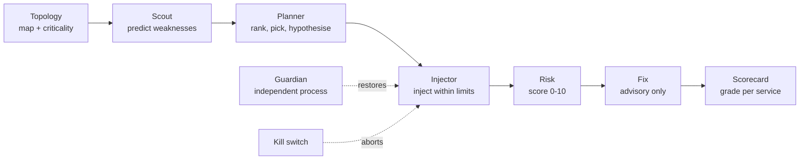

<div align="center">


<br>


**[Targets](#targets)** · **[Quickstart](#quickstart)** · **[How it works](#how-it-works)** · **[Control room](#the-control-room)** · **[Safety](#safety-first)** · **[Docs](#documentation)**

</div>

---

Faultline breaks a cloud-native application on purpose, safely, and tells you what it learned.

It points a small team of agents at an open-source application running under Docker Compose. The agents map the service dependency graph (including dependencies the compose file never declares), decide which failure would teach the most, inject it within hard limits, watch what real API clients would see, then write a risk assessment, fix recommendations and a per-service resilience scorecard.

This branch is the reusable core: nothing in it names an application. Each application under test is a *target* — a directory under `targets/` — and each target lives on its own branch, `target/<name>`, which is the core plus that one directory.

Built for the Bosch hackathon problem statement *"AI-Driven Chaos Engineering for Cloud-Native Resilience"*.

> **The LLM proposes, the code disposes.** A model can pick from a code-ranked shortlist and write a hypothesis. It cannot raise a safety threshold, skip the kill switch or apply a fix. Nothing is changed in the application unless a person approves the exact change shown.

## What it does

| Step | What happens | Where to look |
|---|---|---|
| **1. Map** | Parses compose `depends_on`, scans environment variables for hostnames, reads nginx `proxy_pass`, layers in the target's documented edges and enriches from live `docker inspect`. Identifies each datastore's engine from evidence (image, connection URI, the project's own code). Ranks every service by how much breaks if it fails | `faultline topology` |
| **2. Predict** | Seven deterministic checks flag likely weaknesses before anything is injected, each one quoting the exact field it came from | `faultline scout` |
| **3. Plan** | Code ranks every (service, failure) pair; the LLM picks from the top five, tunes parameters within bounds and writes a falsifiable hypothesis | `faultline plan` |
| **4. Inject** | Ten failure types with a 90 s hard cap, abort thresholds, an independent watchdog and a Guardian process | `faultline run` |
| **5. Observe** | A synthetic API probe at about 4 req/s, driven by the target's probe spec, plus a health probe every 3 s | live telemetry |
| **6. Report** | Risk score (0 to 10), advisory fixes and a scorecard graded A to F per service, worst first | `faultline risk && faultline fix && faultline scorecard` |
| **7. Fix, if you say so** | Asks "Can I fix this?" with five parts: what is wrong, the exact change, the expected improvement, the risks and the rollback. Only a code-defined catalog fix can be offered, and only the exact change a person approves by its hash is applied. Faultline then re-runs the same experiment, reports before and after, and rolls a configuration change back if it does not hold. Unanswered proposals expire | `faultline proposals` · `faultline approve <id>` · Fix approvals panel |

**A result worth knowing about:** compose's `depends_on` rarely mentions the database, so a naive map would call it a leaf. Scanning environment variables finds `DB_HOST=db` (or `DATABASE_URL=postgres://db/...`) on every service that needs it, and Faultline ranks the database as the single point of failure it is.

## Targets

A target is everything that belongs to one application, in one directory:

```
targets/<name>/
  target.yaml            compose file, project name, URL, app name, links (settings, layered under .env)
  <name>_knowledge.yaml  what compose cannot say: documented edges, roles, health paths, datastore engines
  probe.yaml             the synthetic requests that stand for real users, and which services each passes
  rules.yaml             optional fix rules naming the application's own services and settings
  thresholds.yaml        optional; which services are protected (degrade-only)
  deploy/                the compose stack itself
```

Select one with `FAULTLINE_TARGET=<name>` in `.env`. `faultline onboard <repo> --out targets/<name>` writes the knowledge file for any compose repository, and [docs/ONBOARDING_A_TARGET.md](docs/ONBOARDING_A_TARGET.md) walks through the rest. A target that ships none of the optional files still runs: the probe polls the health URL, the fix agent uses the generic rules, and `faultline setup` warns about every datastore that is not protected yet.

| Branch | What it is |
|---|---|
| `main` | The core: agents, safety, dashboard, the generic rule library and engine table. No target |
| `target/ditto` | Core plus `targets/ditto/`: Eclipse Ditto 3.9 with MongoDB, nginx and an observability stack, its hand-written knowledge and fix rules, demo, findings and the Fable front end |

## How it works

Faultline uses a blackboard pattern. There is no message bus: every agent reads and writes JSON files in `reports/`, and the Pydantic models in `faultline/schemas.py` are the contract between them. A crashed agent loses nothing, and any agent can be re-run on its own.



The agents:

| Agent | Job |
|---|---|
| **Topology** | Builds the dependency graph from five evidence sources and ranks criticality |
| **Repo Onboarding** | Writes a target's knowledge file from its repository: one bounded LLM pass for prose-only relationships, code alone for datastore engines |
| **Weakness Scout** | Predicts weaknesses before injection, then reconciles them against what experiments confirmed |
| **Failure Injection** | Planner, executor and safety monitor in one |
| **Risk / Impact** | Deterministic severity from user impact, blast radius, recovery time and cascade depth |
| **Fix Recommendation** | A generic remediation library plus the target's own rules; the LLM may add at most two, tagged unverified |
| **Scorecard** | Per-service score and grade, ranked worst first |
| **Narrator** | Plain-English play-by-play for the demo screen |
| **Guardian** | A separate process that restores anything the injector leaves down |
| **Approval** | Optional email round trip for experiments the protection policy would refuse; no LLM |

The module map, the experiment lifecycle and the safety invariants are in [docs/ARCHITECTURE.md](docs/ARCHITECTURE.md).

## Quickstart

You need Docker Desktop with at least 4 GB of memory for its VM, Python 3.10 or newer, and, only if you want a local model, [Ollama](https://ollama.com) with `ollama pull phi4-mini`. Tested on Apple Silicon.

```bash
git clone https://github.com/InnoxCodes/fault-line.git && cd fault-line
python3 -m venv .venv && . .venv/bin/activate && pip install -e .
cp .env.example .env

# either: a ready-made target
git checkout target/ditto && echo FAULTLINE_TARGET=ditto >> .env
# or: your own (see docs/ONBOARDING_A_TARGET.md)
faultline onboard owner/name --out targets/myapp

faultline target             # what is selected, and where its files are
scripts/up.sh                # start the target's stack and wait until it is healthy
faultline setup              # check Docker, the stack, protection and the LLM
faultline dashboard          # terminal 1: control room at http://127.0.0.1:8765
faultline guardian           # terminal 2: the independent safety process
```

Then open the control room: arm the probes, rebuild the map, capture a baseline, and press and hold **LAUNCH**.

Prefer the terminal? The same pipeline runs headless:

```bash
faultline demo --experiments 3     # map, scout, baseline, run, risk, fix, scorecard, narrate
```

## The control room

One screen drives everything. It owns the probes, runs operations as background jobs, streams what each agent is doing and keeps a kill switch in the header. It is a standard-library server with a vanilla ES-module frontend: no build step, no CDN, no web fonts, so it works on venue wifi or none at all.

- **Application map**: node size is criticality, edge style is the evidence the edge came from, and the observed blast radius pulses red against the predicted one.
- **Live telemetry**: success rate, p95 latency, phase bands and dashed abort thresholds.
- **AI planner**: the ranked candidates, the pick, the rationale and the hypothesis, shown before anything runs.
- **Experiments and scorecard**: expand a row for findings, risk, fixes, a timeline and the exact commands to reproduce it by hand.
- **Repo onboarding**: point it at any compose repository and adopt the knowledge file it writes.
- **Explain mode**: press `E` and every panel explains itself in plain English.

Keyboard: `Esc` fires the kill switch, `E` toggles explanations, `Space` pauses live updates.

A target may also ship its own presentation front end at `targets/<name>/fable/`, served at `/fable/`.

## Failure catalog

Ten failure types, every parameter bounded, whatever the model or the operator asks for clamped into range.

| Family | Types |
|---|---|
| Container | `container_crash` · `container_pause` · `container_stop` |
| Network | `network_partition` · `network_delay` · `network_loss` |
| Resource | `cpu_stress` · `disk_pressure` |
| Data and load | `db_flood` · `traffic_spike` |

`db_flood` runs only where the datastore's engine has a write flood verified against its official image (MongoDB, PostgreSQL and Redis today, in `faultline/topology/datastores.py`). Any other datastore still gets every generic fault. `traffic_spike` lands on the entry tier: the published proxy and the service it forwards to.

## Safety first

| Guard | Behaviour |
|---|---|
| **Abort thresholds** | Roll back at once if the error rate passes 30 %, p95 latency passes max(3 s, 5x baseline), or a service outside the expected blast radius fails three health checks in a row |
| **Hard cap** | 90 s per experiment, with an independent watchdog that fires even if the main loop is stuck |
| **Kill switch** | The header button, `Esc`, `faultline stop` or `touch reports/STOP` |
| **Guardian** | A second process with its own Docker client that restores any container left down |
| **Do no harm** | Refuses to inject into a system that is already unhealthy, and only one experiment runs at a time |
| **Protected services** | Services a target lists as protected (typically its datastore) are degrade-only unless explicitly overridden; `faultline setup` flags every datastore that is not |
| **Scoped** | Every container operation is filtered by the compose project label and never reaches outside it |
| **No guessed commands** | An engine-specific command (health ping, write flood, healthcheck fix) runs only where code identified the engine and the command has been verified for it |
| **Advisory fixes** | `FixRecommendation.advisory_only` is always true; no agent has a code path that edits the stack |
| **Human-approved fixes** | The only change path: six catalog fixes, each approved by its hash. Configuration changes go into a Faultline-owned compose override next to the target's compose file, never the stack's own files; every fix is verified by a re-run, and the override is restored byte for byte if the stack is unhealthy or the re-run is worse |

## Documentation

| Document | What it covers |
|---|---|
| [docs/ONBOARDING_A_TARGET.md](docs/ONBOARDING_A_TARGET.md) | Adding a new application: the target directory, onboarding, the probe spec, protection, rules, the branch |
| [docs/ARCHITECTURE.md](docs/ARCHITECTURE.md) | Module map, the experiment lifecycle, onboarding, data contracts and the safety invariants |
| [docs/UI_CONTRACT.md](docs/UI_CONTRACT.md) | The HTTP contract every front end is written against |
| [docs/AGENTS.md](docs/AGENTS.md) | Notes for agents and contributors working in the repo |
| [faultline_langgraph/README.md](faultline_langgraph/README.md) | Opt-in LangGraph reimplementation of the Planner |

A target branch carries its own documents under `targets/<name>/docs/` (for `target/ditto`: the long-form guide, the full reference, the demo runbook and the verification findings).

## Repository layout

```
faultline/             the tool: agents, chaos injectors, safety, observe, dashboard
  agents/              scout, risk, fix, scorecard, narrator, guardian, approval, the generic rule library
  chaos/               failure catalog and Docker / Pumba actions
  onboarding/          repo onboarding: source discovery, the bounded LLM pass, code evidence for engines
  planning/            candidate ranking and the LLM planner
  safety/              thresholds, watchdog, kill switch
  topology/            compose parsing, the graph, datastore engines
  dashboard/           control plane, server and the vanilla-JS control room
faultline_langgraph/   opt-in LangGraph Planner (nothing in faultline/ imports it)
config/                settings, abort thresholds, the onboarding worked example
targets/               one directory per application under test (on its target/<name> branch)
docs/                  architecture, UI contract, agent inventory, onboarding a target
scripts/               up / down / status for the selected target, and the UI verifier
tests/                 offline test suite; tests/fixtures/shop is an invented application to test against
```

## Team

Built at the Bosch hackathon by [@InnoxCodes](https://github.com/InnoxCodes), [@meddoesdev](https://github.com/meddoesdev), [@r153b](https://github.com/r153b), [@Hita2503](https://github.com/Hita2503) and [@Adnan-Ahmad-Khan](https://github.com/Adnan-Ahmad-Khan).

## Development

```bash
pip install -e ".[dev]"
pytest -q            # offline, no Docker required; also collects targets/<name>/tests on a target branch
```

`make venv`, `make up`, `make target`, `make dashboard` and `make demo` wrap the common commands. `scripts/verify_ui.py` drives the control room in a real Chrome at five breakpoints and fails on console errors or overflow.

## Known limits

Single node and Docker Compose only (no Kubernetes backend yet). For JVM-based targets, crash recovery times mostly measure JVM boot rather than the application's own fault handling. The control room is single-operator and unauthenticated, so keep it on loopback. Engine-specific faults exist for three engines; every other datastore gets the generic faults until a command is verified for it.

## Ingestion data quality: validating what comes in

*Added in response to evaluator feedback on how raw input is handled before it is used.*

Every agent's output is schema-validated before it is written; this is the other end. Each topology build (CLI `faultline topology`, the control room's map job, and any command that rebuilds the map) runs the raw compose mapping and the derived edges through `faultline/topology/quality.py` before the graph is built, and writes the audit trail to `reports/data_quality.json` (`DataQualityReport` in `faultline/schemas.py`, validated before write). Six deterministic checks, no LLM:

| Check | What it does | Actions recorded |
|---|---|---|
| Null / missing | empty service blocks, no `image` and no `build`, healthcheck without `test` or `interval` | `defaulted` (with the documented default, e.g. Docker's 30 s interval), `flagged` |
| Consistency | `depends_on` names and env hostnames (`*_HOST`, `*_URI`, ...) must resolve to a declared service or alias; every edge must join two declared services | `excluded` (no edge is created), `flagged` as a dangling reference. IPs, `localhost` and dotted names are treated as external, not as defects |
| Conformity | service names match compose's grammar; `environment`, `depends_on`, `healthcheck` have the right shape; ports are numeric | `excluded`, `flagged` |
| Range | ports 1-65535, memory limits > 0, healthcheck interval/timeout in (0, 3600] s, retries >= 0 | `excluded` (an out-of-range port is dropped), `flagged` |
| Cleaning | trims stray whitespace in names, de-duplicates repeated env keys (last wins, as in compose), `depends_on` entries and edges, resolves relative `build` / `env_file` paths | `normalized`, `deduplicated` |
| Time lenience | `same_window()` / `order()`: two timestamps closer than `TIME_LENIENCE_SECONDS` (default 1.5 s, `time_lenience_s` in settings) are reported as unordered, never as A-before-B | a utility for timestamp correlation, not a rewrite |

Guardrails: the pass only drops or flags; it never adds an edge or changes what a value means. On a well-formed sandbox compose file it reports **zero issues and an identical graph**; on unfamiliar repos it generalises (Mastodon: 5 healthchecks without an interval recorded as Docker's default; OpenTelemetry demo: 16 relative build paths resolved). Tests: `tests/test_data_quality.py`.

This is the fifth data-quality guarantee, alongside schema validation on write, a measured baseline, cross-checking two independent signals, and the sequence-number canary.
