# Faultline

AI-driven chaos engineering for a cloud-native sample application, built for the Bosch hackathon problem statement *"AI-Driven Chaos Engineering for Cloud-Native Resilience"*.

Faultline points a small team of agents at [Eclipse Ditto](https://github.com/eclipse-ditto/ditto), an open-source IoT digital-twin platform running under Docker Compose. It maps the service dependency graph automatically (including the dependencies the compose file does not declare), ranks the services by how much would break if they failed, lets a local open-source LLM pick the most informative next failure experiment from a code-ranked shortlist, injects that failure with hard safety limits enforced by code, observes what real API clients would see, and writes a risk assessment, Ditto-specific fix recommendations and a per-service resilience scorecard. The LLM proposes; the code disposes. Nothing is ever applied to the application: every recommendation is advisory.

## What the judges asked for, and what Faultline does

| Organisers' requirement | Faultline | Command / output |
|---|---|---|
| 1. Select and understand a sample app; map services and dependencies automatically | Topology agent parses compose `depends_on`, scans environment variables for hostnames, parses nginx `proxy_pass`, layers documented Pekko-cluster edges, enriches from live `docker inspect`, and computes a criticality ranking | `faultline topology` -> `reports/topology.json` (+ Mermaid/Markdown rendering) |
| 2. Plan experiments intelligently, riskiest / most informative first | Code ranks every (service, failure) pair by criticality x untested bonus - tested penalty; the LLM picks among the top 5, tunes parameters within bounds and writes a falsifiable hypothesis | `faultline plan` (dry run) / `faultline run` -> `experiments/<id>.json` |
| 3. Inject controlled failures with safety limits and auto-stop | 10 failure types; abort on error rate, p95 latency or blast radius; 90 s hard cap; independent watchdog; STOP file; Guardian process; one experiment at a time | `faultline run`, `faultline stop`, `faultline guardian` |
| 4. Observe behaviour: errors, slowdowns, recovery time | Synthetic Things-API probe through nginx at ~4 req/s with a sequence-number canary; `/alive` + `/ready` health probe every 3 s; Prometheus + Grafana on the side | `reports/live.json`, `faultline dashboard`, Grafana :3000 |
| 5. Analyse and report: weaknesses, fixes, ranked resilience score | Risk agent (0-10 severity), Fix agent (Ditto-specific remediations), Scorecard agent (0-100 per service, graded A-F, ranked worst first) | `faultline risk && faultline fix && faultline scorecard` -> `risk/`, `fixes/`, `scorecard.md` |
| Day-1 minimum: running app | Ditto 3.9.8 + MongoDB + nginx + observability stack in one compose project | `scripts/up.sh` |
| Day-1 minimum: dependency map | Automatic, with the undeclared MongoDB dependency found | `faultline topology` |
| Day-1 minimum: one safe injection with a working kill switch | Any `faultline run`; kill switch via `faultline stop`, the dashboard STOP button, or `touch reports/STOP` | see [docs/DEMO.md](docs/DEMO.md) |
| Agents recommend fixes, never apply them | `FixRecommendation.advisory_only` is always `true`; no agent has a code path that edits the stack | `reports/fixes/<id>.md` |
| One agent proposes failures, one scores risk, one recommends fixes | Failure Injection, Risk/Impact and Fix Recommendation agents, plus Topology, Scorecard, Narrator and Guardian | see architecture below |
| Open-source models | Default provider is Ollama with `phi4-mini`; OpenAI-compatible and Anthropic APIs optional | `.env` |
| Whole app monitored by an open-source observability tool | Prometheus 2.55, cAdvisor, Blackbox exporter, Grafana 11.3 with a provisioned dashboard | http://127.0.0.1:3000 |

## Architecture

Faultline uses a blackboard pattern. There is no message bus and no shared process: every agent reads and writes JSON files in `reports/`, and the Pydantic models in `faultline/schemas.py` are the contract between them. A crashed agent loses nothing, any agent can be re-run in isolation, and the dashboard is just a viewer over the same directory.

```mermaid
flowchart LR
    subgraph sandbox["Docker Compose project: faultline"]
        nginx --> gateway --> policies
        gateway --> things --> policies
        gateway --> search["things-search"] --> policies
        gateway --> conn["connectivity"] --> policies
        policies --> mongo[("MongoDB")]
        things --> mongo
        search --> mongo
        conn --> mongo
        prom["Prometheus + cAdvisor + Blackbox"] -.-> grafana["Grafana"]
    end

    subgraph bb["Blackboard: reports/"]
        topo["topology.json"]
        base["baseline.json"]
        exp["experiments/&lt;id&gt;.json"]
        risk["risk/&lt;id&gt;.json"]
        fix["fixes/&lt;id&gt;.json / .md"]
        score["scorecard.json / .md"]
        live["live.json<br/>ACTIVE_EXPERIMENT.json<br/>STOP"]
    end

    T["Topology agent"] -->|compose + env + nginx + docker inspect| topo
    I["Failure Injection agent<br/>planner + executor + safety"] -->|reads| topo
    I -->|reads| base
    I -->|writes| exp
    I -->|heartbeat / lock| live
    I ==>|inject / roll back| sandbox
    P["Probes: Things API + /alive /ready"] -->|baseline| base
    P -->|samples| I
    R["Risk agent"] -->|reads| exp
    R -->|writes| risk
    F["Fix agent"] -->|reads| risk
    F -->|writes| fix
    S["Scorecard agent"] -->|reads| exp
    S -->|writes| score
    N["Narrator agent"] -->|reads everything| bb
    G["Guardian agent<br/>independent process"] -->|watches| live
    G ==>|restore containers| sandbox
    D["Dashboard :8765"] -->|GET /api/state, POST /api/stop| bb
    LLM(["LLM: Ollama / OpenAI-compatible / Anthropic"]) -. advisory only .-> I
    LLM -. prose only .-> R
    LLM -. up to 2 extras .-> F
```



The agents:

- **Topology / Mapping agent** (`faultline/topology/`). Builds the dependency graph from five sources: compose `depends_on`, an environment-variable scan for values that resolve to another service's name or network alias, nginx `proxy_pass` targets, documented Pekko-cluster edges from `config/ditto_knowledge.yaml`, and live `docker inspect` (container names, state, health, restart policy, aliases). Criticality = number of transitive dependents + 2 for holding state + 1 for being the external entry point + 1 for being a datastore + 0.5 for having no application health endpoint. The key result: compose `depends_on` never mentions MongoDB, so a naive map would call it a leaf. The env scan finds `MONGO_DB_HOSTNAME=mongodb` on four services and ranks MongoDB the number one single point of failure.
- **Failure Injection agent** (`faultline/planning/`, `faultline/chaos/`, `faultline/safety/`). Planner, executor and safety monitor. Described in the next sections.
- **Risk / Impact agent** (`faultline/agents/risk.py`). Deterministic 0-10 severity: 4 x user impact (1 - success rate during injection) + 2 x blast radius fraction + 2 x min(TTR / 120 s, 1) + 1.5 if recovery needed intervention + bonuses for findings. Levels: < 3 low, < 5.5 medium, < 8 high, otherwise critical; any suspected data loss is critical regardless. The LLM only rewrites the two prose fields.
- **Fix Recommendation agent** (`faultline/agents/fix.py`, `faultline/agents/knowledge.py`). A library of Ditto-specific remediation rules (MongoDB replica set, two `policies` instances, nginx upstream with retries, readiness that reflects subsystem health, autoheal sidecar, aligned timeouts, rate limiting, log rotation, split-brain resolver, and so on), matched by finding code > target > failure type > generic. The LLM may add at most two schema-validated extras, tagged `[LLM suggestion, unverified]` and capped at 0.6 confidence. Advisory only.
- **Resilience Scorecard agent** (`faultline/agents/scorecard.py`). Score = 100 - mean penalty per service; penalty = 40 x (1 - success during) + 20 x min(TTR / 120 s, 1) + 20 if manual recovery + 10 per high/critical finding (max 3) + 5 for a cascade. Grades A >= 90, B >= 80, C >= 65, D >= 50, else F. Ranked worst first; untested services are listed last with no grade.
- **Narrator agent**. Turns the blackboard into a plain-English play-by-play for the demo screen (`faultline narrate --watch`).
- **Guardian agent**. A separate process that does not trust the injector. It restores any sandbox container that is down past the deadline recorded in `ACTIVE_EXPERIMENT.json`, removes leftover chaos helper containers (label `faultline.helper=1`), and obeys the `STOP` file. We do not trust a single agent with the kill switch.

## The sample application

**Eclipse Ditto 3.9.8** — https://github.com/eclipse-ditto/ditto — licence EPL-2.0. Ditto is an IoT digital-twin platform: devices get a "thing" in the cloud whose state and features can be read and written over HTTP/WebSocket, searched, and bridged to message brokers.

| Service | Role in Ditto | Notes |
|---|---|---|
| `nginx` | reverse proxy + basic auth | the only published port, `127.0.0.1:8080` |
| `gateway` | HTTP / WebSocket API | no published ports; nginx is the only way in |
| `policies` | authorisation | hard dependency of the other four Java services |
| `things` | twin state | cluster-sharded persistent actors |
| `things-search` | search index | eventually consistent, rebuilt from things events |
| `connectivity` | MQTT / AMQP / Kafka bridges | its loss should not affect the HTTP API |
| `ditto-ui` | web UI | served at `/ui/`, not a chaos target |
| `mongodb` | sole datastore (MongoDB 7) | used by all four persistence services |

The five Java services form one Apache Pekko cluster (network alias `ditto-cluster`). Each exposes `/alive` and `/ready` on port 7626 and Prometheus metrics on port 9095; both are internal to the compose network.

Compliance with the sample-app rules:

- [x] Public repository: https://github.com/eclipse-ditto/ditto
- [x] Open-source licence: Eclipse Public License 2.0
- [x] Cloud-native / containerised: official images `eclipse/ditto-*:3.9.8`, `mongo:7.0`, `nginx:1.27-alpine`
- [x] Multi-service: 8 application containers, 5 of them in one cluster
- [x] Deployable with Docker Compose: `deploy/docker-compose.yml`, compose project `faultline`
- [x] Runs entirely in the team's sandbox: all ports bound to `127.0.0.1`; Faultline filters every container operation by the compose project label and never reaches outside it

`deploy/docker-compose.yml` also ships the observability stack: Prometheus (5 s scrape interval; cAdvisor for container CPU/memory/network, Ditto's own Kamon metrics on 9095, Blackbox probes of `/alive`, `/ready`, the nginx `/health` endpoint and MongoDB's TCP port) and Grafana with a provisioned dashboard "Faultline — Ditto resilience" as the anonymous viewer's home page.

## Quickstart

Prerequisites: Docker Desktop with at least 4 GB of memory for the VM (Ditto's container limits sum to about 2.6 GB), Python 3.10+, and optionally [Ollama](https://ollama.com) with `ollama pull phi4-mini`. Tested on Apple Silicon; arm64 images are available for everything in the stack.

```bash
git clone <this repository> && cd bosch-hackathon-2
python3 -m venv .venv && . .venv/bin/activate && pip install -e .

scripts/up.sh                      # docker compose up -d, then waits for /health = UP (cold start ~2 min)
cp .env.example .env               # defaults match deploy/docker-compose.yml; edit if needed

faultline setup                    # checks Docker, the stack, pulls the Pumba images, checks the LLM
faultline topology                 # dependency map + criticality ranking -> reports/topology.json
faultline baseline                 # 60 s steady-state window -> reports/baseline.json (derives the safety thresholds)
faultline run --experiments 3      # plan, inject, observe, roll back, report; three times
faultline risk && faultline fix && faultline scorecard
faultline dashboard                # http://127.0.0.1:8765 (live state, reports, STOP button)
```

`faultline demo --experiments N` runs topology, baseline, run, risk, fix, scorecard and narrate in sequence. `make venv`, `make up`, `make demo` and friends wrap the same commands.

After the stack is up: Ditto API at http://127.0.0.1:8080/api/2/things (credentials `ditto` / `ditto`), Ditto UI at http://127.0.0.1:8080/ui/, Prometheus at http://127.0.0.1:9090, Grafana at http://127.0.0.1:3000.

To attach Faultline to an existing Ditto compose project instead of the bundled one, set `FAULTLINE_COMPOSE_PROJECT=<project name>` and `DITTO_USER` / `DITTO_PASSWORD` in `.env`. The compose file at `FAULTLINE_COMPOSE_FILE` is still used for the static part of the topology.

### CLI

`faultline <command>` after `pip install -e .`, or `python -m faultline <command>`.

| Command | What it does |
|---|---|
| `setup` | Checks Docker, the compose stack, pulls Pumba images, checks the LLM |
| `topology [--no-live]` | Builds the dependency map; `--no-live` skips `docker inspect` |
| `baseline [--duration 60]` | Captures steady state and derives the safety thresholds |
| `catalog` | Prints the failure catalog with parameters and bounds |
| `plan [--llm/--no-llm]` | Shows the ranked candidates and the pick; runs nothing |
| `run [--experiments N] [--target SVC --failure TYPE --param k=v ...] [--allow-protected] [--no-llm]` | Plans and executes experiments; operator flags pin a specific one |
| `rerun <id>` | Repeats a previous experiment with the same spec |
| `risk`, `fix`, `scorecard` | Run the downstream agents on every report that does not have output yet |
| `narrate [--watch] [--llm]` | Plain-English play-by-play; `--watch` follows the blackboard |
| `guardian` | Starts the independent Guardian process |
| `stop` / `resume` | Writes / removes `reports/STOP` |
| `status` | One-screen summary of the blackboard |
| `dashboard [--port 8765]` | Serves the live dashboard |
| `demo [--experiments N]` | topology, baseline, run, risk, fix, scorecard, narrate |

## Failure catalog

Ten failure types in `faultline/chaos/catalog.py`. Every parameter has a bound; whatever the LLM or the operator asks for is clamped into it and the clamp is recorded in the report's `planner_notes`.

| Failure type | Mechanism | Parameters (default, bounds) | Organisers' example |
|---|---|---|---|
| `container_crash` | `docker kill` (SIGKILL); optional `block_restart` disables Docker's auto-restart for the duration | `duration_s` 30 [10-90], `block_restart` false | Service / container crash |
| `container_pause` | `docker pause` (SIGSTOP): processes freeze, TCP connections stay open, callers hang | `duration_s` 20 [5-60] | Service / container crash (hung variant) |
| `container_stop` | `docker stop` (SIGTERM), stays down until rollback | `duration_s` 30 [10-90] | Failed dependency |
| `network_partition` | `docker network disconnect`; reconnected with the original aliases on rollback | `duration_s` 30 [5-90] | Failed dependency |
| `network_delay` | Pumba + `tc netem` delay with jitter, run as a sidecar (`gaiaadm/pumba` + `ghcr.io/alexei-led/pumba-alpine-nettools`); nothing installed in the target | `duration_s` 45 [10-90], `delay_ms` 800 [100-3000], `jitter_ms` 200 [0-1000] | Slow or lossy network |
| `network_loss` | Pumba + `tc netem` packet loss | `duration_s` 45 [10-90], `loss_percent` 30 [5-80] | Slow or lossy network |
| `disk_pressure` | bounded `fallocate` in the container's writable layer; capped at 1 GiB because the Docker VM disk is shared | `duration_s` 30 [10-90], `size_mb` 256 [64-1024] | Full disk |
| `cpu_stress` | busy-loop workers wrapped in `timeout`, tagged so they can be killed early | `duration_s` 45 [10-90], `workers` 2 [1-4] | Overloaded database (on `mongodb`) |
| `db_flood` | parallel `mongosh` insert loops inside the MongoDB container; the flood collection is dropped on rollback | `duration_s` 45 [10-90], `writers` 2 [1-4] | Overloaded database |
| `traffic_spike` | host-side request burst against nginx -> gateway on top of the probe traffic | `duration_s` 30 [10-90], `rps` 150 [20-600] | Sudden traffic spike |

Role constraints: container crash/stop/pause apply to app and proxy containers; `db_flood` only to MongoDB; `traffic_spike` only to `nginx` and `gateway`; `ditto-ui` and the observability containers are never targets. Every report contains the equivalent `docker` / `pumba` shell commands under `reproduce`.

## Safety

**LLM proposes, code disposes.** The code produces the ranked candidate list; the model may only return the index of one of the top five, parameters that the code clamps anyway, a rationale and a hypothesis. If the model is unavailable, slow or returns nonsense, the deterministic top candidate runs with a templated rationale and the report says so (`planned_by: deterministic`). The model never sees the safety monitor's inputs or outputs and cannot raise any threshold.

**Thresholds** (`config/thresholds.yaml`, derived into `reports/baseline.json` at baseline time) abort an experiment and roll it back immediately when:

- the error rate over the trailing 10 synthetic requests exceeds 30 %, or
- the p95 latency over that window exceeds max(3000 ms, 5 x baseline p95), or
- any service outside the hypothesis' expected blast radius fails 3 health checks in a row, or
- the operator requested a stop.

Further limits: hard cap of 90 s per experiment; an independent watchdog timer fires at 90 + 15 s and calls the rollback even if the main loop is stuck in a blocking Docker call; one experiment at a time (`reports/ACTIVE_EXPERIMENT.json` lock); at most 10 experiments per run with a 30 s pause between them; injection is refused if the 20 s pre-experiment window shows less than 95 % success ("do not break an already sick system").

**Protected services.** MongoDB is the sole datastore, so the Day-1 policy is degrade-only: `network_delay`, `network_loss`, `cpu_stress`, `disk_pressure` and `db_flood` are allowed, crash/stop/pause/partition are not. `--allow-protected` overrides this explicitly, and the override is written into the report.

**Kill switch.** `faultline stop`, the STOP button on the dashboard, or `touch reports/STOP`. The safety monitor checks the file every second; the Guardian honours it too.

**Guardian.** A separate process with its own Docker client. It restores any container in the compose project that is still down past the deadline recorded in `ACTIVE_EXPERIMENT.json`, removes stale Pumba helpers and `tc` qdiscs, and never injects anything.

**Rollback is idempotent.** Every injection returns a handle whose `revert()` can be called from the main loop, the watchdog thread, the Guardian or a `finally` block without double-acting.

**Recovery.** Declared when success >= 95 % and p95 < max(300 ms, 2 x baseline p95) for 3 consecutive checks (2 s apart). The wait is bounded at 240 s because Ditto's Java services need 60-120 s to cold start and rejoin the cluster. If the target is still unhealthy at 50 % of that timeout it is restarted; at 80 % its direct dependents are restarted too. This ladder exists because of [Ditto discussion #1861](https://github.com/eclipse-ditto/ditto/discussions/1861), where Things never reconnected to MongoDB after an outage. Any such action is recorded under `recovery.remediation_actions` and counts against the score.

## What gets measured

Two independent signal sources run for the whole session (`faultline/observe/probes.py`):

- **Things API probe**: synthetic user traffic through nginx -> gateway at ~4 req/s, cycling get thing, put property, search, get property against a canary thing `faultline.probe:canary`. Each `put` carries a monotonically increasing sequence number; the last acknowledged number is remembered.
- **Health probe**: every 3 s, `/alive` and `/ready` on port 7626 via `docker exec` for each Ditto service, `mongosh ping` for MongoDB, and the Docker health status.

Comparing what users see with what the platform claims is how the findings below are detected automatically after every experiment:

| Finding | Meaning |
|---|---|
| `health_check_masked_failure` | a service kept answering `/ready` = 200 while the API through it was failing. Grounded in [Ditto issue #1865](https://github.com/eclipse-ditto/ditto/issues/1865) "/alive and /ready do not consider subsystem health", fixed for liveness only in 3.5.0 |
| `no_automated_remediation` | the container sat `unhealthy`; Docker `restart: always` only reacts to process exit |
| `manual_restart_required` | the escalation ladder had to restart the target or its dependents |
| `data_loss_suspected` | the sequence number read back after recovery is lower than the last acknowledged write |
| `cascade_beyond_hypothesis` | a service outside `hypothesis.expected_affected` was affected |
| `slow_recovery` | time to recover exceeded `hypothesis.expected_recovery_s` |
| `auto_recovered` | the system came back without any intervention |
| `safety_abort` | a threshold fired and the experiment was rolled back early |

Every experiment ends with hypothesis validation: expected max error rate, expected affected services and expected recovery time versus what was observed, recorded in `hypothesis_result.held`.

## LLM providers

The planner, risk and fix agents talk to one `LLMClient` (`faultline/planning/llm.py`). Every call returns `None` on timeout, bad JSON or missing key, so the deterministic path always has the final say. Configure it in `.env`:

```bash
# Ollama (local, open-source, default). qwen3.5:9b and gemma4 are also installed on the demo laptop.
LLM_PROVIDER=ollama
LLM_MODEL=phi4-mini
LLM_BASE_URL=                # default http://127.0.0.1:11434
LLM_API_KEY=

# Any OpenAI-compatible chat API (OpenAI, Groq, OpenRouter, Together, ...)
LLM_PROVIDER=openai
LLM_MODEL=gpt-4o-mini
LLM_BASE_URL=https://api.openai.com/v1     # Groq: https://api.groq.com/openai/v1  OpenRouter: https://openrouter.ai/api/v1
LLM_API_KEY=sk-...

# Anthropic Messages API
LLM_PROVIDER=anthropic
LLM_MODEL=                   # empty = default in faultline/planning/llm.py
LLM_BASE_URL=                # default https://api.anthropic.com
LLM_API_KEY=sk-ant-...

# No model at all: deterministic planning, templated prose
FAULTLINE_LLM=false
```

`--no-llm` on `plan`, `run` and `demo` has the same effect as `FAULTLINE_LLM=false` for one invocation.

## Outputs

```
reports/
  topology.json              dependency map, criticality ranking, structural findings
  baseline.json              steady-state API stats, health availability, derived thresholds
  experiments/<id>.json      one ExperimentReport per injection
  risk/<id>.json             RiskAssessment
  fixes/<id>.json, <id>.md   FixRecommendation (JSON for machines, Markdown for people)
  scorecard.json, .md        per-service scores, ranked worst first
  live.json                  what the injector is doing right now (dashboard feed)
  ACTIVE_EXPERIMENT.json     lock + deadline while an experiment runs (read by the Guardian)
  STOP                       present = abort now
  guardian.heartbeat.json    Guardian liveness
  logs/*.log                 per-agent logs
```

An abbreviated experiment report:

```json
{
  "experiment_id": "3f9a1c2b7d4e",
  "target": {"service": "policies", "container": "faultline-policies-1"},
  "failure_type": "container_stop",
  "parameters": {"duration_s": 30},
  "planned_by": "llm",
  "rationale": "policies is the authorisation dependency of every other service and has not been tested yet",
  "hypothesis": {
    "statement": "taking away policies for 30s will push the synthetic API error rate to at most 100%, impact at most ['connectivity', 'gateway', 'things', 'things-search'], and the API will recover within 90s after rollback without manual intervention",
    "expected_affected": ["connectivity", "gateway", "things", "things-search"],
    "expected_max_error_rate": 1.0,
    "expected_recovery_s": 90.0
  },
  "baseline": {"sample_count": 240, "success_rate": 1.0, "p95_ms": 41.2},
  "during":   {"sample_count": 118, "success_rate": 0.17, "p95_ms": 2210.5},
  "after":    {"sample_count": 96,  "success_rate": 1.0,  "p95_ms": 58.0},
  "recovery": {"recovered": true, "time_to_recover_s": 74.3, "auto_restarted_by_docker": false,
               "remediation_actions": [], "data_integrity_ok": true,
               "data_integrity_detail": "stored seq=312, last acknowledged write seq=312"},
  "safety": {"aborted_early": true, "abort_reason": "error_rate",
             "abort_detail": {"error_rate": 0.9, "threshold": 0.3}, "watchdog_fired": false},
  "hypothesis_result": {"held": true, "observed_max_error_rate": 0.9, "observed_recovery_s": 74.3, "unexpected_affected": []},
  "findings": [
    {"code": "safety_abort", "severity": "info", "title": "Aborted by error-rate threshold", "evidence": "0.90 > 0.30 over trailing 10 requests"},
    {"code": "health_check_masked_failure", "severity": "high", "title": "things answered /ready=200 while the API failed", "evidence": "ready_ok_fraction=1.0 during 83% API errors"}
  ],
  "reproduce": ["docker stop faultline-policies-1", "sleep 30", "docker start faultline-policies-1"],
  "status": "aborted"
}
```

## Known limitations

- Single node, Docker Compose only. The topology and chaos backends are written against the compose project label; there is no Kubernetes backend yet.
- Pumba needs the Docker socket mounted into its helper container. That is normal for Pumba but means network faults require the same privileges as the rest of the tool.
- `disk_pressure` is bounded to 1 GiB and writes into the container's writable layer. It demonstrates the mechanism; it will not fill a production-sized volume.
- Java cold start dominates crash recovery. A killed Ditto service takes 60-120 s to restart and rejoin the Pekko cluster, so time-to-recover for crash-type experiments mostly measures JVM boot time, not Ditto's fault handling.
- Local 7-9B models are slow. A planning call with `phi4-mini` on a laptop takes 5-30 s; `qwen3.5:9b` longer. The deterministic fallback covers timeouts, and `--no-llm` removes the model from the loop entirely.
- The health probe uses `docker exec` because port 7626 is not published. A container that is paused or extremely CPU-starved can make that `exec` slow, which is itself a signal but adds jitter to the health timeline.
- Findings are heuristic. `data_loss_suspected` is a canary read-back, not a journal audit; `health_check_masked_failure` compares fractions over a window, not individual requests.

## Roadmap

- Kubernetes backend (Chaos Mesh or LitmusChaos as the injector; the topology from Services, Deployments and NetworkPolicies).
- OpenTelemetry traces from the probe through gateway to MongoDB so cascades are attributed per hop, not inferred from health fractions.
- Grafana annotations at injection start, rollback and recovery, so the chaos window is visible on every panel.
- Regression mode: run the same experiment before and after a recommended fix and report the delta in the scorecard.
- Bandit-style experiment selection that trades exploration of untested pairs against re-testing weak services, instead of the fixed priority formula.
- Multi-LLM consensus for the planner: two models propose, the code accepts only when they agree on target and failure type.

## Development

```bash
pip install -e ".[dev]"
pytest -q            # offline, no Docker required
```

Repository layout and the experiment lifecycle are documented in [docs/ARCHITECTURE.md](docs/ARCHITECTURE.md); the live-demo runbook is [docs/DEMO.md](docs/DEMO.md).
