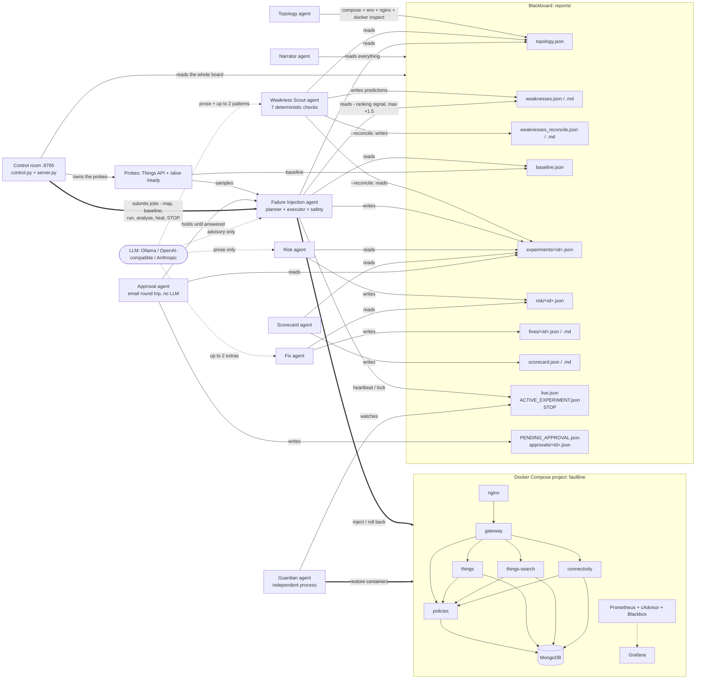

# Faultline

AI-driven chaos engineering for a cloud-native sample application, built for the Bosch hackathon problem statement *"AI-Driven Chaos Engineering for Cloud-Native Resilience"*.

Faultline points a small team of agents at [Eclipse Ditto](https://github.com/eclipse-ditto/ditto), an open-source IoT digital-twin platform running under Docker Compose. It maps the service dependency graph automatically (including the dependencies the compose file does not declare), ranks the services by how much would break if they failed, lets an LLM pick the most informative next failure experiment from a code-ranked shortlist, injects that failure with hard safety limits enforced by code, observes what real API clients would see, and writes a risk assessment, Ditto-specific fix recommendations and a per-service resilience scorecard. The LLM proposes; the code disposes. Nothing is ever applied to the application: every recommendation is advisory.

The whole system is driven from one screen: the **control room** (`faultline dashboard`). It owns the probes, submits the work as background jobs, streams what every agent is doing, and has a kill switch in the header. Every command the control room runs is also a CLI subcommand, so nothing on the screen is a view-only mock-up.

## What the judges asked for, and what Faultline does

| Organisers' requirement | Faultline | Where to see it |
|---|---|---|
| 1. Select and understand a sample app; map services and dependencies automatically | Topology agent parses compose `depends_on`, scans environment variables for hostnames, parses nginx `proxy_pass`, layers documented Pekko-cluster edges, enriches from live `docker inspect`, and computes a criticality ranking | Control room: **Application map** panel (node size = criticality, edges coloured by evidence). CLI: `faultline topology` -> `reports/topology.json` (+ Mermaid/Markdown) |
| 2. Plan experiments intelligently, riskiest / most informative first | Code ranks every (service, failure) pair by criticality x untested bonus - tested penalty (plus small tie-breakers: per-failure informativeness, degrade-only and same-target-as-last-run penalties, and a capped bonus for a Weakness Scout prediction); the LLM picks among the top 5, tunes parameters within bounds and writes a falsifiable hypothesis | Control room: **AI planner** block in the launcher shows the ranked candidates, the pick, the rationale and the hypothesis before anything runs. CLI: `faultline plan` |
| 3. Inject controlled failures with safety limits and auto-stop | 10 failure types; abort on error rate, p95 latency or blast radius; 90 s hard cap; independent watchdog; STOP file; Guardian process; one experiment at a time | Control room: launcher parameters are clamped to the catalog bounds, the phase ribbon shows the watchdog countdown and the abort reason, the header has the kill switch. CLI: `faultline run`, `faultline stop`, `faultline guardian` |
| 4. Observe application behaviour: errors, slowdowns, recovery time | Synthetic Things-API probe through nginx at ~4 req/s with a sequence-number canary; `/alive` + `/ready` health probe every 3 s; Prometheus + Grafana on the side | Control room: **Live telemetry** chart (success rate, p95, phase bands, abort thresholds) and the **Application map** lighting up the observed blast radius against the predicted one. CLI: `reports/live.json`, Grafana :3000 |
| 5. Analyse and report: weaknesses, fixes, ranked resilience score | Risk agent (0-10 severity), Fix agent (Ditto-specific remediations), Scorecard agent (0-100 per service, graded A-F, ranked worst first) | Control room: expand a row in the **Experiments** table for findings, risk, fixes, timeline and reproduce commands; **Resilience scorecard** bottom right. CLI: `faultline risk && faultline fix && faultline scorecard` (or `faultline run --analyze`) -> `risk/`, `fixes/`, `scorecard.md` |
| Day-1 minimum: running app | Ditto 3.9.8 + MongoDB + nginx + observability stack in one compose project | `scripts/up.sh` |
| Day-1 minimum: dependency map | Automatic, with the undeclared MongoDB dependency found | `faultline topology`, or **Rebuild map** in the control room |
| Day-1 minimum: one safe injection with a working kill switch | Any experiment; kill switch via the STOP button in the control-room header (or `Esc`), `faultline stop`, or `touch reports/STOP` | see [docs/DEMO.md](docs/DEMO.md) |
| Agents recommend fixes, never apply them | `FixRecommendation.advisory_only` is always `true`; no agent has a code path that edits the stack | `reports/fixes/<id>.md`, and the "advisory only, nothing is applied" label above every recommendation in the UI |
| One agent proposes failures, one scores risk, one recommends fixes | Failure Injection, Risk/Impact and Fix Recommendation agents, plus Topology, Scorecard, Narrator and Guardian | **Agent pipeline** strip at the top of the stage, live per-agent state. See architecture below |
| Open-source models | Open-weights models only: Ollama with `phi4-mini` locally (default), or Llama 3.3 70B through Groq's OpenAI-compatible endpoint on the demo machine. Any OpenAI-compatible or Anthropic endpoint also works | `.env`, and the model pill in the control-room header |
| Whole app monitored by an open-source observability tool | Prometheus 2.55, cAdvisor, Blackbox exporter, Grafana 11.3 with a provisioned dashboard | http://127.0.0.1:3000 |

### Day-2 verification run

Run on 2026-10-11 against a live Ditto 3.9.8 stack, using only the CLI pipeline (`setup` -> `topology` -> `baseline` -> `run` -> `risk` -> `fix` -> `scorecard` -> `narrate`; the run predates the Weakness Scout). Full results, ranked findings and fixes: **[docs/FINDINGS.md](docs/FINDINGS.md)**. Architecture overview written for Day 2: **[docs/ARCHITECTURE_OVERVIEW.md](docs/ARCHITECTURE_OVERVIEW.md)**; the current module map, control-room and onboarding architecture: [docs/ARCHITECTURE.md](docs/ARCHITECTURE.md).

| Milestone | Evidence from the run |
|---|---|
| AI experiment planner using the dependency map | `faultline topology` ranked `mongodb` #1 (criticality 9.5, vs 5.0 for `policies`) with the finding "mongodb: not referenced by any depends_on; 4 services reach it only via environment variables". `faultline plan` ranked MongoDB's degrade-only failures top-5 and the LLM picked one with a rationale and hypothesis; one experiment in the run (`e85e6fa18520`) was chosen entirely by the planner |
| Three or more distinct failure types | 6 experiments, 6 types: `container_crash` (things), `network_delay` (connectivity), `container_stop` (policies), `cpu_stress` (mongodb), `traffic_spike` (gateway), `network_loss` (mongodb, planner-chosen). Errors, p95 and time-to-recover recorded for each |
| Analysis and scoring | Risk (0-10), Fix (Ditto-specific, advisory) and Scorecard output for every experiment. Overall **87.8/100**; `things` graded **F** (API success 0% when its single instance was killed), the other tested services A |
| Automatic stop on a threshold breach | `things` `container_crash` (`1de6fb6a0969`): `aborted_early: true`, `abort_reason: error_rate` (100% errors > 30% threshold) at +7.2 s, rolled back at +7.6 s, recovered on its own in 26.5 s, no lost write |
| Clean run | Every Ditto service cold-restarted in dependency order (`faultline heal --restart`), then the whole pipeline re-run on an empty blackboard: every step exited 0, the planner chose and ran `network_delay` on MongoDB, and risk/fix/scorecard/narrate produced output. Volumes were deliberately not wiped |

## Architecture

Faultline uses a blackboard pattern. There is no message bus and no shared process: every agent reads and writes JSON files in `reports/`, and the Pydantic models in `faultline/schemas.py` are the contract between them. A crashed agent loses nothing and any agent can be re-run in isolation.

The control room sits on top of that, not beside it. Its control plane (`faultline/dashboard/control.py`) holds the probes, runs operator actions as background jobs, and assembles one JSON snapshot of the whole blackboard per poll; the browser only renders. Anything done from the screen can also be done from the CLI, and both write the same files.



The agents:

- **Topology / Mapping agent** (`faultline/topology/`). Builds the dependency graph from five sources: compose `depends_on`, an environment-variable scan for values that resolve to another service's name or network alias, nginx `proxy_pass` targets, documented Pekko-cluster edges from `config/ditto_knowledge.yaml`, and live `docker inspect` (container names, state, health, restart policy, aliases). Criticality = number of transitive dependents + 2 for holding state + 1 for being the external entry point + 1 for being a datastore + 0.5 for having no application health endpoint. The key result: compose `depends_on` never mentions MongoDB, so a naive map would call it a leaf. The env scan finds `MONGO_DB_HOSTNAME=mongodb` on four services and ranks MongoDB the number one single point of failure.
- **Weakness Scout agent** (`faultline/agents/scout.py`, `faultline/agents/reconcile.py`). The one agent that is not empirical. It runs once, straight after Topology and before anything is injected, reads the compose file, the declared health checks, the resource limits, the restart policies and the knowledge file, and ranks the weaknesses it *predicts*. Seven deterministic checks over eight categories (`shallow_health_check`, `missing_health_check`, `no_redundancy`, `no_resource_limits`, `weak_restart_policy`, `no_retry_or_backoff`, `port_beyond_ingress`, `no_rate_limiting`); every finding quotes a field out of the compose file or `topology.json`, because a hallucinated "no health check" on a service that has one would be indistinguishable from a real finding in a severity-ranked report. Predicted severity = 3.5 x relative criticality + category weight + 2 x blast-radius fraction + 0.5 per other check the same service fails (max 3) + 1 if it holds state + 0.5 if it is a protected service, clamped to 10, at the Risk agent's own level thresholds. Every record carries `[predicted, unconfirmed]`; the LLM only writes the one-sentence "why this matters" per finding and at most two systemic-pattern narratives. The key result: 21 predictions on Ditto, led by MongoDB having no replica set — the exact remediation the Fix agent's library offers only *after* an experiment proves it — and `faultline scout --reconcile` later scores 8 of the 21 confirmed by live findings, 13 untested. See [Predicting weaknesses before breaking anything](#predicting-weaknesses-before-breaking-anything).
- **Failure Injection agent** (`faultline/planning/`, `faultline/chaos/`, `faultline/safety/`). Planner, executor and safety monitor. Described in the next sections.
- **Risk / Impact agent** (`faultline/agents/risk.py`). Deterministic 0-10 severity: 4 x user impact (1 - success rate during injection) + 2 x blast radius fraction + 2 x min(TTR / 120 s, 1) + 1.5 if recovery needed intervention + bonuses for findings + cascade depth (0.5 per hop the failure travelled beyond the hypothesis along a real graph path, max 1.0, +0.5 if one of those hops was hidden by a green health check; this replaces the flat cascade finding bonus when attribution is present). Levels: < 3 low, < 5.5 medium, < 8 high, otherwise critical; any suspected data loss is critical regardless. The LLM only rewrites the two prose fields.
- **Fix Recommendation agent** (`faultline/agents/fix.py`, `faultline/agents/knowledge.py`). A library of Ditto-specific remediation rules (MongoDB replica set, two `policies` instances, nginx upstream with retries, readiness that reflects subsystem health, autoheal sidecar, aligned timeouts, rate limiting, log rotation, split-brain resolver, and so on), matched by finding code > target > failure type > generic. The LLM may add at most two schema-validated extras, tagged `[LLM suggestion, unverified]` and capped at 0.6 confidence. Advisory only.
- **Resilience Scorecard agent** (`faultline/agents/scorecard.py`). Score = 100 - mean penalty per service; penalty = 40 x (1 - success during) + 20 x min(TTR / 120 s, 1) + 20 if manual recovery + 10 per high/critical finding (max 3) + 5 for a cascade. Grades A >= 90, B >= 80, C >= 65, D >= 50, else F. Ranked worst first; untested services are listed last with no grade.
- **Narrator agent**. Turns the blackboard into a plain-English play-by-play for the demo screen (`faultline narrate --watch`).
- **Guardian agent**. A separate process that does not trust the injector. It restores the experiment's target if it is still down past the deadline recorded in `ACTIVE_EXPERIMENT.json` (any other watched container after 20 s down), removes leftover chaos helper containers (label `faultline.helper=1`) once that deadline has passed, and obeys the `STOP` file by restoring everything immediately. We do not trust a single agent with the kill switch.
- **Approval agent** (`faultline/agents/approval.py`). The human in the loop, by email. It holds an operator-chosen experiment the protected-services policy would otherwise have refused, and asks again once an experiment the Risk agent scored high or critical has finished. The admin replies with one word from a closed list; no valid reply within `APPROVAL_TIMEOUT_SECONDS` (120 s) applies the safe default — `SKIP` before injection, `CONTINUE` after. No LLM, and it applies nothing.
- **Control room** (`faultline/dashboard/`), not an agent but the thing that drives them. A long-lived session that owns the two probes, a single-slot job queue for operator actions, an in-memory event log that every agent writes its narration into, and a 1 Hz telemetry buffer. See [Control room](#control-room) below.

## The sample application

**Eclipse Ditto 3.9.8** — https://github.com/eclipse-ditto/ditto — licence EPL-2.0. Ditto is an IoT digital-twin platform: devices get a "thing" in the cloud whose state and features can be read and written over HTTP/WebSocket, searched, and bridged to message brokers.

| Service | Role in Ditto | Notes |
|---|---|---|
| `nginx` | reverse proxy + basic auth | the only published port, `127.0.0.1:8080` |
| `gateway` | HTTP / WebSocket API | no published ports; nginx is the only way in |
| `policies` | authorisation | hard dependency of the other four Java services |
| `things` | twin state | cluster-sharded persistent actors |
| `things-search` | search index | eventually consistent, rebuilt from things events |
| `connectivity` | MQTT / AMQP / Kafka bridges | its loss should not affect the HTTP API |
| `ditto-ui` | web UI | served at `/ui/`, not a chaos target |
| `mongodb` | sole datastore (MongoDB 7) | used by all four persistence services |

The five Java services form one Apache Pekko cluster (network alias `ditto-cluster`). Each exposes `/alive` and `/ready` on port 7626 and Prometheus metrics on port 9095; both are internal to the compose network.

Compliance with the sample-app rules:

- [x] Public repository: https://github.com/eclipse-ditto/ditto
- [x] Open-source licence: Eclipse Public License 2.0
- [x] Cloud-native / containerised: official images `eclipse/ditto-*:3.9.8`, `mongo:7.0`, `nginx:1.27-alpine`
- [x] Multi-service: 8 application containers, 5 of them in one cluster
- [x] Deployable with Docker Compose: `deploy/docker-compose.yml`, compose project `faultline`
- [x] Runs entirely in the team's sandbox: all ports bound to `127.0.0.1`; Faultline filters every container operation by the compose project label and never reaches outside it

`deploy/docker-compose.yml` also ships the observability stack: Prometheus (5 s scrape interval; cAdvisor for container CPU/memory/network, Ditto's own Kamon metrics on 9095, Blackbox probes of `/alive`, `/ready`, the nginx `/health` endpoint and MongoDB's TCP port) and Grafana with a provisioned dashboard "Faultline — Ditto resilience" as the anonymous viewer's home page.

## Quickstart

Prerequisites: Docker Desktop with at least 4 GB of memory for the VM (the application containers' memory limits sum to about 3.1 GB), Python 3.10+, and — only if you want a local model — [Ollama](https://ollama.com) with `ollama pull phi4-mini`. Tested on Apple Silicon; arm64 images are available for everything in the stack.

```bash
git clone <this repository> && cd bosch-hackathon-2
python3 -m venv .venv && . .venv/bin/activate && pip install -e .

scripts/up.sh                      # docker compose up -d, then waits for /health = UP (cold start ~2 min)
cp .env.example .env               # defaults match deploy/docker-compose.yml; edit if needed

faultline setup                    # checks Docker, the stack, pulls the Pumba images, checks the LLM
faultline dashboard                # terminal 1, blocks: http://127.0.0.1:8765
faultline guardian                 # terminal 2, blocks: the independent safety process
```

The Guardian is optional but recommended: it is a second process with its own Docker client that restores anything the injector leaves down, and the control room shows a grey "No guardian" pill until it is running.

Then do the rest in the browser. The control room is the primary interface:

1. **Arm probes** (left panel, Operations). This builds the application map if there is none, starts the synthetic Things-API probe at ~4 req/s and the health monitor at 3 s, and begins sampling telemetry. The header pill switches from `disarmed` to a rising sample count.
2. **Rebuild map**. The dependency graph appears on the stage, node size by criticality. MongoDB ends up largest, which the compose file alone would never tell you.
3. **Capture baseline**. 60 s of steady state; this is what the abort thresholds are derived from. Until it exists the thresholds fall back to the floors in `config/thresholds.yaml`.
4. **Launch**. Leave the mode on AI PLANNER to let the planner choose, or switch to MANUAL and pick a target, a failure type and parameters yourself. Read the hypothesis, then press and hold LAUNCH.
5. **Watch**, then **read**. The phase ribbon, telemetry chart and blast radius move while it runs; when it finishes, the analysis agents score that experiment and it appears in the table at the bottom. **Run analysis** sweeps every experiment that does not yet have risk and fix output and rebuilds the scorecard.

Everything above is also a CLI command, which is what the control room calls underneath:

```bash
faultline topology                 # dependency map + criticality ranking -> reports/topology.json
faultline scout                    # predicted weaknesses, before anything is injected -> reports/weaknesses.json
faultline baseline                 # 60 s steady-state window -> reports/baseline.json
faultline run --experiments 3      # plan, inject, observe, roll back, report; three times
faultline risk && faultline fix && faultline scorecard
faultline scout --reconcile        # which of those predictions the experiments confirmed
faultline heal --restart           # reset the sandbox between runs
```

`faultline demo --experiments N` (default 3) runs topology, scout, a 45 s baseline (`--baseline`), run, risk, fix, scorecard, `scout --reconcile` and narrate in sequence with no browser involved. `make venv`, `make up`, `make dashboard`, `make demo` and friends wrap the same commands.

After the stack is up: Ditto API at http://127.0.0.1:8080/api/2/things, Ditto UI at http://127.0.0.1:8080/ui/, Prometheus at http://127.0.0.1:9090, Grafana at http://127.0.0.1:3000. The bundled compose project uses basic-auth credentials `ditto` / `ditto`; if you attached to another stack, the ones in `.env` apply.

To attach Faultline to an existing Ditto compose project instead of the bundled one, set `FAULTLINE_COMPOSE_PROJECT=<project name>` and `DITTO_USER` / `DITTO_PASSWORD` in `.env` — this is what the demo machine does. The compose file at `FAULTLINE_COMPOSE_FILE` is still used for the static part of the topology.

### CLI

`faultline <command>` after `pip install -e .`, or `python -m faultline <command>`. A global `--config <yaml>` replaces `config/settings.yaml`.

| Command | What it does |
|---|---|
| `setup` | Checks Docker, the compose stack, pulls Pumba images, checks the LLM |
| `topology [--no-live]` | Builds the dependency map; `--no-live` skips `docker inspect` |
| `scout [--no-llm] [--json]` | Predicts weaknesses from the compose file and `topology.json` before anything is injected, ranked worst first, every severity labelled `[predicted, unconfirmed]` -> `reports/weaknesses.json` (+ Markdown). Maps the topology first with `--no-live` if there is none, so it works with the stack down |
| `scout --reconcile` | Scores every prediction against the experiments that have since run — confirmed / cleared / untested — and writes `reports/weaknesses_reconcile.json` (+ Markdown). No LLM is involved |
| `baseline [--duration 60]` | Captures steady state and derives the safety thresholds |
| `catalog` | Prints the failure catalog with parameters and bounds |
| `plan [--no-llm] [--allow-protected]` | Shows the ranked candidates and the pick; runs nothing |
| `run [--experiments N] [--target SVC --failure TYPE --param k=v ...] [--duration S] [--allow-protected] [--no-llm] [--analyze] [--resume-stop] [--no-approvals]` | Plans and executes experiments; operator flags pin a specific one; `--analyze` runs risk, fix and scorecard afterwards; `--resume-stop` clears a leftover STOP first. Note that `--analyze` is opt-in here, whereas the control room always runs the analysis agents after each experiment |
| `rerun <id> [--no-llm] [--allow-protected] [--analyze] [--resume-stop]` | Repeats a previous experiment with the same target, failure and parameters |
| `risk [ids...] [--force] [--no-llm]`, `fix [ids...] [--force] [--no-llm]` | Assess / recommend for every report that does not have output yet (`--force` redoes them) |
| `scorecard` | Recomputes the scorecard from all completed and aborted experiments |
| `narrate [--watch] [--llm]` | Plain-English play-by-play; `--watch` follows the blackboard |
| `guardian [--interval 5]` | Starts the independent Guardian process |
| `approvals [--resend <id>] [--limit 5]` | Prints the pending approval decision and the last `--limit` decided ones (`0` = none); `--resend` re-sends that decision's email with the same correlation token. There is deliberately no way to answer from the CLI: the answer comes back by email on purpose, and a CLI bypass would defeat the gate. `stop` / `resume` already cover an operator who is at the laptop |
| `stop` / `resume` | Writes / removes `reports/STOP` |
| `heal [--restart]` | Operator reset between runs: clears the active-experiment lock, removes chaos helper containers and leftover `tc` qdiscs, unpauses and reconnects containers, starts anything stopped, optionally restarts the Ditto services in dependency order, then waits up to 10 minutes for `/health` = UP |
| `status` | Container states plus STOP / lock / experiment count / Guardian liveness |
| `dashboard [--port N]` | Serves the control room; the port defaults to `dashboard_port` in `config/settings.yaml` (8765) |
| `demo [--experiments 3] [--baseline 45] [--no-llm] [--allow-protected] [--no-approvals]` | topology, scout, baseline, run, risk, fix, scorecard, `scout --reconcile`, narrate — the headless path, no browser |

## Control room

```bash
faultline dashboard                                      # port from config/settings.yaml (8765)
faultline dashboard --port 8777
python -m faultline.dashboard.server --port 8777         # same server, no console script needed
```

Both forms bind `127.0.0.1` only. The server is standard library (`ThreadingHTTPServer`), the frontend is vanilla ES modules with no build step, and nothing is fetched from the internet at runtime: no CDN, no web fonts, system font stack only. It works on venue wifi or on none at all.

The control room is not a view over `reports/`. It holds a **long-lived session**: once armed it owns the synthetic Things-API probe (~4 req/s against the Ditto Things API through nginx) and the health monitor (`/alive` + `/ready` per Ditto service via `docker exec`, plus `mongosh ping` for MongoDB, every 3 s). What the API probe sees is sampled once a second into a rolling 300-second buffer, which is what the chart draws. You arm it once at the start of a session and it keeps measuring between experiments, so there is flat history on screen before anything breaks.

Operator actions run as **background jobs, one at a time**: rebuild the application map, capture a baseline, run experiments (AI-planned or manual), run the analysis agents, heal the sandbox. A second job while one is running is refused with HTTP 409 rather than queued — the same "one experiment at a time" rule the injector enforces with the `ACTIVE_EXPERIMENT.json` lock, surfaced in the UI.

### The screen

| Region | What is in it |
|---|---|
| Header | Brand, the seven-step **phase ribbon** (Preflight → Inject → Observe → Rollback → Recover → Soak → Report) with the active step lit, earlier steps ticked, elapsed time and the watchdog countdown. The injector only reports `injecting`, `recovering` and `soaking`, so Inject and Rollback are shown as passed rather than lit in turn, and the abort reason reaches the UI with the finished report rather than live. Next to it: a model pill (the model name, or `rules only`, with the provider and the reason in its tooltip); a Guardian pill (green only while the Guardian heartbeat is under 15 s old); a probe pill with the live sample count; the Explain toggle; and the **kill switch** |
| Left: launcher | Mode (AI PLANNER / MANUAL) and the LLM toggle; in planner mode the ranked candidates with the pick, its rationale and hypothesis; in manual mode one card per service sorted by criticality (policy-blocked services shown locked and why) and one card per failure type (unavailable ones say what is missing); the parameter dials, each clamped to its catalog bounds; the hypothesis; the safety rails in force; LAUNCH (press and hold ~1.2 s, so a stray click cannot start an experiment); and Operations — Rebuild map, Capture baseline, Run analysis, Heal sandbox, Arm / Disarm probes, Cancel job |
| Centre: stage | The **agent pipeline** strip (Topology → Planner → Injector → Guardian → Risk → Fix → Scorecard) with each agent's live state and one line of detail; the **application map**, a layered dependency graph where node size is criticality, edge style is the evidence the edge came from (`env`, `proxy`, `depends_on`, `documented`, observed), and during an experiment the predicted blast radius is outlined while the observed one goes red and pulses along the edges; the **live telemetry** chart (success-rate area, p95 line, shaded phase bands, dashed abort thresholds); and four KPI tiles with sparklines |
| Right: feed | Every decision and measurement each agent makes, newest first, colour-coded: violet for lines the model wrote, orange for a fault actually being applied to a container, red for aborts and failures |
| Bottom | The **experiments** table (newest first: id, target, failure, who planned it, success during, recovery, hypothesis held/violated, risk level, finding count). Expand a row for the rationale and hypothesis, the before/during/after numbers, findings with plain-English explanations, the risk score and its production implication, the recommended fixes with steps and verification commands, the timeline, and the exact shell commands to reproduce it by hand. Next to it, the **resilience scorecard**: overall ring plus per-service grades, ranked worst first, untested services labelled rather than given a flattering default |

### What a judge should look at

1. **The application map, before anything is broken.** MongoDB is the biggest node. Compose's `depends_on` never mentions it; only the environment-variable scan finds `MONGO_DB_HOSTNAME=mongodb` on four services. That is the "map the dependencies automatically" requirement producing a result a human reading the compose file would have missed.
2. **The launcher in AI PLANNER mode, before launching.** The ranked candidate list is code; the pick, parameters, rationale and hypothesis are the model's, inside bounds the code enforces. Nothing has been injected at that point.
3. **The telemetry chart and the blast radius during an experiment.** The success-rate area falls, the dashed threshold line is where the run aborts itself, and the graph shows which services were predicted to be affected versus which actually were. A red node outside the prediction is a `cascade_beyond_hypothesis` finding being born.
4. **The phase ribbon at recovery and soak.** Soak exists because a system can look recovered and then relapse, and a relapse resets the wait.
5. **One expanded experiment row.** Predicted versus observed, the findings (the interesting one is `health_check_masked_failure`: the service kept answering `/ready` = 200 while real requests through it were failing), a computed risk score, advisory fixes, and reproduce commands.
6. **The kill switch.** Press STOP, or `Esc`. See [docs/DEMO.md](docs/DEMO.md).

### Explain mode

Every panel header has a `?` button that opens one to three sentences of plain English: what the panel shows, why it matters for resilience, and what to look at. The **Explain** toggle in the header (or the `E` key) opens all of them at once. The copy lives in `faultline/dashboard/static/copy.js` and is written for someone who has never seen chaos engineering — it is there so a judge can read the screen without a narrator.

Keyboard: `Esc` fires the kill switch. `E` toggles explain-everything. `Space` pauses and resumes live updates (useful when you want to talk over a frozen screen). With the telemetry chart focused, `p` pauses just the chart.

### Degrading gracefully

- The graph, charts and launcher are loaded as separate modules with individual failure handling. If one fails to import, the rest of the room still renders and a toast says which module is missing.
- If the HTTP poll fails the page keeps the last state and marks itself offline instead of blanking.
- If Docker or Ditto is unreachable the page still renders: arming fails with the error shown in the launcher, and the panels show their empty states with the action that would fill them.
- Without JavaScript you get a `<noscript>` pointer at `reports/` and the CLI.
- Colour is never the only signal: every status colour is paired with a glyph or a text label, focus rings are never removed, and `prefers-reduced-motion` disables the pulses.

### HTTP API

All JSON, `Cache-Control: no-store`, errors as `{"error": "..."}`. The full specification is [docs/UI_CONTRACT.md](docs/UI_CONTRACT.md).

| Method and path | Purpose |
|---|---|
| `GET /api/state?since=<seq>` | The single polled snapshot: event-log delta since `<seq>`, session, current job, live run (phase, elapsed, deadline, health, blast radius, abort reason), telemetry points and phase bands, STOP flag, `pending_approval` (the decision an admin is being waited on for, with `seconds_left`, or `null`), Guardian heartbeat, per-agent states, LLM status, topology, baseline, every experiment summary, scorecard. Polled every 1000 ms when idle, 400 ms while an experiment is live |
| `GET /api/catalog` | The ten failure types with their parameter bounds, which services each applies to, which are blocked by policy, which are unavailable and why, the protected-service rules and the thresholds in force |
| `GET /api/plan?llm=0\|1&allow_protected=0\|1` | Ranked candidates plus the planner's pick, rationale and hypothesis. Runs no experiment. Note that it will arm the session (build the topology and start the probes) if that has not happened yet |
| `GET /api/experiment/<id>` | The full report for one experiment, plus its risk, fix and rendered Markdown |
| `GET /api/approvals` | `{"pending": ..., "decided": [...]}`: the open decision from `reports/PENDING_APPROVAL.json`, if any, and the last 20 decided records from `reports/approvals/`, newest first. Read-only: there is deliberately no endpoint that answers a decision, because the answer arrives by email |
| `POST /api/jobs/topology` | Rebuild the application map from compose + env + nginx + live Docker |
| `POST /api/jobs/baseline` | `{"duration": 60}`, clamped to 20–300 s |
| `POST /api/jobs/run` | `{"mode":"auto"\|"manual","target":...,"failure":...,"params":{...},"experiments":1,"llm":true,"allow_protected":false,"analyze":true}`; `auto` lets the planner pick |
| `POST /api/jobs/analyze` | `{"llm": true}`; risk → fix over every experiment that does not already have them, then rebuild the scorecard |
| `POST /api/jobs/heal` | `{"restart": false}`; the same reset as `faultline heal` |
| `POST /api/jobs/cancel` | Cooperative cancel of the current job; for a `run` it also trips STOP |
| `POST /api/arm` / `POST /api/disarm` | Start / stop the probes and the health monitor |
| `POST /api/stop` | **Kill switch.** Always 200, never queued, never blocked by a running job |
| `POST /api/resume` | Clears STOP so experiments can run again |

The five job endpoints return `202 {"ok":true,"job":{...}}`, or `409 {"error":"'<label>' is already running","job":{...}}`. `GET /` serves the page, `GET /static/<file>` the modules and stylesheets, anything else is a 404 JSON body. There is no authentication: the server binds loopback only and is meant for one operator on one laptop.

## Failure catalog

Ten failure types in `faultline/chaos/catalog.py`. Every parameter has a bound; whatever the LLM or the operator asks for is clamped into it; the clamp is noted in the plan's `planner_notes` (printed by `faultline plan`) and the report's `parameters` hold the clamped values.

| Failure type | Mechanism | Parameters (default, bounds) | Organisers' example |
|---|---|---|---|
| `container_crash` | `docker kill` (SIGKILL); optional `block_restart` disables Docker's auto-restart for the duration | `duration_s` 30 [10-90], `block_restart` false | Service / container crash |
| `container_pause` | `docker pause` (SIGSTOP): processes freeze, TCP connections stay open, callers hang | `duration_s` 20 [5-60] | Service / container crash (hung variant) |
| `container_stop` | `docker stop` (SIGTERM), stays down until rollback | `duration_s` 30 [10-90] | Failed dependency |
| `network_partition` | `docker network disconnect`; reconnected with the original aliases on rollback | `duration_s` 30 [5-90] | Failed dependency |
| `network_delay` | Pumba + `tc netem` delay with jitter, run as a sidecar (`gaiaadm/pumba` + `ghcr.io/alexei-led/pumba-alpine-nettools`); nothing installed in the target | `duration_s` 45 [10-90], `delay_ms` 800 [100-3000], `jitter_ms` 200 [0-1000] | Slow or lossy network |
| `network_loss` | Pumba + `tc netem` packet loss | `duration_s` 45 [10-90], `loss_percent` 30 [5-80] | Slow or lossy network |
| `disk_pressure` | bounded `fallocate` in the container's writable layer; capped at 1 GiB because the Docker VM disk is shared | `duration_s` 30 [10-90], `size_mb` 256 [64-1024] | Full disk |
| `cpu_stress` | busy-loop workers wrapped in `timeout`, tagged so they can be killed early | `duration_s` 45 [10-90], `workers` 2 [1-4] | Overloaded database (on `mongodb`) |
| `db_flood` | parallel `mongosh` insert loops inside the MongoDB container; the flood collection is dropped on rollback | `duration_s` 45 [10-90], `writers` 2 [1-4] | Overloaded database |
| `traffic_spike` | host-side request burst against nginx -> gateway on top of the probe traffic | `duration_s` 30 [10-90], `rps` 150 [20-600] | Sudden traffic spike |

Role constraints: the container, network, CPU and disk faults apply to app, proxy and datastore containers (MongoDB subject to the protection policy below); `db_flood` only to MongoDB; `traffic_spike` only to `nginx` and `gateway`; `ditto-ui` and the observability containers are never targets. Every report contains the equivalent `docker` / `pumba` shell commands under `reproduce`.

## Safety

**LLM proposes, code disposes.** The code produces the ranked candidate list; the model may only return the index of one of the top five, parameters that the code clamps anyway, a rationale and a hypothesis. If the model is unavailable, slow or returns nonsense, the deterministic top candidate runs with a templated rationale and the report says so (`planned_by: deterministic`). The model never sees the safety monitor's inputs or outputs and cannot raise any threshold.

**Thresholds** (`config/thresholds.yaml`, derived into `reports/baseline.json` at baseline time) abort an experiment and roll it back immediately when:

- the error rate over the trailing 10 synthetic requests exceeds 30 %, or
- the p95 latency over that window exceeds max(3000 ms, 5 x baseline p95), or
- any service outside the hypothesis' expected blast radius fails 3 health checks in a row, or
- the operator requested a stop.

Further limits: hard cap of 90 s per experiment; an independent watchdog timer fires 15 s after the experiment's deadline (at most 90 + 15 s) and calls the rollback even if the main loop is stuck in a blocking Docker call; one experiment at a time (`reports/ACTIVE_EXPERIMENT.json` lock); at most 10 experiments per run with a 30 s pause between them; injection is refused (report `status: skipped`) if the 20 s pre-experiment window shows less than 95 % success ("do not break an already sick system"), if a STOP file or another active experiment exists, or if the target or any other application service is not running.

**Protected services.** MongoDB is the sole datastore, so the Day-1 policy is degrade-only: `network_delay`, `network_loss`, `cpu_stress`, `disk_pressure` and `db_flood` are allowed, crash/stop/pause/partition are not. `--allow-protected` overrides this explicitly; the override is noted in the plan's `planner_notes` (shown by `faultline plan`).

**Kill switch.** The STOP button in the control-room header (or the `Esc` key — one press, no confirmation dialog), `faultline stop`, or `touch reports/STOP`. All three write the same file. The safety monitor checks it every second and rolls back with `abort_reason: operator_stop`; the Guardian honours it too. While the file exists no new experiment starts. The button then reads RESUME, which clears the flag (as does `faultline resume`). The other `abort_reason` values are `error_rate`, `latency` and `blast_radius:<service>`; a watchdog rollback sets `safety.watchdog_fired`.

**Approval gate.** An operator-chosen experiment the protected-services policy would otherwise have refused is held before injection while the Approval agent emails `ADMIN_EMAIL` and waits for `APPROVE`, `APPROVE REDUCED`, `SKIP` or `STOP RUN`; after an experiment the Risk agent scored high or critical the choices are `FIX <n>`, `WAIT` or `CONTINUE` and nothing is held. Anything outside that vocabulary is not an answer and decides nothing. A timeout, an unreachable mail host or an unset credential all apply the safe default and record why: `SKIP` before an injection, `CONTINUE` after one. A gate that cannot reach the admin never becomes a no-op that approves everything. `WAIT` and `STOP RUN` write the same `reports/STOP` file as the kill switch; there is no second one. `--allow-protected` still bypasses the gate outright. Full detail in [docs/PROJECT_GUIDE.md](docs/PROJECT_GUIDE.md) section 8.4.

**Guardian.** A separate process with its own Docker client. It restores the target if it is still down (stopped or paused) past the deadline recorded in `ACTIVE_EXPERIMENT.json`, restores any other watched container after 20 s down, removes stale Pumba helpers and their `tc` qdiscs, clears a lock left 30 s past its deadline, on STOP reconnects partitioned containers, and never injects anything.

**Rollback is idempotent.** Every injection returns a handle whose `revert()` can be called from the main loop, the watchdog thread or a `finally` block without double-acting; the Guardian, being a separate process, restores state through its own Docker client instead.

**Recovery.** A candidate is declared when success >= 95 % and p95 < max(300 ms, 2 x baseline p95) and the target plus expected-affected services pass their health checks, for 3 consecutive checks (2 s apart); it is then soaked for 20 s, and a relapse during the soak resets the wait (finding `relapse_after_recovery`). The wait is bounded at 300 s (`recovery.timeout_seconds`) because Ditto's Java services need 60-120 s to cold start and rejoin the cluster. If the system has not recovered at 50 % of that timeout (150 s) the target is restarted; at 80 % (240 s) its direct dependents are restarted too. This ladder exists because of [Ditto discussion #1861](https://github.com/eclipse-ditto/ditto/discussions/1861), where Things never reconnected to MongoDB after an outage. Any such action is recorded under `recovery.remediation_actions` and counts against the score.

## What gets measured

Two independent signal sources run for the whole session (`faultline/observe/probes.py`) — started by the CLI command that needs them, or by arming the control room:

- **Things API probe**: synthetic user traffic through nginx -> gateway at ~4 req/s, cycling get thing, put property, search, get property against a canary thing `faultline.probe:canary`. Each `put` carries a monotonically increasing sequence number; the last acknowledged number is remembered.
- **Health probe**: every 3 s, `/alive` and `/ready` on port 7626 via `docker exec` for each Ditto service, `mongosh ping` for MongoDB, and the Docker health status.

Comparing what users see with what the platform claims is how the findings below are detected automatically after every experiment:

| Finding | Meaning |
|---|---|
| `api_impact` | what the synthetic client saw during the fault: success rate and p95 against the pre-experiment window |
| `health_check_masked_failure` | API success fell below 50 % while the target container stayed up (a degrade fault or partition) and a service in the blast radius kept answering `/ready` = 200. Grounded in [Ditto issue #1865](https://github.com/eclipse-ditto/ditto/issues/1865) "/alive and /ready do not consider subsystem health", fixed for liveness only in 3.5.0 |
| `dependency_blind_readiness` | the target was down, yet its expected-affected dependents kept answering `/ready` = 200 while API success was below 50 % (low severity) |
| `no_automated_remediation` | API success fell below 50 % but the target container stayed `running` and never turned `unhealthy`, so nothing reacted; Docker `restart: always` only reacts to process exit |
| `manual_restart_required` | the escalation ladder had to restart the target or its dependents |
| `recovery_failed` | the system did not recover within the recovery timeout |
| `relapse_after_recovery` | the API recovered and then degraded again during the 20 s soak |
| `data_loss_suspected` | the sequence number read back after recovery is lower than the last acknowledged write |
| `cascade_beyond_hypothesis` | a service outside `hypothesis.expected_affected` lost health |
| `slow_recovery` | time to recover exceeded 1.5 x `hypothesis.expected_recovery_s` |
| `auto_recovered` | the system came back without any intervention |
| `safety_abort` | the kill switch fired (threshold or operator stop) and the experiment was rolled back early |

### Cascade attribution: which way the failure went, and how

`cascade_beyond_hypothesis` says *that* a service outside the prediction was hit. The `cascade` field on every experiment report says *how the failure got there*: for each affected service, the topology edge it most likely failed through, when it started failing, and by what mechanism (`process_down`, `process_paused`, `liveness_failed`, `readiness_failed`, `dependency_timeout`, `dependency_unreachable`, `dependency_error`, `auth_failure`, `elevated_error_rate`, `latency_degraded`). It is computed after the fact from samples the two probes already take, by fixed rules and no LLM, and never influences the injector or the safety limits.

Two things keep it honest. First, Ditto's dependents almost never fail their own health checks (#1865 again), so a service is also implicated when API requests routed through it failed *and* `topology.json` says it depends on the broken one — and is then marked "health check stayed green". Second, every onset is an interval, not a point, because the health probe only looks every 3 s: hops whose intervals overlap are reported as `same_interval` ("which failed first cannot be told"), several paths that fit the timing as `ambiguous` with every candidate listed, and a service the graph cannot connect as `no_graph_path`. Only `ordered` hops get a lag figure. A real `container_pause` on `things` reads: *gateway had requests time out waiting on things, first seen failing between +0.0s and +0.2s; most likely via things, but the timing also fits things → things-search → gateway; its own health check stayed green throughout.* The control room pulses just those edges, and the Risk and Narrator agents consume the structured hops rather than re-deriving them. How it was validated against live runs is in [PROGRESS.md](PROGRESS.md#step-6--validated-against-real-experiments-on-the-live-stack).

Every experiment ends with hypothesis validation: expected max error rate, expected affected services and expected recovery time versus what was observed, recorded in `hypothesis_result.held`.

## Predicting weaknesses before breaking anything

Everything above is empirical. The Risk agent scores an experiment that already ran; the Fix agent recommends off a finding that was already observed. That is the right way round, and it also means Faultline has nothing at all to say about a service nobody has gotten around to breaking — which matters when the experiment budget is a hackathon afternoon, and matters more once Faultline is pointed at an unfamiliar repo where you are never going to test every service.

The **Weakness Scout** closes that gap from the other end. `faultline scout` runs once, straight after the topology map and before any injection, reads the compose file, the declared health checks, the resource limits, the restart policies and the knowledge file, and ranks the weaknesses it *predicts* from that evidence alone. Predicted, never measured: the label `[predicted, unconfirmed]` is on the report, on every record in it, in the Markdown header and on every line the CLI prints. Each finding quotes the field it was read from, and each nominates the catalog failure type that would actually test it — resolved against role constraints and the protected-service policy, so MongoDB's predictions ask for `network_delay` rather than `container_stop`.

Against `deploy/docker-compose.yml`, with no model in the loop, it produces 21 predictions. The top of the ranking:

| Predicted severity | Category | Service(s) |
|---|---|---|
| **CRITICAL 9.5** | `no_redundancy` | `mongodb` |
| HIGH 7.7 | `no_resource_limits` | `mongodb` |
| HIGH 7.3 | `shallow_health_check` | `policies` |
| HIGH 7.0 | `no_redundancy` | `policies` |
| HIGH 6.6 | `shallow_health_check` | `things` |
| HIGH 6.4 | `no_redundancy` | `things` |
| HIGH 6.3 | `no_retry_or_backoff` | `policies`, `things`, `things-search`, `connectivity` |

Further down: `missing_health_check` on `nginx` at MEDIUM 3.5, `no_rate_limiting` on `nginx` at MEDIUM 3.0, and at the bottom the two published-port findings on `grafana` and `prometheus`, each of which says in its own policy note that it sits outside the system under test and therefore cannot be confirmed by an experiment at all. All 21, with their evidence and score breakdown, are in `reports/weaknesses.md`.

Three things about that ranking are worth checking against the rest of this repository. The top prediction is MongoDB running as a single instance, whose fix is already in the Fix agent's knowledge library word for word — "Run MongoDB as a replica set so the Ditto driver can fail over" — except that the library only offers it once an experiment has proved the point. `no_redundancy` on `policies` is that library's other Ditto-specific one, "run ≥2 policies instances". And `shallow_health_check` fires on all five Java services off the actual evidence ``test: curl --fail `hostname`:7626/alive`` — a bare liveness probe that never touches MongoDB — which is the static shape of `health_check_masked_failure`, the finding documented above against Ditto issue #1865 and, until now, something Faultline could only find by breaking a service.

The check that reports nothing matters as much. `weak_restart_policy` produces **zero** predictions on Ditto, correctly: every service declares `restart: always`, which is part of why its crash recovery works cleanly. A check that fires on everything is a broken check.

### Predicted before, confirmed after

`faultline scout --reconcile` scores every prediction against the experiments that have since run — confirmed, cleared or untested — which is the whole-system analogue of the per-experiment `hypothesis_result.held` above. Against the six experiment reports on the blackboard: **21 predicted, 8 confirmed, 0 cleared, 13 untested.**

The single best line of evidence is `shallow_health_check` on `things-search`, `connectivity` and `gateway`. All three were predicted off that `/alive` healthcheck in the compose file, before anything was injected; experiment `fd1b18f67001` (`container_crash` on `things`) then raised a live `health_check_masked_failure` naming each of them — `/ready` OK for 100 % of checks while API success was 0 % — citing Ditto issue #1865. Note which prediction is *not* in that list: `shallow_health_check:things` itself, because nothing observed `things`' own health check while it was the crashed container. A finding only confirms the prediction about the service it actually names. `no_resource_limits:mongodb` was confirmed by `db_flood` raising `slow_recovery` (121 s against the hypothesis' 60 s), and `no_retry_or_backoff` by `container_pause` turning requests into timeouts rather than into errors.

Two gates keep that number honest, because an inflated hit rate would be worse than no hit rate at all:

- **An `info`-severity finding is not a confirmation.** The injector writes `api_impact` at `info` precisely to record "API unaffected", and `auto_recovered` and an operator-stop `safety_abort` are always `info` too. Counting those would manufacture confirmations out of experiments that went fine.
- **Each prediction declares `confirming_failure_types`**, and only those experiments bear on it. Before that gate a `container_crash` was "confirming" a predicted missing CPU limit through the generic `api_impact` code — a crash is a fast, clean error, which is exactly not evidence about an unbounded cgroup — and adding it dropped a spurious confirmation.

0 cleared is not an unimplemented state. Clearing needs a bearing experiment that ran the distance and raised neither a confirming finding nor anything high or critical, and on this blackboard every prediction an experiment bore on produced a confirming finding instead — a confirmation outranks a clear, since one demonstration settles it. (`7c359ebe3c68`, `network_delay` on mongodb, did run clean, but the mongodb predictions it bore on were confirmed by other experiments.) The other 13 had no experiment bear on them at all. 13 untested is the honest arithmetic of a six-experiment budget against 21 predictions, and it is also the list to read as "here is what we would break next".

### Feeding the planner

With `reports/weaknesses.json` on disk the planner adds a bounded bonus on top of the existing criticality formula, and subtracts nothing: up to **+1.0** for the predicted severity, plus **+0.5** when the candidate's failure type is the one that prediction nominated as its own test — at most +1.5. The measured effect on the real data is that `policies/container_stop` moves from rank #4 to rank #2, because that is the experiment `no_redundancy:policies` nominates. The cap is deliberate: criticality is computed from the real dependency graph, so a static guess can break a near-tie and steer the failure type, but can never outrank a markedly more critical target. The candidate's reason string carries the label as well — `predicted weakness: shallow_health_check 7.27/10 [predicted, unconfirmed]; exact match: container_stop is the experiment suggested for predicted no_redundancy` — so neither a judge reading `faultline plan` nor the model reading the planner prompt can take it for a measurement.

The model's role here is the narrowest it has anywhere in Faultline: the deterministic list is final and it cannot add to, remove from, re-rank or re-score it. It writes the one-sentence "why this matters" per finding, and at most two systemic-pattern narratives over findings the checks already made, each tagged `[LLM suggestion, unverified]` and required to cite at least two existing weakness ids. Verified against a real provider (`openai/gpt-oss-120b` through Groq): 21/21 explanations and 2 patterns, one of them the genuinely useful observation that six core services share one unbounded-cgroup gap and one traffic-spike exposure rather than being six separate line items. Prose is requested in chunks of seven and the patterns in one small call of their own, so a failure costs only its own piece; a real 429 and a real `json_validate_failed` were both exercised, and both left all 21 deterministic findings intact with templated prose and a note saying which batches failed.

## LLM providers

The planner, risk and fix agents talk to one `LLMClient` (`faultline/planning/llm.py`). Every call returns `None` on timeout, bad JSON or a missing key, so the deterministic path always has the final say. Four settings select the provider, in `.env` or the environment: `LLM_PROVIDER`, `LLM_MODEL`, `LLM_BASE_URL`, `LLM_API_KEY`.

| `LLM_PROVIDER` | Default base URL | Default model | Key | Notes |
|---|---|---|---|---|
| `ollama` | `http://127.0.0.1:11434` | `phi4-mini` | not needed | Local, open-source, offline, free. Availability is checked against `ollama list`, so a model you have not pulled reports as unavailable rather than failing mid-run. Slow on a laptop: 5–30 s per planning call |
| `openai` | `https://api.openai.com/v1` | `gpt-4o-mini` | `LLM_API_KEY` | Any OpenAI-compatible chat API. **The demo machine is configured for Groq**: `LLM_BASE_URL=https://api.groq.com/openai/v1`, `LLM_MODEL=llama-3.3-70b-versatile` — open-weights Llama 3.3 70B, fast enough to keep the planner on the critical path of a six-minute demo, unlike a 7B model on a laptop. Note that this needs `LLM_API_KEY` filled in; with the key empty the client reports `LLM_API_KEY not set` and the planner runs deterministically. OpenRouter (`https://openrouter.ai/api/v1`) and Together (`https://api.together.xyz/v1`) work the same way |
| `anthropic` | `https://api.anthropic.com` | `claude-sonnet-5` | `LLM_API_KEY` | Messages API |

```bash
# The demo machine: Llama 3.3 70B through Groq's OpenAI-compatible endpoint
LLM_PROVIDER=openai
LLM_MODEL=llama-3.3-70b-versatile
LLM_BASE_URL=https://api.groq.com/openai/v1
LLM_API_KEY=gsk_...

# Fully local alternative, no account and no network
LLM_PROVIDER=ollama
LLM_MODEL=phi4-mini

# No model at all: deterministic planning, templated prose
FAULTLINE_LLM=false
```

`--no-llm` on `plan`, `run`, `rerun`, `risk`, `fix`, `scout`, `onboard` and `demo` has the same effect as `FAULTLINE_LLM=false` for one invocation; in the control room it is the LLM toggle next to the mode switch. With the model out of the loop the planner takes the top-ranked candidate, the rationale and hypothesis come from templates, and the report records `planned_by: deterministic`. Either way every number in the risk assessment, the fix matching and the scorecard is computed by code — the model only ever rewrites prose or picks an index. The header pill shows the model name when one is reachable and `rules only` when it is not, with the provider and the reason in its tooltip. `config/settings.yaml` carries the defaults (`llm_provider: ollama`, `llm_model: phi4-mini`); `.env` and the process environment override them in that order. The narrator only calls the model with `narrate --llm` (and inside `demo`, unless `--no-llm`).

## Outputs

```
reports/
  topology.json, .md         dependency map, criticality ranking, structural findings (`faultline topology`
                             also writes the .md, which includes a Mermaid graph)
  weaknesses.json            predicted weaknesses, ranked worst first, all [predicted, unconfirmed]
  weaknesses.md              the same ranking for people: evidence, score breakdown, what would test it
  weaknesses_reconcile.json  each prediction judged against the experiments that ran: confirmed /
                             cleared / untested, with the live finding that settled it
  weaknesses_reconcile.md    the predicted-vs-confirmed table, confirmed rows first
  baseline.json, .md         steady-state API stats, health availability, derived thresholds
  experiments/<id>.json      one ExperimentReport per injection
  experiments/<id>/          report.md plus the last 120 log lines of the target and every
                             service the hypothesis expected to be affected (`raw_logs_ref`)
  risk/<id>.json             RiskAssessment
  fixes/<id>.json, <id>.md   FixRecommendation (JSON for machines, Markdown for people)
  scorecard.json, .md        per-service scores, ranked worst first
  approvals/<id>.json        ApprovalRequest plus its decision, one file per decision, kept for good
  live.json                  what the injector is doing right now (dashboard feed)
  ACTIVE_EXPERIMENT.json     lock + deadline while an experiment runs (read by the Guardian)
  PENDING_APPROVAL.json      present = an admin is being waited on for a decision
  STOP                       present = abort now
  guardian.heartbeat.json    Guardian liveness
  logs/guardian.log          Guardian actions
```

An abbreviated, illustrative experiment report (field names, finding codes and titles follow the code; the numbers are made up, not from a real run):

```json
{
  "experiment_id": "3f9a1c2b7d4e",
  "target": {"service": "policies", "container": "faultline-policies-1"},
  "failure_type": "container_stop",
  "parameters": {"duration_s": 30},
  "planned_by": "llm",
  "rationale": "policies is the authorisation dependency of every other service and has not been tested yet",
  "hypothesis": {
    "statement": "taking away policies (graceful stop (sigterm)) for 30s will push the synthetic API error rate to at most 100%, impact at most ['connectivity', 'gateway', 'things', 'things-search'], and the API will recover within 90s after rollback without manual intervention",
    "expected_affected": ["connectivity", "gateway", "things", "things-search"],
    "expected_max_error_rate": 1.0,
    "expected_recovery_s": 90.0
  },
  "baseline": {"sample_count": 80, "success_rate": 1.0, "p95_ms": 41.2},
  "during":   {"sample_count": 14, "success_rate": 0.21, "p95_ms": 2210.5},
  "after":    {"sample_count": 32, "success_rate": 1.0,  "p95_ms": 58.0},
  "recovery": {"recovered": true, "time_to_recover_s": 74.3, "auto_restarted_by_docker": null,
               "remediation_actions": [], "data_integrity_ok": true,
               "data_integrity_detail": "stored seq=312, last acknowledged write seq=312"},
  "safety": {"aborted_early": true, "abort_reason": "error_rate",
             "abort_detail": {"trailing_samples": 10, "error_rate": 0.9, "p95_ms": 2210.5, "threshold": 0.3}, "watchdog_fired": false, "operator_stop": false},
  "hypothesis_result": {"held": true, "observed_max_error_rate": 0.79, "observed_recovery_s": 74.3, "unexpected_affected": []},
  "findings": [
    {"code": "api_impact", "severity": "high", "title": "API success dropped to 21% during the fault", "evidence": "14 requests, ..."},
    {"code": "dependency_blind_readiness", "severity": "low", "title": "Dependents stayed 'ready' while policies was down: things (100%)", "evidence": "readiness only reflects the service's own process, ..."},
    {"code": "auto_recovered", "severity": "info", "title": "Recovered on its own in 74s", "evidence": "outage as seen by clients: ..."},
    {"code": "safety_abort", "severity": "medium", "title": "Kill switch fired (error_rate)", "evidence": "{\"trailing_samples\": 10, \"error_rate\": 0.9, ...}"}
  ],
  "reproduce": ["docker stop faultline-policies-1", "sleep 30", "docker start faultline-policies-1"],
  "status": "aborted"
}
```

## Pointing Faultline at a different application

Everything above is repo-agnostic except one thing: the topology mapper's richest signal is a
*documented knowledge* file listing the dependencies a deployment never declares. Compose tells you
`things depends_on policies`; it never tells you that the gateway forwards every search to
things-search, or that five services form one Pekko cluster. For Eclipse Ditto a human wrote those
facts down in `config/ditto_knowledge.yaml` after reading Ditto's architecture pages.

`faultline onboard` does that reading for you.

```bash
faultline onboard eclipse-ditto/ditto                 # owner/name, a full GitHub URL, or a local path
faultline onboard https://github.com/owner/app --out config
faultline onboard .                                   # the compose file you actually run
faultline topology --knowledge config/<slug>_knowledge.yaml
```

It shallow-clones the repo (blobless, cached under `.cache/onboarding/`), locates the compose file,
the README and any architecture documentation the project ships, runs the existing structural
parsers, and makes **one bounded LLM call** that is told what is already known structurally and
asked only for what is missing. The answer is validated before it reaches disk: edges naming a
service that does not exist are dropped, roles must be legal, a `cluster_alias` must be a real
network alias in the compose file, and `health_port` is derived from the compose healthchecks in
code rather than taken from the model. Same rule as everywhere else in this project — the model
proposes, code disposes.

One guard is worth calling out. In Faultline the roles `ui` and `other` mean *excluded from chaos
testing*. A model that labels a product's web front-end `ui` would silently exempt it from every
experiment, so an override to `ui`/`other` is refused for any service built from the repository's
own source.

### Does it work?

Ditto is the one target with ground truth, so that is the acceptance test — the generated file
against the hand-authored one:

| Measure | Result |
|---|---|
| Final graph coverage (documented ∪ structural vs. hand-authored) | **9/9** |
| Documented-edge F1 | 0.82 (precision 0.88, recall 0.78) |
| Effective role accuracy | 1.00 |
| `cluster_alias`, `health_port` | exact |
| **Criticality ranking vs. hand-authored** | **identical order, all 9 services** |

The ranking is the number that matters, because the ranking is what the planner breaks things by.
The three documented edges the agent "missed" are all ones `depends_on` already declares — it was
told not to restate those, so the merged graph is complete.

```
$ faultline onboard eclipse-ditto/ditto --out /tmp/faultline-onboard \
    --compare-to config/ditto_knowledge.yaml
ditto: 9 services, 13 structural edges from docker-compose.yml + nginx.conf
architecture docs: 6 file(s), 16834 chars (architecture-overview.md, architecture-services-gateway.md, ...)
asking openai:openai/gpt-oss-120b to document 9 services ...
model proposed 8 edges, 8 survived validation
  gateway -> things            (gateway forwards thing commands to things (architecture-overview))
  things-search -> things      (search index built from thing events (things-search documentation))
  connectivity -> policies     (connectivity enforces policies for inbound/outbound messages)
  ...
```

Run against repos nobody tuned for, it stays honest rather than inventing structure:
`dockersamples/example-voting-app` returns **zero** documented edges, because its
compose already declares every dependency it has — and notably it does not hallucinate a Pekko
cluster from the worked example. Onboarding this repository's own `deploy/docker-compose.yml`
independently reproduced all four observability role overrides (`prometheus`, `grafana`, `cadvisor`,
`blackbox` → `other`) that the hand-authored file carries.

### Limits worth knowing

- The agent is only as good as the documentation the target ships. Ditto keeps its architecture
  pages in-repo, which is why it scores well; a project whose docs live only on a website will
  produce role overrides and little else.
- Output is a **draft for review**, not a fact. Documented edges change the criticality ranking and
  therefore what gets broken first — read the file before trusting it. The provenance header records
  which repo, which compose file and which model produced it.
- Everything else about a new target (remediation knowledge in `faultline/agents/knowledge.py`, the
  protected-service policy in `config/thresholds.yaml`) is still Ditto-shaped. Onboarding closes the
  topology gap, not those.

## Known limitations

- Single node, Docker Compose only. The topology and chaos backends are written against the compose project label; there is no Kubernetes backend yet.
- Pumba needs the Docker socket mounted into its helper container. That is normal for Pumba but means network faults require the same privileges as the rest of the tool.
- `disk_pressure` is bounded to 1 GiB and writes into the container's writable layer. It demonstrates the mechanism; it will not fill a production-sized volume.
- Java cold start dominates crash recovery. A killed Ditto service takes 60-120 s to restart and rejoin the Pekko cluster, so time-to-recover for crash-type experiments mostly measures JVM boot time, not Ditto's fault handling.
- Local 7-9B models are slow. A planning call with `phi4-mini` on a laptop takes 5-30 s; `qwen3.5:9b` longer. The deterministic fallback covers timeouts, and `--no-llm` removes the model from the loop entirely.
- The health probe uses `docker exec` because port 7626 is not published. A container that is paused or extremely CPU-starved can make that `exec` slow, which is itself a signal but adds jitter to the health timeline.
- Findings are heuristic. `data_loss_suspected` is a canary read-back, not a journal audit; `health_check_masked_failure` compares fractions over a window, not individual requests.
- The Weakness Scout cannot see runtime configuration. It reads the compose file, the declared health checks and `topology.json`; Ditto's actual MongoDB timeouts live in the `ditto-*.conf` files baked into the images, not in compose, so `no_retry_or_backoff` can flag an edge on a service that does in fact handle retries in code. The finding quotes exactly what it did and did not find, which is the only honest way to present that.
- The Scout's output is bounded by the quality of `topology.json`. It predicts against the dependency graph it is given, so a stale map is a worse prediction: during development a topology missing the documented Pekko-cluster edges produced 16 predictions where the current one produces 21.
- `confirming_finding_codes` matching is code-plus-severity, not causal proof. "Confirmed" means an experiment that could have shown this prediction did show something consistent with it, which is weaker than an attributed cause — the two gates above keep it from being weaker still, but it is not a proof.
- `port_beyond_ingress` on a service outside the system under test can never be confirmed, because Faultline will not inject into `grafana` or `prometheus`. Those predictions say so in their policy note rather than sitting in the untested column as if an experiment were pending.
- The approval gate trusts the mailbox it polls. A reply is matched by the correlation token (`FL-xxxxxxxx`) in the subject line or by `In-Reply-To` pointing at the `Message-ID` Faultline sent — never by "the newest unread mail", because two decisions can be open at once — but there is no signature check and no sender check, so anyone who can write into the `IMAP_MAILBOX` can answer for the admin. The gate is exactly as strong as that mailbox. `ADMIN_EMAIL` is also still a placeholder: the project owner has not supplied the real address, and it is deliberately not hardcoded anywhere.
- The approval gate only ever fires for an operator-chosen experiment. `Planner.plan_operator` sets `requires_approval` when the policy refuses the pair and the gate is on; `Planner.candidates` (weakness-aware or not) still drops a protected pair from the ranked list rather than marking it for a decision, so an AI-planned run never reaches the gate — and neither does the LangGraph planner in `faultline_langgraph/`, which ranks through the same `Planner.candidates` and only plans, never runs. The Weakness Scout trigger that would widen it is a documented hook, not wired: `scout_predicted_severity()` reads the Scout's real `reports/weaknesses.json` (target and failure type of each `suggested_experiment`, its `predicted_level`), and `needs_pre_injection_approval()` documents where to call it, but nothing calls it yet. In the control room the run job is wired end to end — `POST /api/jobs/run` with `mode: "manual"` on a protected pair and `allow_protected: false` is held, not refused, once the gate is configured — but neither the control room launcher nor Fable sends that request today: both lock a protected card unless the override is ticked, and the override bypasses the gate.
- The control room is single-operator and unauthenticated. It binds loopback only, has no login and no CSRF protection, and its state lives in one process: two browser tabs share one session, and restarting the server disarms the probes and empties the event log (the experiment reports on disk survive, the narration does not). Do not expose the port.
- The control room's telemetry starts when you arm it, not when the stack started. Close the server and the chart's history is gone.
- `pyproject.toml` declares only `static/*.html` as package data, so a non-editable `pip install` would ship the page without its CSS and JS. Install with `pip install -e .`, as the quickstart does.

## Roadmap

- Kubernetes backend (Chaos Mesh or LitmusChaos as the injector; the topology from Services, Deployments and NetworkPolicies).
- OpenTelemetry traces from the probe through gateway to MongoDB. Cascade attribution already orders hops from probe timing and the topology graph; traces would attribute each individual request, removing the 3 s timing resolution and the `ambiguous` cases.
- Grafana annotations at injection start, rollback and recovery, so the chaos window is visible on every panel.
- Regression mode: run the same experiment before and after a recommended fix and report the delta in the scorecard.
- Bandit-style experiment selection that trades exploration of untested pairs against re-testing weak services, instead of the fixed priority formula.
- Multi-LLM consensus for the planner: two models propose, the code accepts only when they agree on target and failure type.

## Parallel LangGraph implementation (opt-in)

`faultline_langgraph/` reimplements Faultline's agents on LangGraph and LangChain, one agent at a time. Today it covers the Planner, as an agent that investigates with read-only tools before it commits, and corrects itself when code rejects its plan. It reads and writes the same `reports/` blackboard, validates against `faultline.schemas` and calls the original planner code for validation, clamping and the deterministic fallback, so "LLM proposes, code disposes" still holds.

It is opt-in only: install with `pip install -e '.[langgraph]'` and run with `python -m faultline_langgraph.cli plan`. The `faultline` commands, the dashboard and the base install are completely unaffected; nothing in `faultline/` imports it. Details, the graph and the plan for converting other agents are in [faultline_langgraph/README.md](faultline_langgraph/README.md).

## Development

```bash
pip install -e ".[dev]"
pytest -q            # offline, no Docker required
```

The control room has a visual verification harness. It drives the real page in a real Chrome through Playwright, screenshots five breakpoints (1920, 1440, 1024, 820 and 390 px wide) and exits non-zero on any console error or warning, any failed request, horizontal page overflow, an element overflowing its box, a visible control shorter than 32 px or narrower than 24 px, or an essentially empty page:

```bash
pip install playwright && playwright install chrome     # not a project dependency
faultline dashboard --port 8777 &
python scripts/verify_ui.py --url http://127.0.0.1:8777 --out /tmp/faultline-ui --expand
```

It is a manual check, not a CI gate, and it only inspects what the live server happens to be showing — a page with no experiments on it will not exercise the expanded detail view.

The UI contract that the control plane and every frontend module are written against is [docs/UI_CONTRACT.md](docs/UI_CONTRACT.md). Repository layout and the experiment lifecycle are documented in [docs/ARCHITECTURE.md](docs/ARCHITECTURE.md); the live-demo runbook is [docs/DEMO.md](docs/DEMO.md).

## Ingestion data quality: validating what comes in

*Added in response to evaluator feedback on how raw input is handled before it is used.*

Every agent's output is schema-validated before it is written; this is the other end. Each topology build (CLI `faultline topology`, the control room's map job, and any command that rebuilds the map) now runs the raw compose mapping and the derived edges through `faultline/topology/quality.py` before the graph is built, and writes the audit trail to `reports/data_quality.json` (`DataQualityReport` in `faultline/schemas.py`, validated before write). Six deterministic checks, no LLM:

| Check | What it does | Actions recorded |
|---|---|---|
| Null / missing | empty service blocks, no `image` and no `build`, healthcheck without `test` or `interval` | `defaulted` (with the documented default, e.g. Docker's 30 s interval), `flagged` |
| Consistency | `depends_on` names and env hostnames (`*_HOST`, `*_URI`, ...) must resolve to a declared service or alias; every edge must join two declared services | `excluded` (no edge is created), `flagged` as a dangling reference. IPs, `localhost` and dotted names are treated as external, not as defects |
| Conformity | service names match compose's grammar; `environment`, `depends_on`, `healthcheck` have the right shape; ports are numeric | `excluded`, `flagged` |
| Range | ports 1-65535, memory limits > 0, healthcheck interval/timeout in (0, 3600] s, retries >= 0 | `excluded` (an out-of-range port is dropped), `flagged` |
| Cleaning | trims stray whitespace in names, de-duplicates repeated env keys (last wins, as in compose), `depends_on` entries and edges, resolves relative `build` / `env_file` paths | `normalized`, `deduplicated` |
| Time lenience | `same_window()` / `order()`: two timestamps closer than `TIME_LENIENCE_SECONDS` (default 1.5 s, `time_lenience_s` in settings) are reported as unordered, never as A-before-B | a utility for timestamp correlation, not a rewrite |

Guardrails: the pass only drops or flags; it never adds an edge or changes what a value means. On Ditto's own compose file it reports **zero issues and an identical graph** (12 services, 21 edges); on unfamiliar repos it generalises (Mastodon: 5 healthchecks without an interval recorded as Docker's default; OpenTelemetry demo: 16 relative build paths resolved). Tests: `tests/test_data_quality.py`.

This is the fifth data-quality guarantee, alongside schema validation on write, a measured baseline, cross-checking two independent signals, and the sequence-number canary.
