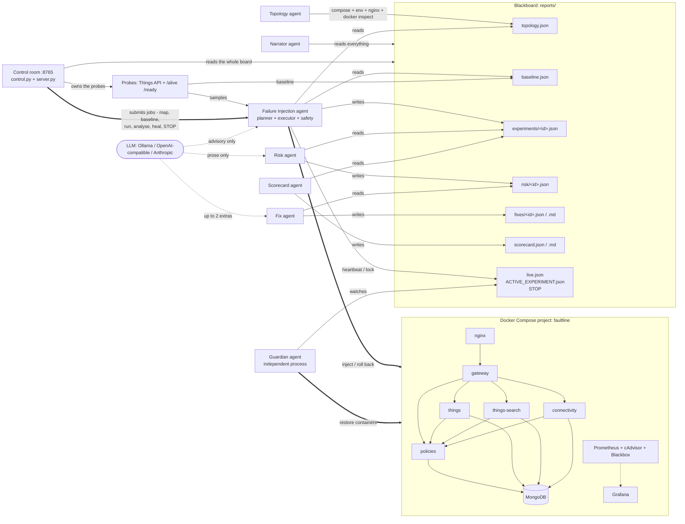

# Faultline

AI-driven chaos engineering for a cloud-native sample application, built for the Bosch hackathon problem statement *"AI-Driven Chaos Engineering for Cloud-Native Resilience"*.

Faultline points a small team of agents at [Eclipse Ditto](https://github.com/eclipse-ditto/ditto), an open-source IoT digital-twin platform running under Docker Compose. It maps the service dependency graph automatically (including the dependencies the compose file does not declare), ranks the services by how much would break if they failed, lets an LLM pick the most informative next failure experiment from a code-ranked shortlist, injects that failure with hard safety limits enforced by code, observes what real API clients would see, and writes a risk assessment, Ditto-specific fix recommendations and a per-service resilience scorecard. The LLM proposes; the code disposes. Nothing is ever applied to the application: every recommendation is advisory.

The whole system is driven from one screen: the **control room** (`faultline dashboard`). It owns the probes, submits the work as background jobs, streams what every agent is doing, and has a kill switch in the header. Every command the control room runs is also a CLI subcommand, so nothing on the screen is a view-only mock-up.

## What the judges asked for, and what Faultline does

| Organisers' requirement | Faultline | Where to see it |
|---|---|---|
| 1. Select and understand a sample app; map services and dependencies automatically | Topology agent parses compose `depends_on`, scans environment variables for hostnames, parses nginx `proxy_pass`, layers documented Pekko-cluster edges, enriches from live `docker inspect`, and computes a criticality ranking | Control room: **Application map** panel (node size = criticality, edges coloured by evidence). CLI: `faultline topology` -> `reports/topology.json` (+ Mermaid/Markdown) |
| 2. Plan experiments intelligently, riskiest / most informative first | Code ranks every (service, failure) pair by criticality x untested bonus - tested penalty; the LLM picks among the top 5, tunes parameters within bounds and writes a falsifiable hypothesis | Control room: **AI planner** block in the launcher shows the ranked candidates, the pick, the rationale and the hypothesis before anything runs. CLI: `faultline plan` |
| 3. Inject controlled failures with safety limits and auto-stop | 10 failure types; abort on error rate, p95 latency or blast radius; 90 s hard cap; independent watchdog; STOP file; Guardian process; one experiment at a time | Control room: launcher parameters are clamped to the catalog bounds, the phase ribbon shows the watchdog countdown and the abort reason, the header has the kill switch. CLI: `faultline run`, `faultline stop`, `faultline guardian` |
| 4. Observe application behaviour: errors, slowdowns, recovery time | Synthetic Things-API probe through nginx at ~4 req/s with a sequence-number canary; `/alive` + `/ready` health probe every 3 s; Prometheus + Grafana on the side | Control room: **Live telemetry** chart (success rate, p95, phase bands, abort thresholds) and the **Application map** lighting up the observed blast radius against the predicted one. CLI: `reports/live.json`, Grafana :3000 |
| 5. Analyse and report: weaknesses, fixes, ranked resilience score | Risk agent (0-10 severity), Fix agent (Ditto-specific remediations), Scorecard agent (0-100 per service, graded A-F, ranked worst first) | Control room: expand a row in the **Experiments** table for findings, risk, fixes, timeline and reproduce commands; **Resilience scorecard** bottom right. CLI: `faultline risk && faultline fix && faultline scorecard` |
| Day-1 minimum: running app | Ditto 3.9.8 + MongoDB + nginx + observability stack in one compose project | `scripts/up.sh` |
| Day-1 minimum: dependency map | Automatic, with the undeclared MongoDB dependency found | `faultline topology`, or **Rebuild map** in the control room |
| Day-1 minimum: one safe injection with a working kill switch | Any experiment; kill switch via the STOP button in the control-room header (or `Esc`), `faultline stop`, or `touch reports/STOP` | see [docs/DEMO.md](docs/DEMO.md) |
| Agents recommend fixes, never apply them | `FixRecommendation.advisory_only` is always `true`; no agent has a code path that edits the stack | `reports/fixes/<id>.md`, and the "advisory only, nothing is applied" label above every recommendation in the UI |
| One agent proposes failures, one scores risk, one recommends fixes | Failure Injection, Risk/Impact and Fix Recommendation agents, plus Topology, Scorecard, Narrator and Guardian | **Agent pipeline** strip at the top of the stage, live per-agent state. See architecture below |
| Open-source models | Open-weights models only: Ollama with `phi4-mini` locally (default), or Llama 3.3 70B through Groq's OpenAI-compatible endpoint on the demo machine. Any OpenAI-compatible or Anthropic endpoint also works | `.env`, and the model pill in the control-room header |
| Whole app monitored by an open-source observability tool | Prometheus 2.55, cAdvisor, Blackbox exporter, Grafana 11.3 with a provisioned dashboard | http://127.0.0.1:3000 |

## Architecture

Faultline uses a blackboard pattern. There is no message bus and no shared process: every agent reads and writes JSON files in `reports/`, and the Pydantic models in `faultline/schemas.py` are the contract between them. A crashed agent loses nothing and any agent can be re-run in isolation.

The control room sits on top of that, not beside it. Its control plane (`faultline/dashboard/control.py`) holds the probes, runs operator actions as background jobs, and assembles one JSON snapshot of the whole blackboard per poll; the browser only renders. Anything done from the screen can also be done from the CLI, and both write the same files.



The agents:

- **Topology / Mapping agent** (`faultline/topology/`). Builds the dependency graph from five sources: compose `depends_on`, an environment-variable scan for values that resolve to another service's name or network alias, nginx `proxy_pass` targets, documented Pekko-cluster edges from `config/ditto_knowledge.yaml`, and live `docker inspect` (container names, state, health, restart policy, aliases). Criticality = number of transitive dependents + 2 for holding state + 1 for being the external entry point + 1 for being a datastore + 0.5 for having no application health endpoint. The key result: compose `depends_on` never mentions MongoDB, so a naive map would call it a leaf. The env scan finds `MONGO_DB_HOSTNAME=mongodb` on four services and ranks MongoDB the number one single point of failure.
- **Failure Injection agent** (`faultline/planning/`, `faultline/chaos/`, `faultline/safety/`). Planner, executor and safety monitor. Described in the next sections.
- **Risk / Impact agent** (`faultline/agents/risk.py`). Deterministic 0-10 severity: 4 x user impact (1 - success rate during injection) + 2 x blast radius fraction + 2 x min(TTR / 120 s, 1) + 1.5 if recovery needed intervention + bonuses for findings. Levels: < 3 low, < 5.5 medium, < 8 high, otherwise critical; any suspected data loss is critical regardless. The LLM only rewrites the two prose fields.
- **Fix Recommendation agent** (`faultline/agents/fix.py`, `faultline/agents/knowledge.py`). A library of Ditto-specific remediation rules (MongoDB replica set, two `policies` instances, nginx upstream with retries, readiness that reflects subsystem health, autoheal sidecar, aligned timeouts, rate limiting, log rotation, split-brain resolver, and so on), matched by finding code > target > failure type > generic. The LLM may add at most two schema-validated extras, tagged `[LLM suggestion, unverified]` and capped at 0.6 confidence. Advisory only.
- **Resilience Scorecard agent** (`faultline/agents/scorecard.py`). Score = 100 - mean penalty per service; penalty = 40 x (1 - success during) + 20 x min(TTR / 120 s, 1) + 20 if manual recovery + 10 per high/critical finding (max 3) + 5 for a cascade. Grades A >= 90, B >= 80, C >= 65, D >= 50, else F. Ranked worst first; untested services are listed last with no grade.
- **Narrator agent**. Turns the blackboard into a plain-English play-by-play for the demo screen (`faultline narrate --watch`).
- **Guardian agent**. A separate process that does not trust the injector. It restores any sandbox container that is down past the deadline recorded in `ACTIVE_EXPERIMENT.json`, removes leftover chaos helper containers (label `faultline.helper=1`), and obeys the `STOP` file. We do not trust a single agent with the kill switch.
- **Control room** (`faultline/dashboard/`), not an agent but the thing that drives them. A long-lived session that owns the two probes, a single-slot job queue for operator actions, an in-memory event log that every agent writes its narration into, and a 1 Hz telemetry buffer. See [Control room](#control-room) below.

## The sample application

**Eclipse Ditto 3.9.8** — https://github.com/eclipse-ditto/ditto — licence EPL-2.0. Ditto is an IoT digital-twin platform: devices get a "thing" in the cloud whose state and features can be read and written over HTTP/WebSocket, searched, and bridged to message brokers.

| Service | Role in Ditto | Notes |
|---|---|---|
| `nginx` | reverse proxy + basic auth | the only published port, `127.0.0.1:8080` |
| `gateway` | HTTP / WebSocket API | no published ports; nginx is the only way in |
| `policies` | authorisation | hard dependency of the other four Java services |
| `things` | twin state | cluster-sharded persistent actors |
| `things-search` | search index | eventually consistent, rebuilt from things events |
| `connectivity` | MQTT / AMQP / Kafka bridges | its loss should not affect the HTTP API |
| `ditto-ui` | web UI | served at `/ui/`, not a chaos target |
| `mongodb` | sole datastore (MongoDB 7) | used by all four persistence services |

The five Java services form one Apache Pekko cluster (network alias `ditto-cluster`). Each exposes `/alive` and `/ready` on port 7626 and Prometheus metrics on port 9095; both are internal to the compose network.

Compliance with the sample-app rules:

- [x] Public repository: https://github.com/eclipse-ditto/ditto
- [x] Open-source licence: Eclipse Public License 2.0
- [x] Cloud-native / containerised: official images `eclipse/ditto-*:3.9.8`, `mongo:7.0`, `nginx:1.27-alpine`
- [x] Multi-service: 8 application containers, 5 of them in one cluster
- [x] Deployable with Docker Compose: `deploy/docker-compose.yml`, compose project `faultline`
- [x] Runs entirely in the team's sandbox: all ports bound to `127.0.0.1`; Faultline filters every container operation by the compose project label and never reaches outside it

`deploy/docker-compose.yml` also ships the observability stack: Prometheus (5 s scrape interval; cAdvisor for container CPU/memory/network, Ditto's own Kamon metrics on 9095, Blackbox probes of `/alive`, `/ready`, the nginx `/health` endpoint and MongoDB's TCP port) and Grafana with a provisioned dashboard "Faultline — Ditto resilience" as the anonymous viewer's home page.

## Quickstart

Prerequisites: Docker Desktop with at least 4 GB of memory for the VM (Ditto's container limits sum to about 2.6 GB), Python 3.10+, and — only if you want a local model — [Ollama](https://ollama.com) with `ollama pull phi4-mini`. Tested on Apple Silicon; arm64 images are available for everything in the stack.

```bash
git clone <this repository> && cd bosch-hackathon-2
python3 -m venv .venv && . .venv/bin/activate && pip install -e .

scripts/up.sh                      # docker compose up -d, then waits for /health = UP (cold start ~2 min)
cp .env.example .env               # defaults match deploy/docker-compose.yml; edit if needed

faultline setup                    # checks Docker, the stack, pulls the Pumba images, checks the LLM
faultline dashboard                # terminal 1, blocks: http://127.0.0.1:8765
faultline guardian                 # terminal 2, blocks: the independent safety process
```

The Guardian is optional but recommended: it is a second process with its own Docker client that restores anything the injector leaves down, and the control room shows a grey "No guardian" pill until it is running.

Then do the rest in the browser. The control room is the primary interface:

1. **Arm probes** (left panel, Operations). This builds the application map if there is none, starts the synthetic Things-API probe at ~4 req/s and the health monitor at 3 s, and begins sampling telemetry. The header pill switches from `disarmed` to a rising sample count.
2. **Rebuild map**. The dependency graph appears on the stage, node size by criticality. MongoDB ends up largest, which the compose file alone would never tell you.
3. **Capture baseline**. 60 s of steady state; this is what the abort thresholds are derived from. Until it exists the thresholds fall back to the floors in `config/thresholds.yaml`.
4. **Launch**. Leave the mode on AI PLANNER to let the planner choose, or switch to MANUAL and pick a target, a failure type and parameters yourself. Read the hypothesis, then press and hold LAUNCH.
5. **Watch**, then **read**. The phase ribbon, telemetry chart and blast radius move while it runs; when it finishes, the analysis agents score that experiment and it appears in the table at the bottom. **Run analysis** sweeps every experiment that does not yet have risk and fix output and rebuilds the scorecard.

Everything above is also a CLI command, which is what the control room calls underneath:

```bash
faultline topology                 # dependency map + criticality ranking -> reports/topology.json
faultline baseline                 # 60 s steady-state window -> reports/baseline.json
faultline run --experiments 3      # plan, inject, observe, roll back, report; three times
faultline risk && faultline fix && faultline scorecard
faultline heal --restart           # reset the sandbox between runs
```

`faultline demo --experiments N` runs topology, baseline, run, risk, fix, scorecard and narrate in sequence with no browser involved. `make venv`, `make up`, `make dashboard`, `make demo` and friends wrap the same commands.

After the stack is up: Ditto API at http://127.0.0.1:8080/api/2/things, Ditto UI at http://127.0.0.1:8080/ui/, Prometheus at http://127.0.0.1:9090, Grafana at http://127.0.0.1:3000. The bundled compose project uses basic-auth credentials `ditto` / `ditto`; if you attached to another stack, the ones in `.env` apply.

To attach Faultline to an existing Ditto compose project instead of the bundled one, set `FAULTLINE_COMPOSE_PROJECT=<project name>` and `DITTO_USER` / `DITTO_PASSWORD` in `.env` — this is what the demo machine does. The compose file at `FAULTLINE_COMPOSE_FILE` is still used for the static part of the topology.

### CLI

`faultline <command>` after `pip install -e .`, or `python -m faultline <command>`.

| Command | What it does |
|---|---|
| `setup` | Checks Docker, the compose stack, pulls Pumba images, checks the LLM |
| `topology [--no-live]` | Builds the dependency map; `--no-live` skips `docker inspect` |
| `baseline [--duration 60]` | Captures steady state and derives the safety thresholds |
| `catalog` | Prints the failure catalog with parameters and bounds |
| `plan [--no-llm] [--allow-protected]` | Shows the ranked candidates and the pick; runs nothing |
| `run [--experiments N] [--target SVC --failure TYPE --param k=v ...] [--duration S] [--allow-protected] [--no-llm] [--analyze] [--resume-stop]` | Plans and executes experiments; operator flags pin a specific one. Note that `--analyze` is opt-in here, whereas the control room always runs the analysis agents after each experiment |
| `rerun <id>` | Repeats a previous experiment with the same spec |
| `risk [ids...] [--force]`, `fix [ids...] [--force]`, `scorecard` | Run the downstream agents on every report that does not have output yet; `--force` redoes them |
| `narrate [--watch] [--llm]` | Plain-English play-by-play; `--watch` follows the blackboard |
| `guardian [--interval 5]` | Starts the independent Guardian process |
| `stop` / `resume` | Writes / removes `reports/STOP` |
| `heal [--restart]` | Operator reset between runs: clears the active-experiment lock, removes chaos helper containers and leftover `tc` qdiscs, unpauses and reconnects containers, starts anything stopped, optionally restarts the Ditto services in dependency order, then waits up to 10 minutes for `/health` = UP |
| `status` | One-screen summary of the blackboard |
| `dashboard [--port N]` | Serves the control room; the port defaults to `dashboard_port` in `config/settings.yaml` (8765) |
| `demo [--experiments N] [--baseline S]` | topology, baseline, run, risk, fix, scorecard, narrate — the headless path, no browser |

## Control room

```bash
faultline dashboard                                      # port from config/settings.yaml (8765)
faultline dashboard --port 8777
python -m faultline.dashboard.server --port 8777         # same server, no console script needed
```

Both forms bind `127.0.0.1` only. The server is standard library (`ThreadingHTTPServer`), the frontend is vanilla ES modules with no build step, and nothing is fetched from the internet at runtime: no CDN, no web fonts, system font stack only. It works on venue wifi or on none at all.

The control room is not a view over `reports/`. It holds a **long-lived session**: once armed it owns the synthetic Things-API probe (~4 req/s against the Ditto Things API through nginx) and the health monitor (`/alive` + `/ready` per Ditto service via `docker exec`, plus `mongosh ping` for MongoDB, every 3 s). What the API probe sees is sampled once a second into a rolling 300-second buffer, which is what the chart draws. You arm it once at the start of a session and it keeps measuring between experiments, so there is flat history on screen before anything breaks.

Operator actions run as **background jobs, one at a time**: rebuild the application map, capture a baseline, run experiments (AI-planned or manual), run the analysis agents, heal the sandbox. A second job while one is running is refused with HTTP 409 rather than queued — the same "one experiment at a time" rule the injector enforces with the `ACTIVE_EXPERIMENT.json` lock, surfaced in the UI.

### The screen

| Region | What is in it |
|---|---|
| Header | Brand, the seven-step **phase ribbon** (Preflight → Inject → Observe → Rollback → Recover → Soak → Report) with the active step lit, earlier steps ticked, elapsed time and the watchdog countdown. The injector only reports `injecting`, `recovering` and `soaking`, so Inject and Rollback are shown as passed rather than lit in turn, and the abort reason reaches the UI with the finished report rather than live. Next to it: a model pill (the model name, or `rules only`, with the provider and the reason in its tooltip); a Guardian pill (green only while the Guardian heartbeat is under 15 s old); a probe pill with the live sample count; the Explain toggle; and the **kill switch** |
| Left: launcher | Mode (AI PLANNER / MANUAL) and the LLM toggle; in planner mode the ranked candidates with the pick, its rationale and hypothesis; in manual mode one card per service sorted by criticality (policy-blocked services shown locked and why) and one card per failure type (unavailable ones say what is missing); the parameter dials, each clamped to its catalog bounds; the hypothesis; the safety rails in force; LAUNCH (press and hold ~1.2 s, so a stray click cannot start an experiment); and Operations — Rebuild map, Capture baseline, Run analysis, Heal sandbox, Arm / Disarm probes, Cancel job |
| Centre: stage | The **agent pipeline** strip (Topology → Planner → Injector → Guardian → Risk → Fix → Scorecard) with each agent's live state and one line of detail; the **application map**, a layered dependency graph where node size is criticality, edge style is the evidence the edge came from (`env`, `proxy`, `depends_on`, `documented`, observed), and during an experiment the predicted blast radius is outlined while the observed one goes red and pulses along the edges; the **live telemetry** chart (success-rate area, p95 line, shaded phase bands, dashed abort thresholds); and four KPI tiles with sparklines |
| Right: feed | Every decision and measurement each agent makes, newest first, colour-coded: violet for lines the model wrote, orange for a fault actually being applied to a container, red for aborts and failures |
| Bottom | The **experiments** table (newest first: id, target, failure, who planned it, success during, recovery, hypothesis held/violated, risk level, finding count). Expand a row for the rationale and hypothesis, the before/during/after numbers, findings with plain-English explanations, the risk score and its production implication, the recommended fixes with steps and verification commands, the timeline, and the exact shell commands to reproduce it by hand. Next to it, the **resilience scorecard**: overall ring plus per-service grades, ranked worst first, untested services labelled rather than given a flattering default |

### What a judge should look at

1. **The application map, before anything is broken.** MongoDB is the biggest node. Compose's `depends_on` never mentions it; only the environment-variable scan finds `MONGO_DB_HOSTNAME=mongodb` on four services. That is the "map the dependencies automatically" requirement producing a result a human reading the compose file would have missed.
2. **The launcher in AI PLANNER mode, before launching.** The ranked candidate list is code; the pick, parameters, rationale and hypothesis are the model's, inside bounds the code enforces. Nothing has been injected at that point.
3. **The telemetry chart and the blast radius during an experiment.** The success-rate area falls, the dashed threshold line is where the run aborts itself, and the graph shows which services were predicted to be affected versus which actually were. A red node outside the prediction is a `cascade_beyond_hypothesis` finding being born.
4. **The phase ribbon at recovery and soak.** Soak exists because a system can look recovered and then relapse, and a relapse resets the wait.
5. **One expanded experiment row.** Predicted versus observed, the findings (the interesting one is `health_check_masked_failure`: the service kept answering `/ready` = 200 while real requests through it were failing), a computed risk score, advisory fixes, and reproduce commands.
6. **The kill switch.** Press STOP, or `Esc`. See [docs/DEMO.md](docs/DEMO.md).

### Explain mode

Every panel header has a `?` button that opens one to three sentences of plain English: what the panel shows, why it matters for resilience, and what to look at. The **Explain** toggle in the header (or the `E` key) opens all of them at once. The copy lives in `faultline/dashboard/static/copy.js` and is written for someone who has never seen chaos engineering — it is there so a judge can read the screen without a narrator.

Keyboard: `Esc` fires the kill switch. `E` toggles explain-everything. `Space` pauses and resumes live updates (useful when you want to talk over a frozen screen). With the telemetry chart focused, `p` pauses just the chart.

### Degrading gracefully

- The graph, charts and launcher are loaded as separate modules with individual failure handling. If one fails to import, the rest of the room still renders and a toast says which module is missing.
- If the HTTP poll fails the page keeps the last state and marks itself offline instead of blanking.
- If Docker or Ditto is unreachable the page still renders: arming fails with the error shown in the launcher, and the panels show their empty states with the action that would fill them.
- Without JavaScript you get a `<noscript>` pointer at `reports/` and the CLI.
- Colour is never the only signal: every status colour is paired with a glyph or a text label, focus rings are never removed, and `prefers-reduced-motion` disables the pulses.

### HTTP API

All JSON, `Cache-Control: no-store`, errors as `{"error": "..."}`. The full specification is [docs/UI_CONTRACT.md](docs/UI_CONTRACT.md).

| Method and path | Purpose |
|---|---|
| `GET /api/state?since=<seq>` | The single polled snapshot: event-log delta since `<seq>`, session, current job, live run (phase, elapsed, deadline, health, blast radius, abort reason), telemetry points and phase bands, STOP flag, Guardian heartbeat, per-agent states, LLM status, topology, baseline, every experiment summary, scorecard. Polled every 1000 ms when idle, 400 ms while an experiment is live |
| `GET /api/catalog` | The ten failure types with their parameter bounds, which services each applies to, which are blocked by policy, which are unavailable and why, the protected-service rules and the thresholds in force |
| `GET /api/plan?llm=0\|1&allow_protected=0\|1` | Ranked candidates plus the planner's pick, rationale and hypothesis. Runs no experiment. Note that it will arm the session (build the topology and start the probes) if that has not happened yet |
| `GET /api/experiment/<id>` | The full report for one experiment, plus its risk, fix and rendered Markdown |
| `POST /api/jobs/topology` | Rebuild the application map from compose + env + nginx + live Docker |
| `POST /api/jobs/baseline` | `{"duration": 60}`, clamped to 20–300 s |
| `POST /api/jobs/run` | `{"mode":"auto"\|"manual","target":...,"failure":...,"params":{...},"experiments":1,"llm":true,"allow_protected":false,"analyze":true}`; `auto` lets the planner pick |
| `POST /api/jobs/analyze` | `{"llm": true}`; risk → fix over every experiment that does not already have them, then rebuild the scorecard |
| `POST /api/jobs/heal` | `{"restart": false}`; the same reset as `faultline heal` |
| `POST /api/jobs/cancel` | Cooperative cancel of the current job; for a `run` it also trips STOP |
| `POST /api/arm` / `POST /api/disarm` | Start / stop the probes and the health monitor |
| `POST /api/stop` | **Kill switch.** Always 200, never queued, never blocked by a running job |
| `POST /api/resume` | Clears STOP so experiments can run again |

The five job endpoints return `202 {"ok":true,"job":{...}}`, or `409 {"error":"'<label>' is already running","job":{...}}`. `GET /` serves the page, `GET /static/<file>` the modules and stylesheets, anything else is a 404 JSON body. There is no authentication: the server binds loopback only and is meant for one operator on one laptop.

## Failure catalog

Ten failure types in `faultline/chaos/catalog.py`. Every parameter has a bound; whatever the LLM or the operator asks for is clamped into it and the clamp is recorded in the report's `planner_notes`.

| Failure type | Mechanism | Parameters (default, bounds) | Organisers' example |
|---|---|---|---|
| `container_crash` | `docker kill` (SIGKILL); optional `block_restart` disables Docker's auto-restart for the duration | `duration_s` 30 [10-90], `block_restart` false | Service / container crash |
| `container_pause` | `docker pause` (SIGSTOP): processes freeze, TCP connections stay open, callers hang | `duration_s` 20 [5-60] | Service / container crash (hung variant) |
| `container_stop` | `docker stop` (SIGTERM), stays down until rollback | `duration_s` 30 [10-90] | Failed dependency |
| `network_partition` | `docker network disconnect`; reconnected with the original aliases on rollback | `duration_s` 30 [5-90] | Failed dependency |
| `network_delay` | Pumba + `tc netem` delay with jitter, run as a sidecar (`gaiaadm/pumba` + `ghcr.io/alexei-led/pumba-alpine-nettools`); nothing installed in the target | `duration_s` 45 [10-90], `delay_ms` 800 [100-3000], `jitter_ms` 200 [0-1000] | Slow or lossy network |
| `network_loss` | Pumba + `tc netem` packet loss | `duration_s` 45 [10-90], `loss_percent` 30 [5-80] | Slow or lossy network |
| `disk_pressure` | bounded `fallocate` in the container's writable layer; capped at 1 GiB because the Docker VM disk is shared | `duration_s` 30 [10-90], `size_mb` 256 [64-1024] | Full disk |
| `cpu_stress` | busy-loop workers wrapped in `timeout`, tagged so they can be killed early | `duration_s` 45 [10-90], `workers` 2 [1-4] | Overloaded database (on `mongodb`) |
| `db_flood` | parallel `mongosh` insert loops inside the MongoDB container; the flood collection is dropped on rollback | `duration_s` 45 [10-90], `writers` 2 [1-4] | Overloaded database |
| `traffic_spike` | host-side request burst against nginx -> gateway on top of the probe traffic | `duration_s` 30 [10-90], `rps` 150 [20-600] | Sudden traffic spike |

Role constraints: container crash/stop/pause apply to app and proxy containers; `db_flood` only to MongoDB; `traffic_spike` only to `nginx` and `gateway`; `ditto-ui` and the observability containers are never targets. Every report contains the equivalent `docker` / `pumba` shell commands under `reproduce`.

## Safety

**LLM proposes, code disposes.** The code produces the ranked candidate list; the model may only return the index of one of the top five, parameters that the code clamps anyway, a rationale and a hypothesis. If the model is unavailable, slow or returns nonsense, the deterministic top candidate runs with a templated rationale and the report says so (`planned_by: deterministic`). The model never sees the safety monitor's inputs or outputs and cannot raise any threshold.

**Thresholds** (`config/thresholds.yaml`, derived into `reports/baseline.json` at baseline time) abort an experiment and roll it back immediately when:

- the error rate over the trailing 10 synthetic requests exceeds 30 %, or
- the p95 latency over that window exceeds max(3000 ms, 5 x baseline p95), or
- any service outside the hypothesis' expected blast radius fails 3 health checks in a row, or
- the operator requested a stop.

Further limits: hard cap of 90 s per experiment; an independent watchdog timer fires at 90 + 15 s and calls the rollback even if the main loop is stuck in a blocking Docker call; one experiment at a time (`reports/ACTIVE_EXPERIMENT.json` lock); at most 10 experiments per run with a 30 s pause between them; injection is refused if the 20 s pre-experiment window shows less than 95 % success ("do not break an already sick system").

**Protected services.** MongoDB is the sole datastore, so the Day-1 policy is degrade-only: `network_delay`, `network_loss`, `cpu_stress`, `disk_pressure` and `db_flood` are allowed, crash/stop/pause/partition are not. `--allow-protected` overrides this explicitly, and the override is written into the report.

**Kill switch.** The STOP button in the control-room header (or the `Esc` key — one press, no confirmation dialog), `faultline stop`, or `touch reports/STOP`. All three write the same file. The safety monitor checks it every second; the Guardian honours it too. The button then reads RESUME, which clears the flag.

**Guardian.** A separate process with its own Docker client. It restores any container in the compose project that is still down past the deadline recorded in `ACTIVE_EXPERIMENT.json`, removes stale Pumba helpers and `tc` qdiscs, and never injects anything.

**Rollback is idempotent.** Every injection returns a handle whose `revert()` can be called from the main loop, the watchdog thread, the Guardian or a `finally` block without double-acting.

**Recovery.** Declared when success >= 95 % and p95 < max(300 ms, 2 x baseline p95) for 3 consecutive checks (2 s apart). A recovery candidate then has to survive a 20 s soak; a relapse resets the wait. The whole wait is bounded by `recovery.timeout_seconds` (currently 300 s) because Ditto's Java services need 60-120 s to cold start and rejoin the cluster. If the target is still unhealthy at 50 % of that timeout (150 s) it is restarted; at 80 % (240 s) its direct dependents are restarted too. This ladder exists because of [Ditto discussion #1861](https://github.com/eclipse-ditto/ditto/discussions/1861), where Things never reconnected to MongoDB after an outage. Any such action is recorded under `recovery.remediation_actions` and counts against the score.

## What gets measured

Two independent signal sources run for the whole session (`faultline/observe/probes.py`) — started by the CLI command that needs them, or by arming the control room:

- **Things API probe**: synthetic user traffic through nginx -> gateway at ~4 req/s, cycling get thing, put property, search, get property against a canary thing `faultline.probe:canary`. Each `put` carries a monotonically increasing sequence number; the last acknowledged number is remembered.
- **Health probe**: every 3 s, `/alive` and `/ready` on port 7626 via `docker exec` for each Ditto service, `mongosh ping` for MongoDB, and the Docker health status.

Comparing what users see with what the platform claims is how the findings below are detected automatically after every experiment:

| Finding | Meaning |
|---|---|
| `health_check_masked_failure` | a service kept answering `/ready` = 200 while the API through it was failing. Grounded in [Ditto issue #1865](https://github.com/eclipse-ditto/ditto/issues/1865) "/alive and /ready do not consider subsystem health", fixed for liveness only in 3.5.0 |
| `no_automated_remediation` | the container sat `unhealthy`; Docker `restart: always` only reacts to process exit |
| `manual_restart_required` | the escalation ladder had to restart the target or its dependents |
| `data_loss_suspected` | the sequence number read back after recovery is lower than the last acknowledged write |
| `cascade_beyond_hypothesis` | a service outside `hypothesis.expected_affected` was affected |
| `slow_recovery` | time to recover exceeded `hypothesis.expected_recovery_s` |
| `auto_recovered` | the system came back without any intervention |
| `safety_abort` | a threshold fired and the experiment was rolled back early |

Every experiment ends with hypothesis validation: expected max error rate, expected affected services and expected recovery time versus what was observed, recorded in `hypothesis_result.held`.

## LLM providers

The planner, risk and fix agents talk to one `LLMClient` (`faultline/planning/llm.py`). Every call returns `None` on timeout, bad JSON or a missing key, so the deterministic path always has the final say. Four settings select the provider, in `.env` or the environment: `LLM_PROVIDER`, `LLM_MODEL`, `LLM_BASE_URL`, `LLM_API_KEY`.

| `LLM_PROVIDER` | Default base URL | Default model | Key | Notes |
|---|---|---|---|---|
| `ollama` | `http://127.0.0.1:11434` | `phi4-mini` | not needed | Local, open-source, offline, free. Availability is checked against `ollama list`, so a model you have not pulled reports as unavailable rather than failing mid-run. Slow on a laptop: 5–30 s per planning call |
| `openai` | `https://api.openai.com/v1` | `gpt-4o-mini` | `LLM_API_KEY` | Any OpenAI-compatible chat API. **The demo machine is configured for Groq**: `LLM_BASE_URL=https://api.groq.com/openai/v1`, `LLM_MODEL=llama-3.3-70b-versatile` — open-weights Llama 3.3 70B, fast enough to keep the planner on the critical path of a six-minute demo, unlike a 7B model on a laptop. Note that this needs `LLM_API_KEY` filled in; with the key empty the client reports `LLM_API_KEY not set` and the planner runs deterministically. OpenRouter (`https://openrouter.ai/api/v1`) and Together (`https://api.together.xyz/v1`) work the same way |
| `anthropic` | `https://api.anthropic.com` | `claude-sonnet-5` | `LLM_API_KEY` | Messages API |

```bash
# The demo machine: Llama 3.3 70B through Groq's OpenAI-compatible endpoint
LLM_PROVIDER=openai
LLM_MODEL=llama-3.3-70b-versatile
LLM_BASE_URL=https://api.groq.com/openai/v1
LLM_API_KEY=gsk_...

# Fully local alternative, no account and no network
LLM_PROVIDER=ollama
LLM_MODEL=phi4-mini

# No model at all: deterministic planning, templated prose
FAULTLINE_LLM=false
```

`--no-llm` on `plan`, `run`, `rerun`, `risk`, `fix` and `demo` has the same effect as `FAULTLINE_LLM=false` for one invocation; in the control room it is the LLM toggle next to the mode switch. With the model out of the loop the planner takes the top-ranked candidate, the rationale and hypothesis come from templates, and the report records `planned_by: deterministic`. Either way every number in the risk assessment, the fix matching and the scorecard is computed by code — the model only ever rewrites prose or picks an index. The header pill shows the model name when one is reachable and `rules only` when it is not, with the provider and the reason in its tooltip. `config/settings.yaml` carries the defaults (`llm_provider: ollama`, `llm_model: phi4-mini`); `.env` and the process environment override them in that order.

## Outputs

```
reports/
  topology.json              dependency map, criticality ranking, structural findings
  baseline.json              steady-state API stats, health availability, derived thresholds
  experiments/<id>.json      one ExperimentReport per injection
  experiments/<id>/          report.md plus the last 120 log lines of the target and every
                             service the hypothesis expected to be affected (`raw_logs_ref`)
  risk/<id>.json             RiskAssessment
  fixes/<id>.json, <id>.md   FixRecommendation (JSON for machines, Markdown for people)
  scorecard.json, .md        per-service scores, ranked worst first
  live.json                  what the injector is doing right now (dashboard feed)
  ACTIVE_EXPERIMENT.json     lock + deadline while an experiment runs (read by the Guardian)
  STOP                       present = abort now
  guardian.heartbeat.json    Guardian liveness
  logs/*.log                 per-agent logs
```

An abbreviated experiment report:

```json
{
  "experiment_id": "3f9a1c2b7d4e",
  "target": {"service": "policies", "container": "faultline-policies-1"},
  "failure_type": "container_stop",
  "parameters": {"duration_s": 30},
  "planned_by": "llm",
  "rationale": "policies is the authorisation dependency of every other service and has not been tested yet",
  "hypothesis": {
    "statement": "taking away policies for 30s will push the synthetic API error rate to at most 100%, impact at most ['connectivity', 'gateway', 'things', 'things-search'], and the API will recover within 90s after rollback without manual intervention",
    "expected_affected": ["connectivity", "gateway", "things", "things-search"],
    "expected_max_error_rate": 1.0,
    "expected_recovery_s": 90.0
  },
  "baseline": {"sample_count": 240, "success_rate": 1.0, "p95_ms": 41.2},
  "during":   {"sample_count": 118, "success_rate": 0.17, "p95_ms": 2210.5},
  "after":    {"sample_count": 96,  "success_rate": 1.0,  "p95_ms": 58.0},
  "recovery": {"recovered": true, "time_to_recover_s": 74.3, "auto_restarted_by_docker": false,
               "remediation_actions": [], "data_integrity_ok": true,
               "data_integrity_detail": "stored seq=312, last acknowledged write seq=312"},
  "safety": {"aborted_early": true, "abort_reason": "error_rate",
             "abort_detail": {"error_rate": 0.9, "threshold": 0.3}, "watchdog_fired": false},
  "hypothesis_result": {"held": true, "observed_max_error_rate": 0.9, "observed_recovery_s": 74.3, "unexpected_affected": []},
  "findings": [
    {"code": "safety_abort", "severity": "info", "title": "Aborted by error-rate threshold", "evidence": "0.90 > 0.30 over trailing 10 requests"},
    {"code": "health_check_masked_failure", "severity": "high", "title": "things answered /ready=200 while the API failed", "evidence": "ready_ok_fraction=1.0 during 83% API errors"}
  ],
  "reproduce": ["docker stop faultline-policies-1", "sleep 30", "docker start faultline-policies-1"],
  "status": "aborted"
}
```

## Pointing Faultline at a different application

Everything above is repo-agnostic except one thing: the topology mapper's richest signal is a
*documented knowledge* file listing the dependencies a deployment never declares. Compose tells you
`things depends_on policies`; it never tells you that the gateway forwards every search to
things-search, or that five services form one Pekko cluster. For Eclipse Ditto a human wrote those
facts down in `config/ditto_knowledge.yaml` after reading Ditto's architecture pages.

`faultline onboard` does that reading for you.

```bash
faultline onboard eclipse-ditto/ditto                 # owner/name, a full GitHub URL, or a local path
faultline onboard https://github.com/owner/app --out config
faultline onboard .                                   # the compose file you actually run
faultline topology --knowledge config/<slug>_knowledge.yaml
```

It shallow-clones the repo (blobless, cached under `.cache/onboarding/`), locates the compose file,
the README and any architecture documentation the project ships, runs the existing structural
parsers, and makes **one bounded LLM call** that is told what is already known structurally and
asked only for what is missing. The answer is validated before it reaches disk: edges naming a
service that does not exist are dropped, roles must be legal, a `cluster_alias` must be a real
network alias in the compose file, and `health_port` is derived from the compose healthchecks in
code rather than taken from the model. Same rule as everywhere else in this project — the model
proposes, code disposes.

One guard is worth calling out. In Faultline the roles `ui` and `other` mean *excluded from chaos
testing*. A model that labels a product's web front-end `ui` would silently exempt it from every
experiment, so an override to `ui`/`other` is refused for any service built from the repository's
own source.

### Does it work?

Ditto is the one target with ground truth, so that is the acceptance test — the generated file
against the hand-authored one:

| Measure | Result |
|---|---|
| Final graph coverage (documented ∪ structural vs. hand-authored) | **9/9** |
| Documented-edge F1 | 0.82 (precision 0.88, recall 0.78) |
| Effective role accuracy | 1.00 |
| `cluster_alias`, `health_port` | exact |
| **Criticality ranking vs. hand-authored** | **identical order, all 9 services** |

The ranking is the number that matters, because the ranking is what the planner breaks things by.
The three documented edges the agent "missed" are all ones `depends_on` already declares — it was
told not to restate those, so the merged graph is complete.

```
$ faultline onboard eclipse-ditto/ditto --compare-to config/ditto_knowledge.yaml
ditto: 9 services, 13 structural edges from docker-compose.yml + nginx.conf
architecture docs: 6 file(s), 16834 chars (architecture-overview.md, architecture-services-gateway.md, ...)
asking openai:openai/gpt-oss-120b to document 9 services ...
model proposed 8 edges, 8 survived validation
  gateway -> things            (gateway forwards thing commands to things (architecture-overview))
  things-search -> things      (search index built from thing events (things-search documentation))
  connectivity -> policies     (connectivity enforces policies for inbound/outbound messages)
  ...
```

Run against repos nobody tuned for, it stays honest rather than inventing structure:
`dockersamples/example-voting-app` returns **zero** documented edges, because its five-service
compose already declares every dependency it has — and notably it does not hallucinate a Pekko
cluster from the worked example. Onboarding this repository's own `deploy/docker-compose.yml`
independently reproduced all four observability role overrides (`prometheus`, `grafana`, `cadvisor`,
`blackbox` → `other`) that the hand-authored file carries.

### Limits worth knowing

- The agent is only as good as the documentation the target ships. Ditto keeps its architecture
  pages in-repo, which is why it scores well; a project whose docs live only on a website will
  produce role overrides and little else.
- Output is a **draft for review**, not a fact. Documented edges change the criticality ranking and
  therefore what gets broken first — read the file before trusting it. The provenance header records
  which repo, which compose file and which model produced it.
- Everything else about a new target (remediation knowledge in `faultline/agents/knowledge.py`, the
  protected-service policy in `config/thresholds.yaml`) is still Ditto-shaped. Onboarding closes the
  topology gap, not those.

## Known limitations

- Single node, Docker Compose only. The topology and chaos backends are written against the compose project label; there is no Kubernetes backend yet.
- Pumba needs the Docker socket mounted into its helper container. That is normal for Pumba but means network faults require the same privileges as the rest of the tool.
- `disk_pressure` is bounded to 1 GiB and writes into the container's writable layer. It demonstrates the mechanism; it will not fill a production-sized volume.
- Java cold start dominates crash recovery. A killed Ditto service takes 60-120 s to restart and rejoin the Pekko cluster, so time-to-recover for crash-type experiments mostly measures JVM boot time, not Ditto's fault handling.
- Local 7-9B models are slow. A planning call with `phi4-mini` on a laptop takes 5-30 s; `qwen3.5:9b` longer. The deterministic fallback covers timeouts, and `--no-llm` removes the model from the loop entirely.
- The health probe uses `docker exec` because port 7626 is not published. A container that is paused or extremely CPU-starved can make that `exec` slow, which is itself a signal but adds jitter to the health timeline.
- Findings are heuristic. `data_loss_suspected` is a canary read-back, not a journal audit; `health_check_masked_failure` compares fractions over a window, not individual requests.
- The control room is single-operator and unauthenticated. It binds loopback only, has no login and no CSRF protection, and its state lives in one process: two browser tabs share one session, and restarting the server disarms the probes and empties the event log (the experiment reports on disk survive, the narration does not). Do not expose the port.
- The control room's telemetry starts when you arm it, not when the stack started. Close the server and the chart's history is gone.
- `pyproject.toml` declares only `static/*.html` as package data, so a non-editable `pip install` would ship the page without its CSS and JS. Install with `pip install -e .`, as the quickstart does.

## Roadmap

- Kubernetes backend (Chaos Mesh or LitmusChaos as the injector; the topology from Services, Deployments and NetworkPolicies).
- OpenTelemetry traces from the probe through gateway to MongoDB so cascades are attributed per hop, not inferred from health fractions.
- Grafana annotations at injection start, rollback and recovery, so the chaos window is visible on every panel.
- Regression mode: run the same experiment before and after a recommended fix and report the delta in the scorecard.
- Bandit-style experiment selection that trades exploration of untested pairs against re-testing weak services, instead of the fixed priority formula.
- Multi-LLM consensus for the planner: two models propose, the code accepts only when they agree on target and failure type.

## Development

```bash
pip install -e ".[dev]"
pytest -q            # offline, no Docker required
```

The control room has a visual verification harness. It drives the real page in a real Chrome through Playwright, screenshots five breakpoints (1920, 1440, 1024, 820 and 390 px wide) and exits non-zero on any console error or warning, any failed request, horizontal page overflow, an element overflowing its box, a visible control shorter than 32 px or narrower than 24 px, or an essentially empty page:

```bash
pip install playwright && playwright install chrome     # not a project dependency
faultline dashboard --port 8777 &
python scripts/verify_ui.py --url http://127.0.0.1:8777 --out /tmp/faultline-ui --expand
```

It is a manual check, not a CI gate, and it only inspects what the live server happens to be showing — a page with no experiments on it will not exercise the expanded detail view.

The UI contract that the control plane and every frontend module are written against is [docs/UI_CONTRACT.md](docs/UI_CONTRACT.md). Repository layout and the experiment lifecycle are documented in [docs/ARCHITECTURE.md](docs/ARCHITECTURE.md); the live-demo runbook is [docs/DEMO.md](docs/DEMO.md).
