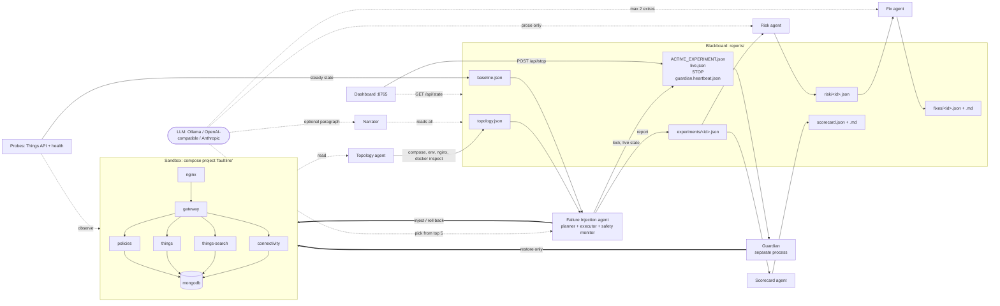
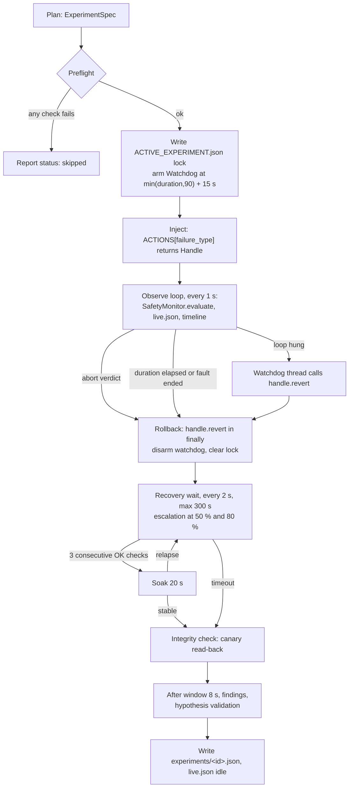

# Faultline: Architecture Overview

Faultline is an AI-driven chaos engineering system. It maps a containerised application's dependencies, plans failure experiments with help from an LLM, injects those failures under safety limits enforced by code, observes what real API clients experience, and reports risk, fixes and a per-service resilience score. This document describes the system as implemented in this repository. Every number in it comes from `config/thresholds.yaml` or the source code, and each one names the file it comes from.

> **Scope.** This overview was written for the Day-2 deliverables and describes the CLI pipeline as it stood for the Day-2 verification run ([FINDINGS.md](FINDINGS.md)). It predates the Weakness Scout (`faultline scout`), repo onboarding (`faultline onboard`), the control room (`faultline/dashboard/control.py` and the modular frontend that replaced the single-file dashboard described in 4.8), the Fable front end and the opt-in LangGraph planner. For those, and for the current module map, see [ARCHITECTURE.md](ARCHITECTURE.md) and the [README](../README.md).

Contents

1. [Summary and system under test](#1-summary-and-system-under-test)
2. [Design principles](#2-design-principles)
3. [The blackboard](#3-the-blackboard)
4. [Agents](#4-agents)
5. [Experiment lifecycle](#5-experiment-lifecycle)
6. [Safety system](#6-safety-system)
7. [Failure catalog](#7-failure-catalog)
8. [Observation and findings](#8-observation-and-findings)
9. [LLM providers](#9-llm-providers)
10. [Repository layout](#10-repository-layout)
11. [Known limitations](#11-known-limitations)
12. [Validated by a live run](#12-validated-by-a-live-run)

---

## 1. Summary and system under test

Faultline is a Python package (`faultline/`, command-line tool `faultline`) with a small team of agents. The agents never call each other. They coordinate through JSON files in a shared `reports/` directory, the *blackboard*. One agent maps the topology. One plans and runs experiments, and its safety monitor can abort them. Downstream agents score risk, recommend fixes and grade each service. A Guardian process restores the sandbox on its own, without relying on the injector. An LLM may help choose experiments and word the prose. It cannot change a limit, apply a fix or make an experiment heavier than the code allows.

The system under test is **Eclipse Ditto 3.9.8**, an open-source (EPL-2.0) IoT digital-twin platform. It runs as a single Docker Compose project, `faultline`, defined in `deploy/docker-compose.yml`.

| Service | Image | Role in Ditto | Faultline role |
|---|---|---|---|
| `nginx` | `nginx:1.27-alpine` | Reverse proxy and basic auth. The only Ditto entry point, published on `127.0.0.1:8080` | `proxy`, chaos target |
| `gateway` | `eclipse/ditto-gateway:3.9.8` | HTTP and WebSocket API. No published port | `app`, chaos target |
| `policies` | `eclipse/ditto-policies:3.9.8` | Authorisation | `app`, chaos target |
| `things` | `eclipse/ditto-things:3.9.8` | Twin state, held in cluster-sharded persistent actors | `app`, chaos target |
| `things-search` | `eclipse/ditto-things-search:3.9.8` | Search index, eventually consistent | `app`, chaos target |
| `connectivity` | `eclipse/ditto-connectivity:3.9.8` | MQTT, AMQP and Kafka bridges | `app`, chaos target |
| `mongodb` | `mongo:7.0` | The only datastore, used by all four persistence services | `datastore`, protected (degrade-only) |
| `ditto-ui` | `eclipse/ditto-ui:3.9.8` | Web UI at `/ui/` | `ui`, never a target |

The five Java services form one Apache Pekko cluster (network alias `ditto-cluster`). Each one exposes `/alive` and `/ready` on internal port 7626. The same compose project also runs an observability stack that is never a chaos target (role `other`):

- Prometheus 2.55.1 (5 s scrape interval)
- cAdvisor
- Blackbox exporter
- Grafana 11.3.0, with a provisioned dashboard called "Faultline — Ditto resilience"

Every published port is bound to `127.0.0.1`.

## 2. Design principles

1. **LLM proposes, code disposes.** Code builds the candidate list, clamps every parameter, enforces policy and owns every safety threshold. The model can choose only from what the code offers, and every model call has a deterministic fallback.
2. **Blackboard, not message bus.** Agents share files, not processes. Any agent can crash or be re-run without affecting the others.
3. **Users' view over the platform's view.** Synthetic API traffic is the main signal. Health endpoints are a second signal, and the two are compared on purpose.
4. **Advisory only.** No agent has a code path that edits the compose file, container configuration or Ditto settings. `FixRecommendation.advisory_only` is always `true`. The only state changes are the injected fault, its rollback, and restarts that restore service.
5. **Scoped.** Every container operation goes through `DockerController` (`faultline/chaos/docker_ctl.py`). It addresses containers only through the label `com.docker.compose.project=<project>`.

## 3. The blackboard

The blackboard is the `reports/` directory. `ReportStore` (`faultline/reporting/store.py`) writes JSON atomically: it writes a `.tmp` file, then renames it over the target, so readers never see a half-written file. When a file is read back, it is validated against its Pydantic model in `faultline/schemas.py`. A file that will not parse is treated as missing.

### Files

| Path | Model | Writer | Readers |
|---|---|---|---|
| `topology.json` (+ `topology.md`) | `Topology` | Topology agent | Injector (planner, probes), Risk, Scorecard, Guardian, Dashboard |
| `baseline.json` (+ `baseline.md`) | `Baseline` | `faultline baseline` | Injector (to derive thresholds), Dashboard |
| `experiments/<id>.json` | `ExperimentReport` | Injector | Planner (history), Risk, Fix, Scorecard, Narrator, Dashboard |
| `experiments/<id>/` | per-service container logs, `report.md` | Injector | humans |
| `risk/<id>.json` | `RiskAssessment` | Risk agent | Fix, Scorecard, Narrator, Dashboard |
| `fixes/<id>.json`, `fixes/<id>.md` | `FixRecommendation` | Fix agent | Narrator, Dashboard |
| `scorecard.json`, `scorecard.md` | `Scorecard` | Scorecard agent | Dashboard |
| `ACTIVE_EXPERIMENT.json` | free-form dict | Injector | Guardian, Dashboard, next `run` (lock) |
| `live.json` | free-form dict with `updated_at` | Injector | Dashboard, Narrator `--watch` |
| `STOP` | presence is the signal | `faultline stop`, dashboard, `touch` | Safety monitor, Guardian, `run` loop |
| `guardian.heartbeat.json` | free-form dict with `at` | Guardian | Dashboard, `faultline status` |
| `logs/<agent>.log` | text | Guardian | humans |

### Data contracts (`faultline/schemas.py`)

| Model | Content |
|---|---|
| `ServiceNode`, `Edge`, `Criticality`, `Topology` | Services with role, statefulness, entry point, health port, memory limit, aliases and live container state. Edges `src -> dst` have `kind` set to `depends_on`, `env`, `proxy`, `documented` or `observed`, plus evidence. Criticality ranking. Structural findings |
| `WindowStats` | Sample count, success rate, p50, p95 and p99, per-operation breakdown, status counts |
| `Thresholds` | Absolute abort and recovery limits, derived from the YAML and the baseline p95 |
| `Baseline` | Steady-state API stats, per-service health availability, thresholds, notes |
| `Hypothesis` | Statement, `expected_affected`, `expected_max_error_rate`, `expected_recovery_s` |
| `ExperimentSpec` | Transient planner output: target, container, failure type, clamped parameters, rationale, hypothesis, `planned_by` (`llm`, `deterministic` or `operator`), `planner_notes`, `reproduce` |
| `ExperimentReport` | The complete record of one experiment: spec fields; `baseline`, `during` and `after` window stats; `HealthSummary` per service; `RecoveryOutcome`; `SafetyOutcome`; `HypothesisResult`; findings; timeline; reproduce commands; `status` (`completed`, `aborted`, `failed` or `skipped`) |
| `RiskAssessment` | Severity 0-10, level, blast radius, user impact, recovery seconds, factor breakdown, summary, production implication, `generated_by` |
| `Recommendation`, `FixRecommendation` | Title, category, effort S/M/L, confidence, rationale, steps, verification, references. `advisory_only` is always `true` |
| `ServiceScore`, `Scorecard` | Per-service score, grade and worst numbers; overall score; ranking with the worst service first |

### Why a blackboard

- **Crash isolation.** A crashed agent loses nothing that is already on disk. The Guardian and the dashboard are separate processes. They keep working when the injector dies, because they read only files and Docker state.
- **Re-runnable agents.** `risk` and `fix` skip experiments that already have output, unless you pass `--force`. `scorecard` recomputes from all reports. Each downstream agent can be run alone, at any time, against any set of reports.
- **Auditable.** Every decision and measurement is a human-readable JSON file that validates against a schema. A judge can inspect `experiments/<id>.json` without running anything.



## 4. Agents

| Agent | Code | Reads | Writes | LLM role |
|---|---|---|---|---|
| Topology / Mapping | `faultline/topology/` | compose file, nginx config, `config/ditto_knowledge.yaml`, `docker inspect` | `topology.json`, `topology.md` | none |
| Failure Injection | `faultline/planning/`, `faultline/agents/injector.py`, `faultline/chaos/`, `faultline/safety/` | topology, baseline, experiment history, `STOP` | `experiments/<id>.json` and `<id>/`, `ACTIVE_EXPERIMENT.json`, `live.json` | chooses among the top 5 candidates, sets parameters (clamped), writes rationale and hypothesis |
| Risk / Impact | `faultline/agents/risk.py` | experiment reports, topology | `risk/<id>.json` | rewords two prose fields |
| Fix Recommendation | `faultline/agents/fix.py`, `faultline/agents/knowledge.py` | experiment reports, risk | `fixes/<id>.json`, `fixes/<id>.md` | adds at most 2 schema-validated extras |
| Resilience Scorecard | `faultline/agents/scorecard.py` | experiment reports, risk, topology | `scorecard.json`, `scorecard.md` | none |
| Narrator | `faultline/agents/narrator.py` | everything | stdout | optional closing paragraph |
| Guardian | `faultline/agents/guardian.py` | `ACTIVE_EXPERIMENT.json`, `STOP`, topology, Docker | `guardian.heartbeat.json`, `logs/guardian.log` | none |
| Dashboard | `faultline/dashboard/` | everything | `STOP` (create and delete only) | none |

### 4.1 Topology / Mapping agent

**Inputs.** The compose file, the nginx config, `config/ditto_knowledge.yaml`, and live `docker inspect` data.
**Output.** `topology.json`, plus `topology.md`, which contains a Mermaid graph that groups the `ditto-cluster` members.

Edges come from four static sources. They are de-duplicated on `(src, dst, kind)`.

1. **`depends_on`**, in list form or dict form (`faultline/topology/compose.py`).
2. **Environment-variable scan.** For keys ending in `_HOSTNAME`, `_HOST`, `_URI`, `_URL`, `_ADDR`, `_ADDRESS`, `_ENDPOINT` or `_SEED_NODES`, the agent extracts hostnames from bare hosts, `host:port`, URIs and comma lists. It resolves each hostname against service names and network aliases. For any other key, the whole value, or the host of a URI value, must name a service. Keys matching `PASSWORD|SECRET|TOKEN` are skipped.
3. **nginx `proxy_pass`** targets.
4. **Documented edges** from `config/ditto_knowledge.yaml`: the Pekko-cluster dependencies that compose cannot express, each with an evidence string. Examples are `gateway -> policies`, `things-search -> things` and `connectivity -> things`.

Live enrichment (`faultline/topology/live.py`) adds the container name, state, Docker health, restart policy, memory limit and network aliases to each node. It also reports any service with no container, and any container in the project that compose does not declare.

**Roles.** Roles come from `ditto_knowledge.yaml` overrides, with fallback to name and image heuristics. `ui` and `other` (the observability stack) are marked `chaos_relevant: false`.

**Criticality formula** (`faultline/topology/graph.py`):

```
score = |transitive dependents|          (over all edge kinds)
      + 2.0  if stateful                 (datastore role or a named volume)
      + 1.0  if entry point              (has published ports)
      + 1.0  if role == datastore
      + 0.5  if no application health port and role != ui
```

Computed from the bundled compose file, the chaos-relevant services rank as follows:

| Service | Score |
|---|---|
| `mongodb` | 9.5 (6 transitive dependents + 2 + 1 + 0.5) |
| `policies` | 5.0 |
| `things` | 4.0 |
| `connectivity` | 2.0 |
| `things-search` | 2.0 |
| `nginx` | 1.5 |
| `gateway` | 1.0 |

These values follow deterministically from the compose file and the code; they are not run results.

The key structural result: no `depends_on` in the compose file mentions MongoDB. The environment scan finds `MONGO_DB_HOSTNAME=mongodb` on four services, and the topology records the finding "mongodb: not referenced by any depends_on; 4 services reach it only via environment variables". It also flags any chaos-relevant app service whose compose healthcheck exposes no application port.

**LLM.** None. Topology is fully deterministic.

### 4.2 Failure Injection agent

This agent has three parts: the planner decides, the executor acts, and the safety monitor can veto at any second.

#### Planner (`faultline/planning/planner.py`)

**Inputs.** Topology, `Policy` (from `config/thresholds.yaml`), experiment history, available helper images, and an optional LLM.
**Output.** One `ExperimentSpec`.

1. **Enumerate candidates.** The planner lists every `(service, failure type)` pair that passes all of these checks:
   - The service is not in a skipped role (`ui`) and is chaos-relevant.
   - The failure type applies to the service's role (`catalog.applicable`). `traffic_spike` applies only to `nginx` and `gateway`, and `db_flood` only to a Mongo image.
   - The protected-service policy allows the pair.
   - The required Pumba and tc images are present locally.
2. **Score each candidate:**

   ```
   priority = criticality * (1.5 if never tested else 1.0)
            - 1.5 * times_tested                 (completed or aborted runs of this pair)
            + informativeness[failure_type]
            - 0.5  if the failure type is degrade-only
            - 1.0  if same target as the previous experiment
   ```

   The informativeness tie-breaker values are:

   | Failure type | Value |
   |---|---|
   | `network_delay` | 0.4 |
   | `container_crash` | 0.4 |
   | `db_flood` | 0.35 |
   | `network_partition` | 0.35 |
   | `network_loss` | 0.3 |
   | `container_stop` | 0.3 |
   | `container_pause` | 0.2 |
   | `traffic_spike` | 0.2 |
   | `cpu_stress` | 0.1 |
   | `disk_pressure` | 0.0 |

3. **Ask the LLM**, if one is enabled and reachable. The planner sends the top 5 candidates with their parameter bounds, the topology (service and transitive dependents), and the last 5 experiments in history. The model must answer with a single JSON object containing `choice`, `parameters`, `rationale` and `hypothesis`.
4. **Validate the answer:**
   - `choice` must be an index into the top 5. Otherwise the whole answer is discarded.
   - Parameters are clamped to catalog bounds (`catalog.clamp`), and unknown keys are dropped.
   - The rationale is truncated to 300 characters and the hypothesis statement to 400.
   - `expected_affected` is filtered to known service names, with the default as fallback.
   - `expected_max_error_rate` is clamped to [0, 1] and `expected_recovery_s` to [1, 600].
5. **Fall back** if the LLM is disabled, unreachable, slow (120 s timeout) or returns anything unusable. The top-ranked candidate runs with a templated rationale and a default hypothesis, with `planned_by: deterministic`.
6. **Operator mode** (`--target`, `--failure`, `--param`) skips ranking but not applicability, policy or clamping, and sets `planned_by: operator`.

**Default hypothesis.**

- `expected_affected` is the target's direct dependents. For degrade-only faults, nginx is excluded.
- The expected error rate is 1.0 for full outages, except `things-search` (0.3) and `connectivity` (0.05). For degrade-only faults it is the failure type's `severity_hint`.
- The expected recovery time is the catalog's `expected_recovery_s`.

**LLM may:** pick one of the 5 code-ranked candidates, suggest parameters, write a rationale and a falsifiable hypothesis.
**LLM may not:** choose a target or failure type outside the top 5, exceed any parameter bound, see or change any threshold, bypass the protected-service policy (blocked pairs never reach the candidate list), or change the hard cap.

#### Executor (`faultline/agents/injector.py`, `faultline/chaos/actions.py`)

**Inputs.** `ExperimentSpec`, the two running probes, thresholds and policy.
**Outputs.**

- `experiments/<id>.json` (`ExperimentReport`)
- `experiments/<id>/<service>.log` (the last 120 log lines per watched container) and `report.md`
- `ACTIVE_EXPERIMENT.json` while the fault is live
- `live.json` updated every loop tick

Each failure type has an `apply_*` function that performs the fault and returns a `Handle`. `Handle.revert()` is idempotent: a lock plus a `reverted` flag means it acts at most once, so it is safe to call from the main loop, the watchdog thread or a `finally` block. The full sequence is in [section 5](#5-experiment-lifecycle).

#### Safety monitor (`faultline/safety/monitor.py`)

`SafetyMonitor.evaluate()` runs once per second during injection and returns an abort verdict on the first matching check:

1. **`operator_stop`**: `reports/STOP` exists.
2. **`error_rate`**: more than 30 % of the trailing 10 probe requests since injection failed. This is evaluated once at least 5 samples exist.
3. **`latency`**: the p95 of the successful requests in that trailing window exceeds max(3000 ms, 5 x baseline p95).
4. **`blast_radius:<svc>`**: a chaos-relevant service outside `{target} ∪ hypothesis.expected_affected` has failed 3 consecutive health checks.

The monitor contains no LLM and its result is never shown to one. Thresholds and the watchdog are covered in [section 6](#6-safety-system).

### 4.3 Risk / Impact agent (`faultline/agents/risk.py`)

**Input.** Every `experiments/<id>.json` without a risk file, or all of them with `--force`.
**Output.** `risk/<id>.json`.

The severity formula is deterministic and clamped to [0, 10]:

```
user_impact  = 1 - success_rate_during                       (missing -> 1.0)
blast_radius = |affected_services_observed ∪ {target}|
severity = 4.0 * user_impact
         + 2.0 * min(blast_radius / number_of_chaos_relevant_services, 1)   (fallback 7 services)
         + 2.0 * min(time_to_recover_s / 120, 1)
         + 1.5 if not recovered or any remediation action was needed
         + finding bonuses: health_check_masked_failure 1.0, data_loss_suspected 1.0,
                            cascade_beyond_hypothesis 0.5, no_automated_remediation 0.5,
                            manual_restart_required 0.5
```

| Severity | Level |
|---|---|
| < 3 | low |
| < 5.5 | medium |
| < 8 | high |
| otherwise | critical |

Two special cases apply. Any `data_loss_suspected` finding forces the level to `critical`. A skipped experiment gets severity 0 and level `low`, with a "no conclusion" note.

The `summary` and `production_implication` fields are first produced from templates. If an LLM is available, it receives the computed numbers and may rewrite **only those two strings**. The rewrite is accepted only if both are non-empty strings shorter than 600 characters, and `generated_by` becomes `llm+rules`. Severity, level, factors and findings are never taken from the model.

### 4.4 Fix Recommendation agent (`faultline/agents/fix.py`, `faultline/agents/knowledge.py`)

**Input.** The experiment report and its risk assessment. If the risk file is missing, the risk is computed in memory without an LLM.
**Output.** `fixes/<id>.json` and a human-readable `fixes/<id>.md`.

`knowledge.py` holds 18 Ditto-specific remediation rules. Each rule matches on finding codes, target and failure type, where an empty slot matches anything. Examples:

- MongoDB replica set
- MongoDB client timeouts and connection pool
- MongoDB healthcheck plus an autoheal sidecar
- Readiness that reflects subsystem health (Ditto issue #1865)
- Automated reconnect and health-keyed restarts (Ditto discussion #1861)
- Two or more `policies` instances
- Two `gateway` replicas behind an nginx upstream with retries
- Pekko split-brain resolver for partitions
- nginx rate limiting for traffic spikes
- Log rotation and free-space alerts for disk pressure

Rules are ranked by specificity: finding code (0) beats target (1), which beats failure type (2), which beats generic (3). Ties are broken by confidence, descending, and then by rule order. Duplicates by title are removed. At most 6 rule recommendations are kept, and each one's rationale is prefixed with the measured evidence from the experiment.

The LLM receives the experiment facts and the existing titles, and may add **at most 2** extra recommendations. Each extra must validate against the `Recommendation` schema, must have steps, must not duplicate an existing title, has its rationale prefixed `[LLM suggestion, unverified]`, and has its confidence capped at 0.6. The model cannot remove, reorder or edit rule recommendations. `advisory_only` is always `true`, and nothing is applied.

### 4.5 Resilience Scorecard agent (`faultline/agents/scorecard.py`)

**Input.** All experiment reports with status `completed` or `aborted`; `failed` and `skipped` runs are not scored. Also the risk files (for the summary) and the topology (for the service list).
**Output.** `scorecard.json`, `scorecard.md`.

The scorecard is pure arithmetic. Each experiment gets a penalty, which is charged to its target service:

```
penalty = 40 * (1 - success_rate_during)
        + 20 * min(time_to_recover_s / 120, 1)
        + 20 if not recovered or any remediation action was needed
        + 10 * min(number of high/critical findings, 3)
        +  5 if cascade_beyond_hypothesis
service score = max(0, 100 - mean(penalty over that service's experiments))
overall score = mean of tested service scores
```

| Score | Grade |
|---|---|
| ≥ 90 | A |
| ≥ 80 | B |
| ≥ 65 | C |
| ≥ 50 | D |
| otherwise | F |

The ranking puts the worst service first. Untested services are listed last, with grade `—`. Each service gets notes: masked health checks, needed a manual restart, suspected data loss, cascade, slow recovery, the number of experiments that never recovered, and the failure types tested.

**LLM.** None.

### 4.6 Narrator (`faultline/agents/narrator.py`)

**Input.** All experiment reports, risk, fixes and `live.json`.
**Output.** Text on stdout. It writes nothing to the blackboard.

For each experiment, the Narrator prints a deterministic play-by-play: header and rationale, the full timeline with `t+` offsets, impact (success and p95, before, during and after), recovery, the hypothesis verdict, the safety abort, findings, the risk level and the top fix. If risk or fix output is missing, it computes both in memory without an LLM. With `--watch`, it polls every 3 s, prints phase changes from `live.json`, and narrates new reports as they appear.

With `--llm`, a model may add **one** closing paragraph of 2-3 sentences, built only from the facts passed to it. The paragraph is discarded if it is longer than 900 characters. It is appended after the deterministic lines and never replaces them.

### 4.7 Guardian (`faultline/agents/guardian.py`)

The Guardian is a second, independent kill switch. It is a separate process (`faultline guardian`) with its own Docker client. It shares nothing with the injector except the blackboard, so it works even if the injector has died. Every `--interval` seconds (default 5 s), it:

- **Restores stopped or paused services.** It unpauses or starts any chaos-relevant container that has been down or paused for more than 20 s. The exception is the current experiment's target before the lock deadline. When `STOP` is present, it restores immediately.
- **Clears a stale lock.** It removes `ACTIVE_EXPERIMENT.json` once it is 30 s past its deadline.
- **Removes helper containers.** It deletes chaos helpers (label `faultline.helper=1`) once there is no lock, the deadline has passed, or `STOP` is set, and it deletes any leftover `tc netem` qdisc on the affected container.
- **Reconnects services on `STOP`.** It reconnects any service that was disconnected from the compose network.
- **Records what it did.** It writes `guardian.heartbeat.json` and appends every action to `logs/guardian.log`.

The Guardian **only restores. It never injects anything.** It does not use an LLM.

### 4.8 Dashboard (`faultline/dashboard/server.py`, `static/index.html`)

The dashboard is a standard-library HTTP server bound to `127.0.0.1:8765`. It has five routes:

- `GET /` serves the page.
- `GET /api/state` returns a snapshot of the stop flag, the lock, `live.json`, the Guardian heartbeat, the topology, the baseline, the experiment summaries and the scorecard.
- `GET /api/experiment/<id>` returns the report plus its risk and fix.
- `POST /api/stop` creates `reports/STOP`.
- `POST /api/resume` deletes `reports/STOP`.

The single-page UI polls every 2 s. It shows:

- the live experiment
- services
- experiments
- the scorecard
- the baseline
- a Guardian indicator (armed if the heartbeat is less than 15 s old)
- the STOP / RESUME button

Apart from `STOP`, the dashboard writes nothing.

### LLM permissions at a glance

| Agent | LLM may | LLM may not | Fallback |
|---|---|---|---|
| Planner | pick an index in the top 5; propose parameters; write rationale and hypothesis | pick outside the top 5; exceed bounds; see or alter thresholds; bypass policy | top candidate, templated rationale, `planned_by: deterministic` |
| Risk | rewrite `summary` and `production_implication` | change severity, level, factors or findings | templated prose, `generated_by: rules` |
| Fix | add at most 2 extras (validated, tagged unverified, confidence at most 0.6) | edit, remove or reorder rule recommendations; apply anything | rules only |
| Narrator | append one paragraph of at most 900 characters | replace the deterministic narrative | no paragraph |
| Topology, Safety, Scorecard, Guardian, Dashboard | nothing | everything | not applicable |

## 5. Experiment lifecycle

`faultline run` starts the two probes and builds the topology if it is missing. It re-derives the thresholds from `config/thresholds.yaml` and the baseline p95. Without a baseline, it uses the floor values and prints a warning. If an LLM is available, it pre-warms it, so a local model is loaded before steady state is measured, not during the measurement. It then warms up for 20 s and runs up to `--experiments N` iterations (default 1, at most 10), with a 30 s pause between experiments. Each iteration runs the following sequence:



1. **Preflight.** Injection is refused, and a `skipped` report is written with the reasons, if any of these is true:
   - `reports/STOP` exists.
   - `ACTIVE_EXPERIMENT.json` exists, meaning another experiment is active.
   - The target container is not running.
   - Any chaos-relevant service is not running.
   - The 20 s pre-experiment window has fewer than 5 probe samples.
   - Pre-experiment success is below 95 %.
2. **Lock.** `ACTIVE_EXPERIMENT.json` records the experiment id, target, container, failure type, parameters, start time and `deadline = start + min(duration_s, 90) + 15`.
3. **Arm the watchdog.** A daemon `threading.Timer` is set to `min(duration_s, 90) + 15` seconds.
4. **Inject.** `ACTIONS[failure_type](ctx)` applies the fault and returns a `Handle`, and the `injected` timeline event is recorded.
5. **Observe.** Once per second, until `min(duration_s, 90)` has elapsed, the handle reports `finished()` (the Pumba helper exited, or the traffic burst ended), or the safety monitor returns an abort. Each tick, the executor:
   - evaluates the safety monitor;
   - records `first_api_error` and `target_condition_observed` (Docker state not running, paused or unhealthy) on the timeline;
   - writes `live.json`.
6. **Roll back.** `handle.revert()` runs in a `finally` block, so an exception anywhere above still rolls back:
   - **Crashed or stopped container:** started again if Docker has not already restarted it. If `block_restart` was set, the original restart policy is restored.
   - **Paused container:** unpaused.
   - **Partition:** the container is reconnected with its original aliases.
   - **Network delay or loss:** the Pumba helper is removed and the `tc` qdisc is deleted defensively.
   - **CPU stress or database flood:** the marked processes are killed with `kill -9`, and the flood collection is dropped.
   - **Disk pressure:** the fill file is removed.
   - **Traffic spike:** the burst is signalled to stop.

   If the target is not running within 30 s, it is started by hand, and the step is recorded as a remediation action.
7. **Recover.** The executor polls every 2 s, for at most `recovery.timeout_seconds` = 300 s. A check is OK when all of these hold:
   - At least 5 of the trailing 10 probe samples since rollback exist.
   - Success is at least 95 %.
   - p95 ≤ max(300 ms, 2 x baseline p95).
   - The target and every `expected_affected` service are healthy.

   Three consecutive OK checks make a *recovery candidate*.
8. **Soak.** The executor keeps watching for `soak_seconds` = 20 s. If success drops below 95 % (with at least 5 samples) during the soak, the experiment records a *relapse*, resets the consecutive count and resumes waiting. Time-to-recover (TTR) is measured from rollback to the recovery candidate. Outage duration is measured from the first API error (or the injection, if no error was seen) to the same point.
9. **Report.** The executor then:
   - runs the integrity check (section 8);
   - measures an 8 s "after" window;
   - computes per-service `HealthSummary`, findings and `HypothesisResult`;
   - writes the report atomically;
   - saves container logs and `report.md`;
   - sets `live.json` to idle.

   The risk, fix and scorecard agents run afterwards: with `run --analyze`, as part of `demo`, or on demand.

### Recovery escalation ladder

From `config/thresholds.yaml`, `recovery:`. With `timeout_seconds: 300`:

| Time after rollback | Action | Recorded as |
|---|---|---|
| 0 s | rollback; wait up to 30 s for the target to run, start it if needed | `started <svc> by hand after rollback` (only if needed) |
| 0-150 s | wait for 3 consecutive OK checks, then a 20 s soak | relapse timeline events |
| 150 s (`escalate_restart_target_at: 0.5`) | restart the target | `restart <target> (no recovery after 50% of timeout)` |
| 240 s (`escalate_restart_dependents_at: 0.8`) | restart the target's direct dependents | `restart dependents [...] (Ditto #1861 pattern: clients did not reconnect)` |
| 300 s | give up | `recovery_failed` finding (critical) |

The second step exists because of Ditto discussion #1861, where services never reconnected to MongoDB after an outage. Any escalation makes `remediation_actions` non-empty. That produces `manual_restart_required`, adds 1.5 to risk severity and 20 to the scorecard penalty, and means the hypothesis did not hold.

## 6. Safety system

Every threshold below lives in `config/thresholds.yaml` and is enforced by code. The comment at the top of that file says: "The LLM may make an experiment more conservative (shorter, lighter) but can not raise any of these."

| Control | Value | Where enforced |
|---|---|---|
| Error-rate abort | > 30 % of the trailing 10 requests (at least 5 samples since injection) | `SafetyMonitor.evaluate` |
| Latency abort | p95 > max(3000 ms, 5 x baseline p95) | `SafetyMonitor.evaluate`, `thresholds_from` |
| Blast-radius abort | a service outside target ∪ `expected_affected` fails 3 health checks in a row | `SafetyMonitor.evaluate` |
| Operator stop | `reports/STOP` present, checked every 1 s | `SafetyMonitor.evaluate`; also checked before each new experiment |
| Hard cap | `max_experiment_seconds: 90` per fault | `Injector.run` (`min(duration, 90)`) |
| Watchdog | independent timer at cap + `watchdog_grace_seconds: 15` | `Watchdog`, `threading.Timer` |
| Single-experiment lock | `ACTIVE_EXPERIMENT.json` | `Injector.preflight`, Guardian |
| Pre-experiment health gate | 20 s window, at least 5 samples, success at least 95 %, all chaos-relevant services running | `Injector.preflight` |
| Run limits | at most 10 experiments per run, 30 s pause between them | `cmd_run`, `Policy` |
| Parameter bounds | every numeric parameter has `lo`/`hi`; `clamp()` applies to LLM and operator input alike | `catalog.clamp` |
| Protected services | `mongodb`: degrade-only | `Policy.allows` |
| Recovery bound | 300 s, with escalation at 150 s and 240 s | `Injector._wait_recovery` |

**LLM proposes, code disposes.** The model sees candidate indices, parameter bounds, topology and history. It never sees the thresholds or the monitor's verdicts. Its parameters are clamped, so it can make an experiment shorter or lighter, never longer or heavier. Every LLM call returns `None` on any failure, and the deterministic path takes over.

**Thresholds are absolute and derived.** `thresholds_from(policy, baseline_p95)` (`faultline/safety/thresholds.py`) turns the floors and factors into absolute limits. `faultline baseline` stores them in `baseline.json`. Each `run` re-derives them from the current YAML and the stored baseline p95.

**Watchdog.** `Watchdog` arms a daemon `threading.Timer` at `min(duration, 90) + 15` s. If it fires, it marks `safety.watchdog_fired` and calls `handle.revert()` from its own thread. This works even when the main loop is blocked inside a Docker call.

**Idempotent rollback.** `Handle.revert()` takes a lock and checks a flag, so concurrent calls from the main loop, the watchdog or the `finally` block act once. The Guardian provides further restoration outside the handle: it starts and unpauses containers, removes helpers and qdiscs, and reconnects services.

**Protected services.** `policy.protected.mongodb` permits only `network_delay`, `network_loss`, `cpu_stress`, `disk_pressure` and `db_flood`. The stated reason is "sole datastore for every service; Day-1 policy is degrade-only, never a full outage". Blocked pairs never become planner candidates, and an operator request for one fails with a message that names `--allow-protected`. `--allow-protected` lifts the restriction for one invocation. `skip_roles: [ui]` and `chaos_relevant: false` (ui and observability) exclude `ditto-ui`, Prometheus, cAdvisor, Blackbox and Grafana from targeting.

**Kill switch.** The STOP file can be set three ways: `faultline stop`, the dashboard STOP button (`POST /api/stop`), or `touch reports/STOP`. Its effects are:

- The safety monitor sees it within about 1 s, and rollback follows.
- The `run` loop starts no further experiments.
- The Guardian restores everything on its next tick, without waiting the 20 s grace.
- `faultline resume` clears it, and `run --resume-stop` clears a leftover one.

`faultline heal` is the operator reset between demos. It clears the lock, removes helpers, reconnects, unpauses and starts containers, and removes qdiscs. With `--restart`, it also restarts the Ditto services in dependency order. It then waits up to 10 minutes for `/health` = UP.

**Scope.** `DockerController` lists containers only by `com.docker.compose.project=<FAULTLINE_COMPOSE_PROJECT>`. Containers outside the project cannot be addressed. The only containers Faultline creates are Pumba helpers labelled `faultline.helper=1`, plus short-lived `tc` cleanup containers.

**Reproducible.** Every report carries the equivalent `docker` and `pumba` shell commands under `reproduce`, so a finding can be checked without Faultline.

## 7. Failure catalog

The catalog has ten failure types, defined in `faultline/chaos/catalog.py`, with their mechanics in `faultline/chaos/actions.py`. Bounds are inclusive, and the catalog clamps every numeric parameter into them.

| Failure type | Mechanism | Parameters: default [bounds] | Degrade-only | Expected recovery |
|---|---|---|---|---|
| `container_crash` | `docker kill` (SIGKILL). Optional `block_restart` sets the restart policy to `no` for the duration and restores it on rollback | `duration_s` 30 [10-90], `block_restart` false | no | 90 s |
| `container_stop` | `docker stop` (SIGTERM, 10 s timeout). The container stays down until rollback | `duration_s` 30 [10-90] | no | 90 s |
| `container_pause` | `docker pause` (SIGSTOP). TCP connections stay open, so callers hang | `duration_s` 20 [5-60] | no | 15 s |
| `network_partition` | `docker network disconnect`. Rollback reconnects with the original aliases | `duration_s` 30 [5-90] | no | 20 s |
| `network_delay` | Pumba helper container running `tc netem delay`, normal distribution, on `eth0`. Nothing is installed in the target | `duration_s` 45 [10-90], `delay_ms` 800 [100-3000], `jitter_ms` 200 [0-1000] | yes | 10 s |
| `network_loss` | Pumba plus `tc netem loss` | `duration_s` 45 [10-90], `loss_percent` 30 [5-80] | yes | 10 s |
| `cpu_stress` | `workers` busy-loop shells in the container, wrapped in `timeout duration+5` and tagged for early kill | `duration_s` 45 [10-90], `workers` 2 [1-4] | yes | 10 s |
| `disk_pressure` | `fallocate` (or `dd`) of a file under `/tmp` in the container's writable layer. The 1 GiB cap protects the shared Docker VM disk | `duration_s` 30 [10-90], `size_mb` 256 [64-1024] | yes | 5 s |
| `db_flood` | `writers` parallel `mongosh` insert loops (2 KB documents) into `faultline.flood`. Rollback drops the collection | `duration_s` 45 [10-90], `writers` 2 [1-4] | yes | 15 s |
| `traffic_spike` | host-side burst of `GET` requests on the canary thing through nginx, using 4-32 worker threads, on top of the probe | `duration_s` 30 [10-90], `rps` 150 [20-600] | yes | 10 s |

**Applicability.**

- Most types apply to the `app`, `datastore` and `proxy` roles.
- `db_flood` applies only to a datastore whose image contains `mongo`.
- `traffic_spike` applies only to `nginx` and `gateway`.
- For `mongodb`, the protected-service policy removes the non-degrade types.
- Network faults need the Pumba image (`gaiaadm/pumba:latest`) and the tc image (`ghcr.io/alexei-led/pumba-alpine-nettools:latest`). `faultline setup` pulls them, and the planner drops network candidates when either image is missing.

## 8. Observation and findings

Two independent signal sources run for the whole session (`faultline/observe/probes.py`).

- **`ThingsApiProbe`** sends synthetic user traffic through nginx to the gateway at `probe_rps` = 4 req/s, with a 5 s timeout and at most 16 requests in flight. It cycles 8 operations on the canary thing `faultline.probe:canary`:
  - `get_thing`: 3 times
  - `put_property`: 2 times
  - `search`: 2 times
  - `get_property`: once

  Each `put_property` writes a monotonically increasing sequence number to `features/telemetry/properties/seq`, and the probe remembers the highest acknowledged one. A 2xx response counts as success. Window statistics (`faultline/observe/window.py`) include success rate, p50, p95 and p99 over successful requests, a per-operation breakdown, and status counts.
- **`HealthProbe`** runs every `health_interval_s` = 3 s for each chaos-relevant service. It records:
  - the Docker state and health;
  - for Ditto services, `/alive` and `/ready` on port 7626, via `docker exec curl -m 2`, because the port is not published;
  - for MongoDB, a `mongosh ping` with a 3 s timeout.

  A sample counts as healthy when the container is running and `/alive` returns 200, or when the container is running and has no application endpoint.

**Integrity check.** After recovery, the probe reads `seq` back. If the stored value is lower than the last acknowledged write, then `data_integrity_ok = false`.

**Baseline.** `faultline baseline` warms up for 10 s, then measures a 60 s window (45 s under `demo`), records per-service health availability, and derives the thresholds. It adds a warning note if steady-state success is below 99 %.

### Findings

The executor derives findings automatically after every experiment (`Injector._findings`).

| Code | Severity | Condition |
|---|---|---|
| `api_impact` | high if success < 50 %, medium if < 95 %, low if ≥ 99 % but p95 more than doubled, else info | always emitted when the fault window has samples |
| `health_check_masked_failure` | high | API success < 50 % during the fault, while a service in target ∪ `expected_affected`, whose container never went down, answered `/ready` (or `/alive`) OK in at least 90 % of checks. It is reported for the target, or for dependents when the target container itself stayed up. This is the pattern of Ditto issue #1865 |
| `dependency_blind_readiness` | low | the target container went down and dependents kept reporting ready in at least 90 % of checks |
| `no_automated_remediation` | medium | API success < 50 %, but the target container never stopped and never became Docker-`unhealthy`, so nothing in the platform reacted (`restart: always` acts only on exit) |
| `recovery_failed` | critical | not recovered within 300 s |
| `manual_restart_required` | high | recovered, but rollback fallback or escalation restarts were needed |
| `auto_recovered` | info | recovered with no remediation actions |
| `slow_recovery` | medium | TTR > 1.5 x `hypothesis.expected_recovery_s` |
| `relapse_after_recovery` | high | the API degraded again during at least one soak. This is typical of a Pekko cluster without a downing provider (the compose file sets `pekko.cluster.downing-provider-class=` to empty) |
| `data_loss_suspected` | critical | canary read-back is lower than the last acknowledged write |
| `cascade_beyond_hypothesis` | medium | a service outside target ∪ `expected_affected` had its container go down, or `/alive` OK below 50 % |
| `safety_abort` | info for an operator stop, otherwise medium | a safety threshold or STOP ended the fault early |

**Hypothesis validation.** `hypothesis_result.held` is true only if all three of these hold:

1. The observed error rate (1 - success during) ≤ `expected_max_error_rate` + 0.05.
2. No service outside the hypothesis was affected.
3. Recovery happened with no remediation and within 1.5 x `expected_recovery_s`.

## 9. LLM providers

The planner, risk, fix and narrator agents all use one `LLMClient` (`faultline/planning/llm.py`). It is configured with `LLM_PROVIDER`, `LLM_MODEL`, `LLM_BASE_URL` and `LLM_API_KEY` (in `.env` or the environment).

| Provider | Default model | Default endpoint | Notes |
|---|---|---|---|
| `ollama` (default) | `phi4-mini` (open-weights, runs locally) | `http://127.0.0.1:11434` | Available only if the model appears in `/api/tags`. Any other model pulled into Ollama can be selected with `LLM_MODEL` |
| `openai` | `gpt-4o-mini` | `https://api.openai.com/v1` | Any OpenAI-compatible chat API (for example Groq, OpenRouter or Together) via `LLM_BASE_URL`. Requires an API key |
| `anthropic` | default set in `llm.py` | `https://api.anthropic.com` | Messages API. Requires an API key |

Every provider runs at temperature 0.2. JSON mode is used where the provider supports it. `<think>` blocks and code fences are stripped, and the first `{...}` object is parsed. The timeout is 120 s (`llm_timeout_s`). **Every failure returns `None`**, whether it is a timeout, an HTTP error, bad JSON or a missing key, and the caller then uses its deterministic path. `FAULTLINE_LLM=false`, or `--no-llm` on `plan`, `run`, `demo`, `risk` and `fix`, removes the model completely. Faultline is fully functional without one.

## 10. Repository layout

| Path | Purpose |
|---|---|
| `faultline/cli.py` | `faultline` commands: `setup`, `topology`, `baseline`, `catalog`, `plan`, `run`, `rerun`, `risk`, `fix`, `scorecard`, `narrate`, `guardian`, `stop`, `resume`, `heal`, `status`, `dashboard`, `demo` |
| `faultline/config.py` | `Settings`: loads `config/settings.yaml`, then `.env`, then the environment (`FAULTLINE_*`, `DITTO_*`, `LLM_*`) |
| `faultline/schemas.py` | Pydantic contracts for every blackboard file |
| `faultline/topology/compose.py` | Static nodes and edges: `depends_on`, environment scan, nginx `proxy_pass`, documented edges |
| `faultline/topology/live.py` | `docker inspect` enrichment |
| `faultline/topology/graph.py` | Criticality, structural findings, console summary |
| `faultline/topology/render.py` | Mermaid and Markdown rendering |
| `faultline/observe/window.py` | `Sample`, thread-safe `SampleWindow`, `WindowStats` |
| `faultline/observe/probes.py` | `ThingsApiProbe` (with canary), `HealthProbe`, `summarize_health` |
| `faultline/observe/baseline.py` | Steady-state capture, threshold derivation, `baseline.md` |
| `faultline/planning/planner.py` | `Policy`, `Planner` (ranking, LLM pick and validation, operator pick, default hypotheses) |
| `faultline/planning/llm.py` | `LLMClient` for Ollama, OpenAI-compatible APIs and Anthropic |
| `faultline/chaos/catalog.py` | Ten `FailureType`s, bounds, applicability, `clamp`, `reproduce_commands` |
| `faultline/chaos/actions.py` | `apply_*` per failure type, with idempotent `Handle.revert()` |
| `faultline/chaos/docker_ctl.py` | `DockerController`, scoped to the compose project label |
| `faultline/safety/thresholds.py` | `load_policy`, `thresholds_from` |
| `faultline/safety/monitor.py` | `SafetyMonitor`, `Watchdog` |
| `faultline/agents/injector.py` | Executor: preflight to report, recovery ladder, findings, hypothesis result |
| `faultline/agents/risk.py`, `fix.py`, `knowledge.py`, `scorecard.py`, `narrator.py`, `guardian.py` | Downstream and independent agents |
| `faultline/reporting/store.py` | `ReportStore`, the blackboard |
| `faultline/reporting/markdown.py` | Per-experiment `report.md` |
| `faultline/dashboard/server.py`, `static/index.html` | Dashboard |
| `config/thresholds.yaml` | Abort thresholds, recovery criteria, escalation, protected services, run policy |
| `config/settings.yaml` | Defaults: compose project, URLs, LLM, probe rate, images, dashboard port |
| `config/ditto_knowledge.yaml` | Health port 7626, cluster alias, role overrides, documented Pekko edges |
| `deploy/docker-compose.yml` | Ditto 3.9.8, MongoDB 7, nginx, ditto-ui, Prometheus, cAdvisor, Blackbox, Grafana |
| `deploy/nginx/`, `deploy/monitoring/` | Proxy configuration and basic auth; Prometheus scrape config, Blackbox modules, Grafana provisioning |
| `scripts/up.sh`, `down.sh`, `status.sh`, `Makefile` | Sandbox lifecycle and shortcuts |
| `tests/` | Offline unit tests (`pytest -q`, no Docker needed) |

## 11. Known limitations

- **Single node, Docker Compose only.** There is no Kubernetes backend.
- **Network faults need the Docker socket.** Pumba helpers mount it, and helper cleanup is keyed on the label `faultline.helper=1`, which applies host-wide rather than per compose project.
- **Java cold start dominates crash-type recovery time.** A Ditto service needs 60-120 s to boot and rejoin the Pekko cluster.
- **`disk_pressure` writes only into the container's writable layer** and is capped at 1 GiB. It demonstrates the mechanism and does not fill a production volume.
- **`traffic_spike` always enters through nginx**, whichever of `nginx` or `gateway` is the nominal target.
- **The health probe uses `docker exec`.** A paused or CPU-starved container makes the exec slow, which adds jitter to the health timeline.
- **Findings are heuristic.** `data_loss_suspected` is a canary read-back, not a journal audit, and the health findings compare fractions over a window rather than individual requests.
- **`planner_notes` are not persisted.** Clamp notes, policy-override notes and LLM-fallback notes appear in `faultline plan` output, but `ExperimentReport` does not carry them. The report records the final clamped `parameters` and `planned_by`.
- **The hypothesis's `expected_affected` list scopes the blast-radius check**, and the LLM proposes that list. It is filtered to known service names, but a broad list narrows what the blast-radius check watches. The error-rate, latency, hard-cap, watchdog and STOP checks are unaffected.
- **`run --duration` skips catalog clamping on planner-chosen runs.** It is applied after clamping, but the 90 s hard cap and the watchdog still bound the fault.
- **The recovery wait does not check STOP.** It continues after an abort, but it only restarts services, never injects.
- **The dashboard has no authentication.** It is bound to `127.0.0.1`.
- **Local 4-9B models are slow.** The deterministic fallback covers timeouts.

## 12. Validated by a live run

The system described above was exercised end to end on 2026-10-11 against a live Ditto 3.9.8 stack. The results are in [FINDINGS.md](FINDINGS.md); in brief:

- **Topology**: 12 services and 21 edges discovered; `mongodb` ranked first (criticality 9.5) although no `depends_on` names it, through the environment-variable scan on four services.
- **Baseline**: 240 requests over 60 s at 100% success, p95 57 ms, giving abort thresholds of error rate > 30% or p95 > 3000 ms.
- **Six experiments, six failure types** (`container_crash`, `network_delay`, `container_stop`, `cpu_stress`, `traffic_spike`, `network_loss`), one at a time with the Guardian running; one was chosen end to end by the planner. All six hypotheses held, every target recovered without intervention in 6-27 s, and the sequence canary matched after every experiment.
- **Safety monitor**: the `things` crash breached the error-rate threshold (100% > 30%); the monitor aborted at +7.2 s, rollback completed at +7.6 s and the report records `aborted_early: true`, `abort_reason: error_rate`.
- **Analysis**: Risk, Fix and Scorecard output for every experiment; overall score 87.8/100, `things` graded F, the other tested services A.
- **Clean run**: after a full cold restart of the Ditto services and with an empty `reports/` directory, `setup`, `topology`, `baseline`, a planner-chosen `run`, `risk`, `fix`, `scorecard` and `narrate` all completed successfully.

---

References:

- Ditto architecture: https://eclipse.dev/ditto/architecture-overview.html
- Ditto issue #1865 (health checks ignore subsystem health): https://github.com/eclipse-ditto/ditto/issues/1865
- Ditto discussion #1861 (no reconnect to MongoDB after an outage): https://github.com/eclipse-ditto/ditto/discussions/1861
- Pumba: https://github.com/alexei-led/pumba
