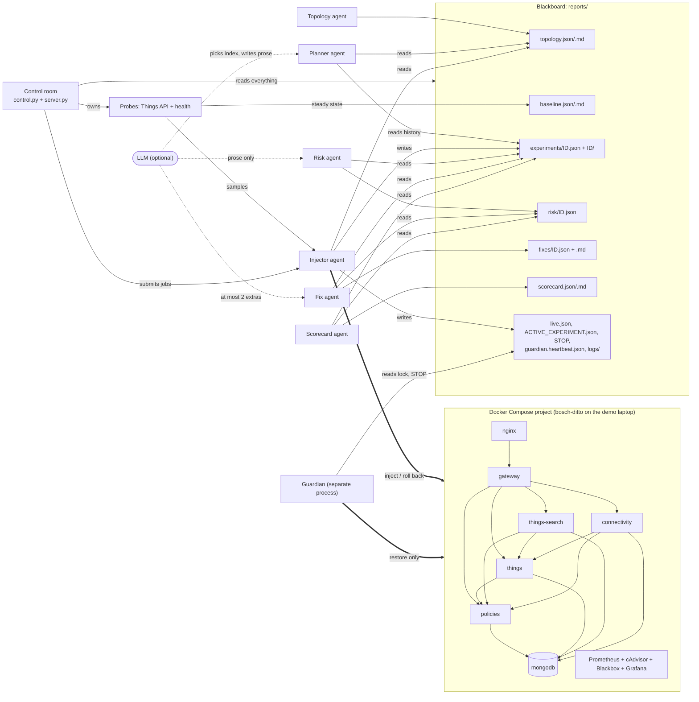
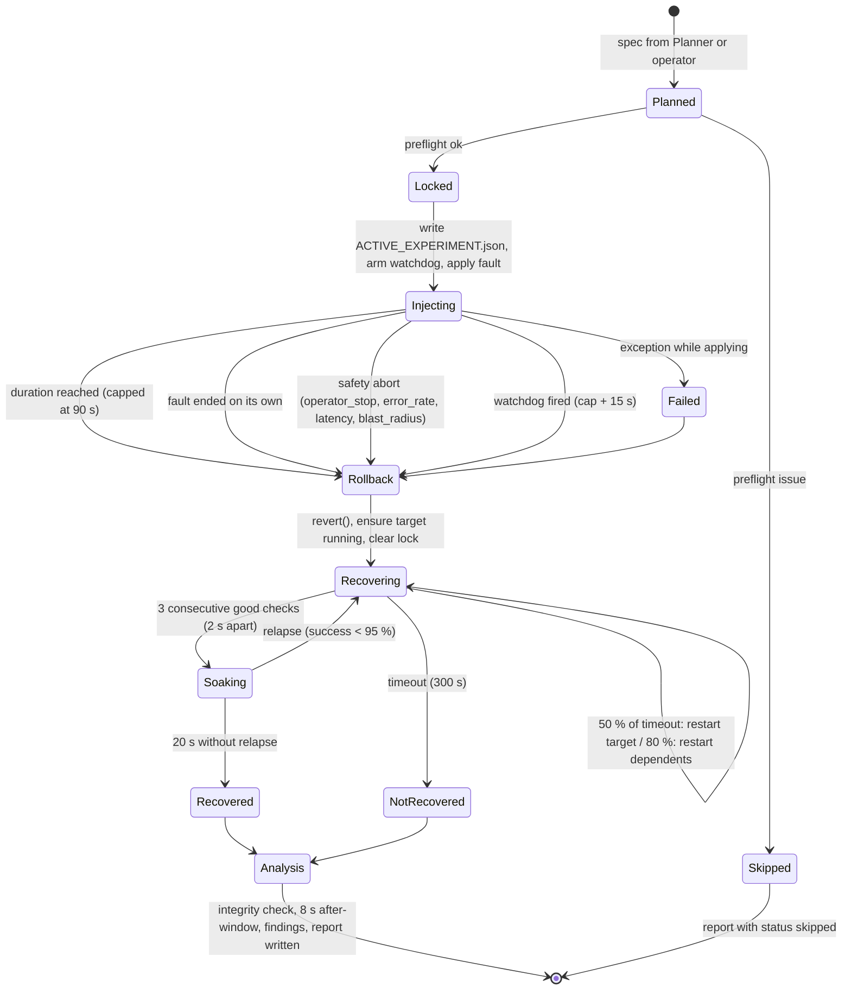
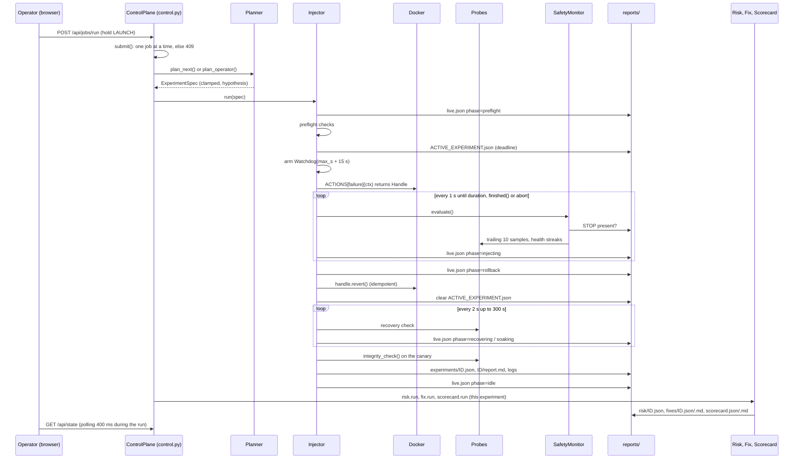

# Faultline project guide

This is the long-form guide to Faultline: what it is, how every part works, how the processes run end to end, and how to demo it. It is written so that you can explain any part of the system to a judge or a teammate without opening the code. Every number in it is quoted from the code or from `config/`, with the file it comes from. Where the older docs (`README.md`, `docs/ARCHITECTURE.md`, `docs/DEMO.md`, `HANDOFF_PROMPT.md`) disagree with the code, the code wins and the difference is listed in [section 17](#17-where-the-docs-and-the-code-disagree).

Contents

1. [What Faultline is and why](#1-what-faultline-is-and-why)
2. [Tech stack](#2-tech-stack)
3. [System overview and the blackboard](#3-system-overview-and-the-blackboard)
4. [The sample application: Eclipse Ditto](#4-the-sample-application-eclipse-ditto)
5. [The eight agents](#5-the-eight-agents)
6. [How Faultline measures: the two probes](#6-how-faultline-measures-the-two-probes)
7. [The experiment lifecycle, step by step](#7-the-experiment-lifecycle-step-by-step)
8. [The safety model](#8-the-safety-model)
9. [The failure catalog](#9-the-failure-catalog)
10. [Findings, hypothesis validation, risk, fixes and the scorecard](#10-findings-hypothesis-validation-risk-fixes-and-the-scorecard)
11. [The control room (dashboard)](#11-the-control-room-dashboard)
12. [Setup and running](#12-setup-and-running)
13. [How to give the demo](#13-how-to-give-the-demo)
14. [Troubleshooting and FAQ](#14-troubleshooting-and-faq)
15. [Known limitations](#15-known-limitations)
16. [Likely judge questions, with short answers](#16-likely-judge-questions-with-short-answers)
17. [Where the docs and the code disagree](#17-where-the-docs-and-the-code-disagree)
18. [Glossary](#18-glossary)

---

## 1. What Faultline is and why

### The problem statement

The Bosch hackathon problem statement is "AI-Driven Chaos Engineering for Cloud-Native Resilience". The organisers asked for a system that:

1. selects a sample cloud-native application and maps its services and dependencies automatically,
2. plans failure experiments intelligently (riskiest or most informative first),
3. injects controlled failures with safety limits and an automatic stop,
4. observes application behaviour (errors, slowdowns, recovery time),
5. analyses and reports weaknesses, recommends fixes and produces a ranked resilience score.

Constraints from the brief that shaped the design: the agents recommend fixes but never apply them; at least one agent proposes failures, one scores risk and one recommends fixes; open-source models; the whole app monitored by an open-source observability tool; Day-1 minimum of a running app, a dependency map and one safe injection with a working kill switch.

### What Faultline does

Faultline deliberately breaks a real Eclipse Ditto 3.9.8 deployment running under Docker Compose, measures what real API clients experience, rolls the fault back, waits for (and if necessary forces) recovery, and then writes a risk assessment, Ditto-specific fix recommendations and a per-service resilience scorecard. Everything is driven from one web page, the **control room**, and every button on that page is also a CLI subcommand.

### Why Eclipse Ditto

- It is a real, public, EPL-2.0 open-source IoT digital-twin platform (https://github.com/eclipse-ditto/ditto), not a toy.
- It is genuinely multi-service: nginx in front, a gateway, four Java persistence services (`policies`, `things`, `things-search`, `connectivity`) that together with the gateway form one Apache Pekko cluster, and one MongoDB behind them.
- It has interesting real-world failure modes that are documented upstream, which lets Faultline ground its findings in evidence rather than invent them: [Ditto issue #1865](https://github.com/eclipse-ditto/ditto/issues/1865) (`/alive` and `/ready` do not consider subsystem health) and [Ditto discussion #1861](https://github.com/eclipse-ditto/ditto/discussions/1861) (Things never reconnected to MongoDB after an outage).
- Official multi-arch images exist for everything, so it runs on an Apple Silicon laptop.

### The headline insight: MongoDB is the number one single point of failure, and Compose does not say so

The Compose file's `depends_on` never mentions MongoDB. A dependency map built only from `depends_on` would show MongoDB as a leaf that nothing depends on. Faultline's topology agent also scans every container's environment variables for values that resolve to another service's name or network alias. It finds `MONGO_DB_HOSTNAME=mongodb` on `policies`, `things`, `things-search` and `connectivity`, adds four `env` edges, and the criticality ranking then puts MongoDB first.

On the live demo stack (`reports/topology.json`, project `bosch-ditto`, 12 services, 21 edges) the ranking is:

| Rank | Service | Score | How the score is built (`faultline/topology/graph.py`) |
|---|---|---|---|
| 1 | `mongodb` | 9.5 | 6 transitive dependents (6.0) + holds state (2.0) + is a datastore (1.0) + no application health endpoint (0.5) |
| 2 | `policies` | 5.0 | 5 transitive dependents |
| 3 | `things` | 4.0 | 4 transitive dependents |

The mapper also reports the gap as a structural finding instead of silently fixing it: `mongodb: not referenced by any depends_on; 4 services reach it only via environment variables`. This is the "map the dependencies automatically" requirement producing a result a human reading the Compose file would miss. Say it to the judges.

### The governing principle: "LLM proposes, code disposes"

Every number that matters (candidate ranking, parameter bounds, abort thresholds, severity, scores, grades) is computed by code. The LLM may only: pick one index from a code-ranked shortlist of five, suggest parameters that the code clamps into catalog bounds, and write prose (rationale, hypothesis, risk summary, up to two extra fix suggestions). If the model is slow, offline or returns nonsense, the deterministic path runs and the report says so. Everything works with `--no-llm` or `FAULTLINE_LLM=false`. The one caveat to this principle is described honestly in [section 8.10](#810-what-the-llm-can-and-cannot-influence).

---

## 2. Tech stack

| Layer | Technology | Version (where pinned) | Why it was chosen |
|---|---|---|---|
| Language | Python | `requires-python >=3.10` (`pyproject.toml`); the demo venv runs 3.12.4 | Fast to write, first-class Docker SDK, everyone on the team can read it |
| Data contracts | pydantic v2 | `pydantic>=2.6` (2.14.0 installed) | Every blackboard file validates against one model in `faultline/schemas.py`; a schema drift fails loudly instead of corrupting the UI |
| Container control | docker-py (`docker` package) | `docker>=7` (7.2.0 installed) | Kill, stop, pause, exec, network connect/disconnect and helper containers from Python, scoped by the Compose project label |
| HTTP client | requests | `requests>=2.31` | Synthetic probe traffic, LLM calls, health checks |
| Config | PyYAML | `pyyaml>=6` | `config/thresholds.yaml`, `config/settings.yaml`, `config/ditto_knowledge.yaml`, and parsing the Compose file |
| Console output | rich | `rich>=13` (declared) | Declared in `pyproject.toml` but not imported anywhere in `faultline/` today |
| Tests | pytest | `pytest>=8` (dev extra; 9.1.1 installed) | Offline unit tests, no Docker needed |
| Web server | Python standard library `http.server.ThreadingHTTPServer` | stdlib | No framework to install or break at the venue; the server is a thin adapter (`faultline/dashboard/server.py`) |
| Frontend | Vanilla ES modules, no build step, no CDN, no web fonts | n/a | Works with no internet at the venue; nothing to compile; system font stack only |
| Charts | HTML `<canvas>` (`charts.js`) | n/a | A streaming 300-point chart re-rendered every 400 ms without a charting library |
| Dependency graph | Inline SVG (`topology.js`) | n/a | Deterministic layered layout; per-poll updates only mutate classes so animations never restart |
| Sample app | Eclipse Ditto (`eclipse/ditto-*`) | 3.9.8 (`DITTO_VERSION` default in `deploy/docker-compose.yml`; live stack runs 3.9.8) | Real multi-service, open-source, documented failure modes (section 1) |
| Datastore | MongoDB | `mongo:7.0` in `deploy/docker-compose.yml` (the live `bosch-ditto` stack runs `mongo:7.0.43`) | Ditto's only persistence backend |
| Reverse proxy | nginx | `nginx:1.27-alpine` | Ditto's documented entry point with basic auth; the only published port |
| Network fault injection | Pumba + `tc netem` | `gaiaadm/pumba:latest` and `ghcr.io/alexei-led/pumba-alpine-nettools:latest` (`config/settings.yaml`) | Latency and packet loss as a sidecar container: nothing is installed in the target |
| Metrics | Prometheus | `prom/prometheus:v2.55.1`, 5 s scrape interval (`deploy/monitoring/prometheus.yml`) | The open-source observability requirement; scrapes cAdvisor, Ditto's own metrics on port 9095 and Blackbox probes |
| Container metrics | cAdvisor | `gcr.io/cadvisor/cadvisor:v0.49.1` | Per-container CPU, memory, network |
| Endpoint probing | Blackbox exporter | `prom/blackbox-exporter:v0.25.0` | Probes `/alive`, `/ready` on port 7626 and MongoDB's TCP port independently of Faultline |
| Dashboards | Grafana | `grafana/grafana:11.3.0` | Provisioned dashboard ("Faultline - Ditto resilience") as an independent second opinion on the numbers |
| LLM transport | OpenAI-compatible chat API (also Ollama and Anthropic Messages API) | `faultline/planning/llm.py` | One client, three providers, every failure returns `None` so code always has the last word |
| LLM on the demo machine | Groq via its OpenAI-compatible endpoint, model `openai/gpt-oss-120b` | per `HANDOFF_PROMPT.md` and the `.env` key names (`LLM_PROVIDER`, `LLM_MODEL`, `LLM_BASE_URL`, `LLM_API_KEY`) | Open-weights model, fast enough to sit on the critical path of a six-minute demo; `llama-3.3-70b-versatile` is not available on that account |
| Local LLM option | Ollama with `phi4-mini` | defaults in `config/settings.yaml` | Fully offline alternative; slow on a laptop |
| UI verification | Playwright driving installed Chrome (`channel="chrome"`) | not a project dependency (1.63.0 installed in the venv) | `scripts/verify_ui.py` screenshots five breakpoints and fails on console errors, overflow and small touch targets |
| Orchestration | Docker Compose | Compose project label `com.docker.compose.project` | Single-node sandbox; the label is also the safety scope |

---

## 3. System overview and the blackboard

### Overview diagram



### The blackboard pattern

There is no message bus and no shared process between the agents. Each agent reads and writes JSON files in `reports/` (the path is `FAULTLINE_REPORTS_DIR`, default `reports`). The pydantic models in `faultline/schemas.py` are the contract. `faultline/reporting/store.py` (`ReportStore`) does all reads and writes; writes are atomic (write to `<file>.tmp`, then rename), so a reader never sees half a file.

Consequences you can say out loud: a crashed agent loses nothing; any agent can be re-run in isolation (`faultline risk --force`, for example); you can watch the agents work by watching the directory; and the control room and the CLI are two front ends over the same files.

### Every file on the blackboard

| File | Model | Written by | Read by |
|---|---|---|---|
| `topology.json` | `Topology` | Topology agent (`faultline topology`, the control room's Rebuild map job, or automatically when a session starts and no map exists) | Planner, Injector (via the session), Risk (blast-radius denominator), Scorecard (service list), Guardian (which services to watch), control room |
| `topology.md` | Markdown with a Mermaid graph | Topology agent (`faultline/topology/render.py`) | Humans |
| `baseline.json` | `Baseline` | `faultline baseline` or the Capture baseline job | Session (derives abort thresholds from `api.p95_ms`), control room (`/api/state`, `/api/catalog`), demo doctor |
| `baseline.md` | Markdown | Same | Humans |
| `experiments/<id>.json` | `ExperimentReport` | Injector, once per experiment | Planner (history), Risk, Fix, Scorecard, Narrator, control room |
| `experiments/<id>/` | directory: `report.md` plus `<service>.log` (last 120 log lines of the target and of every service the hypothesis expected to be affected) | Injector (`_save_logs`) | Humans; `ExperimentReport.raw_logs_ref` points here |
| `risk/<id>.json` | `RiskAssessment` | Risk agent | Fix agent, Scorecard (counts high/critical), Narrator, control room |
| `fixes/<id>.json` | `FixRecommendation` | Fix agent | Narrator, control room |
| `fixes/<id>.md` | Markdown | Fix agent | Humans |
| `scorecard.json` | `Scorecard` | Scorecard agent | Control room |
| `scorecard.md` | Markdown | Scorecard agent | Humans |
| `live.json` | free-form dict with `updated_at` | Injector, about once per second during a run (`_live`) | Control room (the live phase, telemetry phase bands, live health), Narrator `--watch` |
| `ACTIVE_EXPERIMENT.json` | free-form dict: experiment id, target, container, failure type, start time, `deadline`, parameters | Injector (set before inject, cleared after rollback); cleared by `faultline heal`; cleared by the Guardian if stale | Injector preflight (the lock), Guardian (what may be down and until when), control room (`deadline_in_s` countdown), demo doctor |
| `PENDING_APPROVAL.json` | `ApprovalRequest` | Approval agent, when a decision opens and on every resend; deleted when it is decided | `faultline approvals`, `GET /api/approvals`, the control room |
| `approvals/<approval_id>.json` | `ApprovalRequest` with its `decision` filled in | Approval agent, once the decision is answered, timed out or failed; kept for good | Humans, `GET /api/approvals`; `ExperimentReport.approval` carries the same `ApprovalDecision` for scenario B |
| `STOP` | presence is the signal; content is reason and timestamp | `faultline stop`, `POST /api/stop`, `POST /api/jobs/cancel` for a run job, or `touch reports/STOP` | Safety monitor (every second), Guardian (every loop), CLI and control-room run loops, launcher (blocks launch), demo doctor |
| `guardian.heartbeat.json` | free-form dict with `at`, `stop`, `active`, `actions`, `down` | Guardian, every loop | Control room (Guardian pill and pipeline row: alive if under 15 s old), `faultline status`, demo doctor |
| `logs/<agent>.log` | text | Guardian (`append_log`) | Humans |

---

## 4. The sample application: Eclipse Ditto

| Service | Role in Ditto | Faultline role (`config/ditto_knowledge.yaml` and role guessing in `compose.py`) | Memory limit (`deploy/docker-compose.yml`) |
|---|---|---|---|
| `nginx` | reverse proxy, basic auth, the only published port (`127.0.0.1:8080`) | `proxy`, entry point | 32 MB |
| `gateway` | HTTP and WebSocket API; deliberately no published ports | `app` | 512 MB |
| `policies` | authorisation; every other Java service consults it | `app` | 512 MB |
| `things` | digital-twin state, cluster-sharded persistent actors | `app` | 512 MB |
| `things-search` | search index, eventually consistent, built from thing events | `app` | 512 MB |
| `connectivity` | MQTT, AMQP, Kafka bridges | `app` | 768 MB |
| `ditto-ui` | web UI at `/ui/` | `ui`, never a target | 32 MB |
| `mongodb` | the only datastore | `datastore`, protected | 256 MB |
| `prometheus`, `grafana`, `cadvisor`, `blackbox` | observability | `other`, never a target | not limited |

The five Java services form one Pekko cluster (network alias `ditto-cluster`). Each exposes `/alive` and `/ready` on port 7626 and metrics on port 9095, internal to the Compose network only. The JVM options in the bundled Compose file set `pekko.cluster.downing-provider-class=` to empty, which means no split-brain resolver is configured; the `relapse_after_recovery` finding and one of the fix rules refer to this.

Two Compose setups exist:

- `deploy/docker-compose.yml`, project name `faultline`, bundled with the repo, includes the observability stack.
- The demo laptop instead attaches to an already-running project called `bosch-ditto` (13 containers, including a `swagger-ui` container that is not in the bundled Compose file). `.env` sets `FAULTLINE_COMPOSE_PROJECT` to that project. `FAULTLINE_COMPOSE_FILE` is not set, so the static part of the topology still comes from `deploy/docker-compose.yml`; that is why the live map reports `container bosch-ditto-swagger-ui-1 running but not declared in compose`.

---

## 5. The eight agents

The pipeline strip in the control room shows seven agents: Topology, Planner, Injector, Guardian, Risk, Fix, Scorecard. An eighth, the Approval agent, sits outside the strip because it waits on a human by email rather than on the stack. A ninth module, the Narrator, exists for the CLI. For each agent: inputs, outputs, algorithm, and what the LLM does versus what code decides.

### 5.1 Topology agent (`faultline/topology/`)

**Inputs:** the Compose file (`FAULTLINE_COMPOSE_FILE`, default `deploy/docker-compose.yml`), the nginx config (`deploy/nginx/nginx.conf`), `config/ditto_knowledge.yaml`, and live Docker state for the Compose project.

**Output:** `topology.json` and `topology.md`.

**Algorithm:**

1. **Nodes** (`compose.service_nodes`): one `ServiceNode` per Compose service. Role comes from `ditto_knowledge.yaml` overrides, otherwise a guess from name and image (`mongo|postgres|redis|...` = datastore, `nginx|traefik|haproxy|envoy` = proxy, `*-ui` or swagger = ui, else app). `stateful` if it is a datastore or mounts a named volume. `entrypoint` if it publishes ports. `health_port` from the healthcheck command (regex `:(\d+)/`), or 7626 for Ditto app images. `chaos_relevant` is false for roles `ui` and `other`.
2. **Edges** (`compose.static_edges`, `documented_edges`), each with a `kind` and an evidence string:
   - `depends_on`: from Compose `depends_on` (list or dict form).
   - `env`: environment variables whose key ends in `_HOSTNAME`, `_HOST`, `_URI`, `_URL`, `_ADDR`, `_ADDRESS`, `_ENDPOINT` or `_SEED_NODES` and whose value (bare host, `host:port`, URI or comma list) names another service or one of its network aliases. Keys matching `PASSWORD|SECRET|TOKEN` are skipped. Without a host-like key the whole value must be exactly a service name or a single-host URI.
   - `proxy`: every `proxy_pass http(s)://<host>` in the nginx config, from the nginx service to that host.
   - `documented`: the nine Pekko-cluster edges in `config/ditto_knowledge.yaml` (for example "gateway asks policies to authorise every request").
   - (`observed` exists in the schema and the graph legend for live traffic, but the topology builder does not emit it.)
3. **Live enrichment** (`live.enrich`): `docker inspect` adds container name, state, health, restart policy, memory limit (if Compose did not set one) and network aliases. It reports services with no container and containers not declared in Compose.
4. **Criticality** (`graph.criticality`), per service:
   - `+1.0` per transitive dependent (breadth-first over reversed edges of all kinds)
   - `+2.0` if stateful
   - `+1.0` if it is the external entry point
   - `+1.0` if it is a datastore
   - `+0.5` if it has no application health endpoint (and is not a UI)
   - sorted by score descending, then name.
5. **Structural findings**: any service that no `depends_on` references but that others reach via `env` edges; any app service without a health port.

**LLM:** none. This agent is fully deterministic.

### 5.2 Planner agent (`faultline/planning/planner.py`)

**Inputs:** the topology, the policy (`config/thresholds.yaml`), the experiment history (`store.experiments()`), which helper images are present, and optionally the LLM.

**Output:** an `ExperimentSpec` (transient; it ends up inside the report and the lock file).

**Algorithm, code part (`Planner.candidates`):** for every chaos-relevant service whose role is not skipped (`skip_roles: [ui]`), and every failure type that is applicable to it (section 9), allowed by policy, and whose helper images are present:

```
priority = criticality x (1.5 if untested else 1.0)
         - 1.5 x (times this (service, failure) pair already ran as completed or aborted)
         + INFORMATIVENESS[failure_type]
         - 0.5 if the failure type is degrade-only
         - 1.0 if the service was the target of the last experiment
```

`INFORMATIVENESS` is a tie-breaker between failure types on the same target: `network_delay` 0.4, `container_crash` 0.4, `db_flood` 0.35, `network_partition` 0.35, `network_loss` 0.3, `container_stop` 0.3, `container_pause` 0.2, `traffic_spike` 0.2, `cpu_stress` 0.1, `disk_pressure` 0.0.

Worked example on a fresh history: `mongodb` + `network_delay` = 9.5 x 1.5 + 0.4 - 0.5 = **14.15**; `policies` + `container_crash` = 5.0 x 1.5 + 0.4 = **7.9**. MongoDB faults lead the list until they have been tested, and MongoDB only ever appears with degrade-only faults because of the protected-service policy.

**LLM part (`_ask_llm`):** only the top five candidates are sent, with their parameter bounds, a topology summary (who breaks if each service breaks) and the last five results. The model must answer one JSON object: `choice` (an index), `parameters`, `rationale`, `hypothesis` (statement, expected affected services, expected max error rate, expected recovery seconds).

**Code disposes (validation):**

- `choice` must be an integer in range, otherwise the whole answer is discarded.
- `parameters` are clamped into the catalog bounds by `clamp()`; every clamp is written into `planner_notes`.
- `rationale` is truncated to 300 characters, the hypothesis statement to 400.
- `expected_affected` is filtered to known service names (falls back to the default hypothesis if empty).
- `expected_max_error_rate` is clamped to [0, 1]; `expected_recovery_s` to [1, 600].
- If the LLM is disabled, unavailable or gives no usable answer, the top candidate runs with a templated rationale ("X ranks #N by criticality ... and Y has not been tested on it yet") and `planned_by: deterministic`, and a planner note records why.

**Default hypothesis (`default_hypothesis`):** for full-outage faults the expected error rate is 1.0 (0.3 for `things-search`, 0.05 for `connectivity`, 1.0 for a datastore); for degrade-only faults it is the failure type's `severity_hint`. Expected affected = direct dependents of the target (excluding `nginx` for degrade-only faults). Expected recovery = the failure type's `expected_recovery_s`.

**Operator path (`plan_operator`):** manual mode or `--target/--failure/--param` bypasses ranking but not applicability, policy or clamping. `planned_by: operator`.

### 5.3 Injector agent (`faultline/agents/injector.py`)

**Inputs:** an `ExperimentSpec`, the running probes (`SampleWindow`, `HealthProbe`), the thresholds, the policy, Docker.

**Outputs:** `experiments/<id>.json`, `experiments/<id>/report.md` and logs, `live.json` updates, the `ACTIVE_EXPERIMENT.json` lock.

**Algorithm:** the full lifecycle in [section 7](#7-the-experiment-lifecycle-step-by-step): preflight, lock, watchdog, inject, observe with safety every second, rollback, recovery wait with soak and escalation, integrity check, after-window, findings, hypothesis validation, report.

**LLM:** none. The injector never talks to the model.

### 5.4 Guardian agent (`faultline/agents/guardian.py`)

A separate process (`faultline guardian`) with its own Docker client. It shares nothing with the injector except the blackboard files. It never injects; it only restores.

Every `--interval` seconds (default 5.0):

1. Read `STOP` and `ACTIVE_EXPERIMENT.json` (target and `deadline`).
2. For each watched container (the topology's relevant services, or all project containers if there is no topology) that is not running or is paused: if it is the lock's target, before the deadline, and STOP is not set, leave it alone (that outage is the experiment). Otherwise, if STOP is set, or it has been down longer than `DOWN_GRACE_S` = 20 s, unpause or start it.
3. If there is a lock, STOP is not set and the time is more than 30 s past the deadline, clear the stale lock.
4. Remove Faultline helper containers (label `faultline.helper=1`) when STOP is set, when there is no lock, or when the deadline has passed, and delete the `tc` qdisc on the container the helper targeted.
5. If STOP is set, reconnect any watched container that is not connected to the Compose network.
6. Log each action to `logs/guardian.log` and write `guardian.heartbeat.json`.

**Why it exists:** "we do not trust a single agent with the kill switch". If the injector process dies mid-experiment, its `finally` block and watchdog die with it; the Guardian still restores the sandbox.

**LLM:** none.

### 5.5 Risk agent (`faultline/agents/risk.py`)

**Inputs:** `experiments/<id>.json`, the topology, optionally the LLM. **Output:** `risk/<id>.json`.

**Algorithm:** a deterministic 0-10 severity (formula in [section 10.3](#103-risk-severity-faultlineagentsriskpy)), a level, and templated `summary` and `production_implication` prose. Skipped experiments get severity 0, level low.

**LLM:** may rewrite only the two prose fields, given the computed numbers. The answer is used only if both fields are strings of 1-599 characters; then `generated_by` becomes `llm+rules`. The model never sees or changes the severity, level or factors.

### 5.6 Fix agent (`faultline/agents/fix.py`, `faultline/agents/knowledge.py`)

**Inputs:** the report, its risk assessment (computed on the fly without the LLM if missing), optionally the LLM. **Outputs:** `fixes/<id>.json` and `fixes/<id>.md`.

**Algorithm:** match the 18 rules in `knowledge.py` against the report, rank by specificity and confidence, keep up to `MAX_RULE_RECS` = 6, prefix each rationale with an evidence sentence from this experiment ([section 10.4](#104-fix-recommendations-the-knowledge-base)).

**LLM:** may add at most `MAX_LLM_EXTRAS` = 2 additional recommendations. Each must validate against the `Recommendation` schema, must have steps, must not duplicate an existing title, gets its rationale prefixed with `[LLM suggestion, unverified]`, and has its confidence capped at 0.6.

**Advisory only:** `FixRecommendation.advisory_only` is always `true` and no agent has a code path that edits the Compose file, container configuration or Ditto settings.

### 5.7 Scorecard agent (`faultline/agents/scorecard.py`)

**Inputs:** all experiment reports, all risk assessments, the topology. **Outputs:** `scorecard.json` and `scorecard.md`.

**Algorithm:** pure arithmetic, per service, over experiments with status `completed` or `aborted` ([section 10.5](#105-resilience-scorecard-faultlineagentsscorecardpy)). Untested services are listed last with no score and a dash grade rather than a flattering default.

**LLM:** none.

### 5.8 Approval agent (`faultline/agents/approval.py`)

The human in the loop, by email. Two scenarios, one mechanism: pause, notify, wait for a constrained answer, time out to a safe default.

**Inputs:** for `pre_injection`, the `ExperimentSpec` the planner produced — it fires when `spec.requires_approval` is set, which `Planner.plan_operator` does when the protected-services policy refuses the (service, failure) pair and the planner was built with `approval_gate=True`, instead of raising "pass `--allow-protected` to override". For `problem_occurred`, the finished `ExperimentReport`, its `RiskAssessment`, its `FixRecommendation` and the Narrator's lines — all read back off the blackboard, and computed on the fly without the LLM when a file is missing, so the trigger does not silently depend on `--analyze` having been used. Plus the six `SMTP_*` and six `IMAP_*` settings and `ADMIN_EMAIL` from `.env`.

**Outputs:** `reports/PENDING_APPROVAL.json` while a decision is open, then `reports/approvals/<approval_id>.json` for good; `ExperimentReport.approval` (an `ApprovalDecision`) for scenario B; `reports/STOP` for `WAIT` and `STOP RUN`. Credentials are never logged and never written into any `reports/` file: a record says who was emailed and which token correlates the reply, never what was used to send it.

**Algorithm:**

1. **Trigger.** `needs_pre_injection_approval(spec)` returns true when `spec.requires_approval` is set, and the run loop holds the injector for that candidate until it has an answer. Only the operator path sets the flag: `Planner.candidates` still drops a protected pair from the ranked list rather than offering it for approval, deliberately — "a gate on who authorises a specific experiment is not a licence to reopen that policy for the planner". `problem_occurred(report, risk)` returns true when `risk.level` is `high` or `critical`, or when `recovery.remediation_actions` is non-empty; this one blocks nothing by itself.
2. **Preflight.** `preflight(settings)` names everything unset or unusable — `ADMIN_EMAIL`, each `SMTP_*` and `IMAP_*` credential, a non-positive timeout — the same discipline as the LLM client reporting `LLM_API_KEY not set`.
3. **Open.** One `ApprovalRequest`: a 12-character `approval_id`, a correlation token `FL-xxxxxxxx` (`secrets.token_hex(4)`), the recipient, the deadline, the timeout and the timeout default. Written to `PENDING_APPROVAL.json`, the same shape and spirit as the `ACTIVE_EXPERIMENT.json` lock.
4. **Send.** One plain-text mail carrying only facts other agents already wrote: for scenario A the target, failure type, clamped parameters, criticality, the planner's rationale, the hypothesis, why the admin is being asked, the planner notes and the reproduce commands; for scenario B the Narrator's prose, the Risk agent's own `summary` and `production_implication`, and the Fix agent's ranked recommendations, numbered so `FIX <n>` is unambiguous. The token goes in the subject line.
5. **Wait.** Poll `IMAP` every `APPROVAL_POLL_SECONDS` (5 s) with one short-lived connection per poll, until an independent `safety.monitor.Watchdog` on its own thread says the deadline passed — the same reason the injector has one, so a poll stuck in a blocking socket call cannot outlive the deadline. A reply is matched by the token in the subject or by `In-Reply-To` pointing at the `Message-ID` that was sent, never by "the newest unread mail", because two decisions can be open at once.
6. **Parse.** The first non-empty, non-quoted line of the `text/plain` body, whitespace collapsed, surrounding quotes and one trailing full stop or exclamation mark dropped, matched case-insensitively against the scenario's closed vocabulary: `APPROVE`, `APPROVE REDUCED`, `SKIP`, `STOP RUN` for `pre_injection`; `FIX <n>` (1 to the number of fixes listed), `WAIT`, `CONTINUE` for `problem_occurred`. Longest phrase first, so `APPROVE REDUCED` is never read as a bare `APPROVE`. Anything else is not an answer: one short mail re-states the options, at most `MAX_CLARIFICATIONS` = 3 times, and nothing is decided.
7. **Act.** `APPROVE` runs the experiment as planned. `APPROVE REDUCED` halves whichever of `duration_s`, `delay_ms`, `jitter_ms`, `loss_percent`, `workers`, `writers`, `size_mb` and `rps` the experiment actually carries (floor, not round, so half an odd duration is not a fraction `pumba --duration` would have to carry), then `clamp()` in `chaos/catalog.py` enforces the catalog's own bounds and every change is recorded in `planner_notes` like any other clamped parameter — the admin never supplies a raw number by email. `SKIP` rejects the candidate and the planner moves to the next-ranked one. `FIX <n>` is a decision log entry written to the experiment's report, not an action: no agent in this project ever applies a fix, and this one is no exception. `CONTINUE` acknowledges and the run proceeds. `WAIT` and `STOP RUN` call `store.request_stop()`, which is the existing `reports/STOP` kill switch — there is no second one.
8. **Finish.** The decision is attached to the request, the status becomes `answered`, `timed_out` or `failed`, the record is written to `reports/approvals/<approval_id>.json` and `PENDING_APPROVAL.json` is cleared.

**Timeout and failing safe:** the deadline is `APPROVAL_TIMEOUT_SECONDS` (120 s, `faultline/config.py`). `TIMEOUT_DEFAULTS` in `faultline/schemas.py` gives the safe default per scenario: `pre_injection` falls to `SKIP`, `problem_occurred` to `CONTINUE`. Both record `answered: false` and the reason. `WAIT` is never a timeout default, only ever a deliberate human choice, because an unanswered post-hoc note must not pause a run. An unreachable `SMTP` or `IMAP` host, any unset credential and an unset `ADMIN_EMAIL` are all treated exactly as a timeout, so scenario A falls to `SKIP`: a gate that cannot reach the admin never becomes a no-op that approves everything. A `STOP` latched while waiting is treated the same way.

**LLM:** none. Not "none for the numbers" — none at all. This agent sends and receives mail, matches a reply against a fixed vocabulary and writes a record; there is no prompt, no model client and no prose for a model to rewrite anywhere in the file. A closed vocabulary exists precisely so that nothing has to guess what the admin meant.

**Where it is called from, and what is not wired:** `cmd_run` turns the gate on with `approvals_enabled()` unless `--no-approvals` was passed, and off — saying why once — when `preflight()` finds anything unset; it then calls `gate()` before each held experiment and `run_post_experiment()` after each one that was not skipped. A spec that is marked for a decision while the gate is unusable is skipped, never injected on the grounds that nobody can be asked. `ControlPlane._job_run` has the same hold (`_gate`, which blocks the single job slot for up to the timeout while leaving `POST /api/stop`, `/api/resume` and `/api/jobs/cancel` served on their own handler threads) and builds its planner with `approval_gate` set from `gate_available()`, so `POST /api/jobs/run` with `mode: "manual"` on a protected pair and `allow_protected: false` is held rather than refused once the gate is configured. Neither browser front end sends that request today: the control room launcher and Fable both lock a protected card unless the override is ticked, and the override bypasses the gate. The Weakness Scout trigger is a documented hook, not a code path: `scout_predicted_severity(store, spec)` reads the Scout's `reports/weaknesses.json` through `store.weaknesses()` and returns the `predicted_level` of a weakness whose `suggested_experiment` matches the spec's target and failure type (or `None` when the Scout has not run), and `needs_pre_injection_approval()` documents that the call belongs in `Planner.candidates` next to the policy check, so the trigger stays in one place. Nothing calls it today (section 17).

### 5.9 Narrator (`faultline/agents/narrator.py`, CLI only)

`faultline narrate [--watch] [--llm]` prints a plain-English play-by-play of each experiment from the blackboard (header, timeline, impact, recovery, hypothesis, safety, findings, risk, fix). `--watch` polls every 3 s and also prints live lines from `live.json`. With `--llm` the model may write one two-to-three sentence paragraph using only the facts provided. It writes nothing to the blackboard.

### 5.10 Summary: who decides what

| Decision | Code | LLM |
|---|---|---|
| Which services and edges exist, criticality | yes | no |
| Candidate list and order | yes | no |
| Which of the top 5 to run | validates | proposes an index |
| Parameters | clamps to catalog bounds | proposes values |
| Rationale and hypothesis text | templates as fallback, truncates | writes |
| Expected affected services, max error rate, recovery time | filters and clamps | proposes |
| Abort thresholds, watchdog, recovery criteria | yes, from YAML and baseline | never sees them |
| Severity, level, factors | yes | no |
| Risk summary and implication prose | template fallback | may rewrite |
| Fix recommendations | 18 rules, up to 6 | up to 2 extras, confidence at most 0.6 |
| Scores and grades | yes | no |
| Whether a held experiment runs, runs reduced or is skipped, and which fix is recorded as chosen | asks the admin, enforces the closed vocabulary and the safe default on timeout | never asked, never consulted |

---

## 6. How Faultline measures: the two probes

Both probes live in `faultline/observe/probes.py` and run for the whole session: started by a CLI command that needs them, or by arming the control room.

### 6.1 Things API probe (what users experience)

- Synthetic traffic through nginx and the gateway at `probe_rps` = 4 requests/s (`config/settings.yaml`), with up to 16 requests in flight and a 5 s timeout per request.
- Operation cycle of eight: `get_thing`, `put_property`, `get_thing`, `search`, `get_property`, `put_property`, `get_thing`, `search` (so 3:2:2:1).
- All against one canary thing, `faultline.probe:canary`, created on start if missing.
- **Data-integrity canary:** every `put_property` writes a monotonically increasing sequence number to `features/telemetry/properties/seq`, and the probe remembers the highest acknowledged one. `integrity_check()` reads `seq` back after recovery; a stored value lower than the last acknowledged write means an acknowledged write was lost.
- Each request becomes a `Sample` (timestamp, operation, HTTP status, latency, error) in a thread-safe `SampleWindow` (deque of up to 50,000). A sample is a success if the status is 2xx; timeouts and connection errors are failures with status 0.
- `WindowStats` (`faultline/observe/window.py`): sample count, success rate, p50/p95/p99 over successful requests only (linear-interpolation percentile), per-operation breakdown, status counts.

### 6.2 Health probe (what the platform claims)

- Every `health_interval_s` = 3 s, for every chaos-relevant service in parallel.
- Ditto services: `docker exec` runs `curl` against `localhost:7626/alive` and `/ready` inside the container (port 7626 is not published). MongoDB: `mongosh` `ping` mapped to 200 or 503. Everything also gets Docker's status and health.
- A paused or non-running container is recorded with that status and no HTTP codes.
- `healthy` = running and (`/alive` is 200, or there is no application endpoint).
- Used by: the safety monitor (consecutive failures of non-target services), the recovery check (all watched services healthy), the live map in the control room, and the findings (`ready_ok_fraction` versus API success).

Comparing the two probes is the core idea: when the platform says healthy and users get errors, that is a finding.

### 6.3 Baseline (`faultline/observe/baseline.py`)

`faultline baseline --duration 60` (default 60 s; the control room's job clamps to 20-300 s) warms the probes for 10 s (CLI), then records the window. It stores API stats, per-service health availability and the derived thresholds. Notes are added if there were no samples, if success was below 99 %, or if any service was less than 100 % available. Without a baseline, thresholds fall back to the floors in `config/thresholds.yaml`.

---

## 7. The experiment lifecycle, step by step

All numbers come from `config/thresholds.yaml` and `faultline/agents/injector.py`.

### 7.1 State diagram



### 7.2 Sequence of one experiment launched from the control room



### 7.3 Each step in detail

**0. Session warm-up.** Probes must already be running. `faultline run` warms up for max(`pre_experiment_window_s`, 15) = 20 s. The control room's probes run continuously once armed.

**1. Plan.** As in section 5.2.

**2. Preflight** (`Injector.preflight`). `live.json` gets `phase: preflight` first. The experiment is skipped (`status: skipped`, with the reasons) if any of these hold:

- `reports/STOP` exists;
- `ACTIVE_EXPERIMENT.json` exists (another run is active);
- the target container is not `running`;
- any chaos-relevant service is not running;
- fewer than 5 probe samples in the last `pre_experiment_window_s` = 20 s ("let the probe warm up");
- pre-experiment success rate below `min_pre_success_rate` = 0.95 ("do not break an already sick system").

**3. Lock.** `ACTIVE_EXPERIMENT.json` records the spec, container, start time and `deadline = start + max_s + watchdog_grace_seconds`, where `max_s = min(duration_s, max_experiment_seconds)` = min(duration_s, 90).

**4. Watchdog.** `Watchdog(max_s + 15 s, emergency)` on a daemon `threading.Timer`. If it fires it sets `safety.watchdog_fired`, logs `watchdog_fired`, and calls `handle.revert()` from its own thread, even if the main loop is blocked inside a Docker call.

**5. Inject.** `ACTIONS[failure_type](Context)` applies the fault (section 9) and returns a `Handle`. The `injected` timeline event and `injected_at` are recorded.

**6. Observe loop.** Once per second until `max_s` elapses:

- `SafetyMonitor.evaluate()` (section 8.2); an abort verdict sets `aborted_early`, `abort_reason`, `abort_detail`, `operator_stop`, status `aborted`, writes `abort_reason` into `live.json`, and breaks out.
- The first failing API sample after injection records `first_api_error` (used for outage duration).
- The first time Docker reports the target not running, unhealthy or paused records `target_condition_observed`.
- If the handle reports `finished()` (the Pumba helper exited, or the traffic burst ended), the loop ends with `injection_ended`.
- `live.json` is written with `phase: injecting`, current stats and per-service health.

An exception while applying or observing sets status `failed` with the error text.

**7. Rollback** (in a `finally` block, so it always runs). Disarm the watchdog, write `phase: rollback`, call `handle.revert()`. `revert()` runs at most once (lock plus flag), so the watchdog, the main loop, the `finally` block and the Guardian can all call it safely. If revert raises, the target is force-restarted and that is recorded as a remediation action. If the target is not running 30 s later, it is started by hand (also recorded). The lock is cleared.

**8. Recovery wait with soak and escalation** (`_wait_recovery`). Every 2 s, up to `recovery.timeout_seconds` = 300 s after rollback:

- A check is good when, over the last `trailing_samples` = 10 probe samples since rollback, there are at least 5 samples, success is at least `recovery.success_rate_at_least` = 0.95, p95 is at most `recovery_p95_ms_below` = max(300 ms, 2 x baseline p95), and the target plus every expected-affected service is healthy.
- After `consecutive_checks` = 3 good checks in a row the time is recorded as a recovery candidate and the **soak** starts: `soak_seconds` = 20 s, polling every 2 s. If, with at least 5 samples, success since the candidate drops below 0.95, that is a **relapse**: it is recorded, the consecutive counter resets and the wait continues.
- **Escalation:** at `escalate_restart_target_at` = 0.5 of the timeout (150 s) without recovery, restart the target; at `escalate_restart_dependents_at` = 0.8 (240 s), restart its direct dependents ("Ditto #1861 pattern: clients did not reconnect"). Each action goes into `recovery.remediation_actions`.
- Recovered: `time_to_recover_s` = candidate time minus rollback time (the soak is not counted); `outage_duration_s` = candidate time minus the first API error (or the injection time if there was none).
- Timeout: `recovered: false`, `recovery_timeout` timeline event.
- For crashes, `auto_restarted_by_docker` is true if the container was running again with a new start time when rollback came.

**9. Integrity check.** Read the canary `seq` back and compare with the last acknowledged write.

**10. After-window.** Sleep 8 s and record the `after` stats.

**11. Findings and hypothesis validation** ([section 10.1](#101-findings-faultlineagentsinjectorpy-_findings) and [10.2](#102-hypothesis-validation)).

**12. Report.** Write `experiments/<id>.json` atomically, `experiments/<id>/report.md` and the logs, then `live.json` back to `phase: idle`. The CLI pauses `pause_between_experiments_s` = 30 s before the next iteration; the control room does the same and can be cancelled during the pause. At most `max_experiments_per_run` = 10 per run.

**13. Analysis.** The control room runs risk, fix and scorecard for that one experiment automatically (`analyze: true` by default in the run payload). On the CLI, `--analyze` is opt-in.

---

## 8. The safety model

### 8.1 Every limit, its value and where it is enforced

| Limit | Value (`config/thresholds.yaml` unless noted) | Enforced in |
|---|---|---|
| Trailing error rate abort | > 0.30 over the last 10 probe samples since injection; evaluated only once at least max(5, 10 // 2) = 5 such samples exist | `SafetyMonitor.evaluate` (`faultline/safety/monitor.py`) |
| Trailing p95 abort | > max(3000 ms, 5 x baseline p95) over the same samples | `SafetyMonitor.evaluate`; value from `thresholds_from` (`faultline/safety/thresholds.py`) |
| Blast-radius abort | any chaos-relevant service outside (`expected_affected` + target) with 3 consecutive unhealthy health checks | `SafetyMonitor.evaluate` via `HealthProbe.consecutive_failures` |
| Operator stop | `reports/STOP` present | `SafetyMonitor.evaluate` (first check, every second) |
| Hard cap per experiment | `max_experiment_seconds` = 90 s; the fault runs min(duration_s, 90) | Injector observe loop |
| Watchdog | fires at min(duration_s, 90) + `watchdog_grace_seconds` (15) s | `Watchdog` (`threading.Timer`) |
| Parameter bounds | per parameter `lo`/`hi` (section 9) | `clamp()` in `faultline/chaos/catalog.py`, applied to LLM and operator input; the launcher also clamps its dials |
| Pre-experiment health | at least 5 samples and success >= 0.95 in the last 20 s; every relevant service running | `Injector.preflight` |
| One experiment at a time | `ACTIVE_EXPERIMENT.json` lock | `Injector.preflight`; plus one job at a time in the control room (HTTP 409) |
| Experiments per run | `max_experiments_per_run` = 10 | `cmd_run`, `ControlPlane._job_run` |
| Pause between experiments | 30 s | same |
| Recovery wait cap | `timeout_seconds` = 300 s | `_wait_recovery` |
| Approval deadline | `APPROVAL_TIMEOUT_SECONDS` = 120 s, polled every `APPROVAL_POLL_SECONDS` = 5 s (both `faultline/config.py`) | `ApprovalAgent._wait`, with an independent `Watchdog` on its own thread |
| Protected services | `mongodb`: only `network_delay`, `network_loss`, `cpu_stress`, `disk_pressure`, `db_flood` | `Policy.allows` (planner, operator path, catalog endpoint, launcher cards) |
| Never-targets | role `ui` (`skip_roles`) and role `other` (`chaos_relevant: false`) | `Planner.candidates`, `applicable()` |
| Disk fill bound | `size_mb` at most 1024 | catalog |
| Scope | only containers labelled `com.docker.compose.project=<FAULTLINE_COMPOSE_PROJECT>`; helpers labelled `faultline.helper=1` | `DockerController` (`faultline/chaos/docker_ctl.py`) |
| Guardian grace | restore non-expected downed containers after 20 s | `guardian.DOWN_GRACE_S` |
| Stale lock | cleared by the Guardian 30 s after the deadline | `guardian.run` |

Thresholds are turned into absolute numbers by `thresholds_from(policy, baseline_p95)`. On the demo laptop the baseline p95 is about 44 ms, so 5 x 44 ms is far below the 3000 ms floor and the latency abort is effectively 3000 ms; likewise the recovery p95 ceiling is the 300 ms floor.

### 8.2 The safety monitor, in order

`SafetyMonitor.evaluate()` runs once per second and returns the first verdict that fires:

1. `operator_stop` if `reports/STOP` exists.
2. `error_rate` if the trailing error rate exceeds 0.30.
3. `latency` if the trailing p95 exceeds the p95 threshold.
4. `blast_radius:<service>` if a service outside the predicted blast radius has 3 consecutive failed health checks.

The monitor's inputs and outputs are never shown to the model.

### 8.3 Kill switch

The kill switch is one file: `reports/STOP`. Ways to write it:

| Method | What it does |
|---|---|
| STOP button in the control-room header | `POST /api/stop` |
| `Esc` key anywhere on the page (not while typing in a field) | `POST /api/stop`; one press, no confirmation dialog |
| `POST /api/stop` directly | writes `STOP` with reason `dashboard`, sets the job cancel flag, logs a red "KILL SWITCH" event; always answers 200, is never queued, never blocked by a running job |
| `faultline stop` | writes `STOP` with reason `cli` |
| `touch reports/STOP` | works with nothing running at all |
| Cancel job (for a run job) | `POST /api/jobs/cancel` also writes `STOP` (reason `dashboard-cancel`) |

Who reacts: the safety monitor inside a running experiment (within about 1 s, verdict `operator_stop`, rollback); the CLI and control-room run loops (no further experiments start); the Guardian (restores everything immediately, removes helpers, reconnects partitioned containers); the launcher (refuses to launch while STOP is latched).

Clearing it: `faultline resume`, `POST /api/resume` (the header button reads RESUME while STOP is latched), or `faultline run --resume-stop`. Note: a run job submitted directly to `POST /api/jobs/run` clears STOP by default (`resume_stop` defaults to true in `_job_run`); the launcher UI blocks that path by refusing to launch until you press RESUME.

### 8.4 Approval gate

A second kind of pause, and the only one that waits on a person. The Approval agent (section 5.8) holds an operator-chosen experiment before injection when the protected-services policy refused it and the gate is on, and asks again after an experiment the Risk agent scored `high` or `critical` or whose recovery needed the escalation ladder. `--allow-protected` is the explicit override and still bypasses the gate entirely, which is what an unattended run uses; `--no-approvals` turns the gate off without reopening the policy, so a refused pair goes back to being refused.

| Property | Value |
|---|---|
| Who is asked | `ADMIN_EMAIL`. No default, deliberately not hardcoded anywhere; the project owner has not supplied the real address yet |
| On or off | on for `run`, `rerun` and `demo` unless `--no-approvals`; `approvals_enabled()` turns it off and logs the first `preflight()` issue when it cannot reach a human. A spec already marked for a decision is then skipped, never injected |
| What triggers it | scenario A: `Planner.plan_operator` set `requires_approval` because the policy refused the pair. Scenario B: `risk.level` in (`high`, `critical`), or a non-empty `recovery.remediation_actions` |
| Scenario A vocabulary (`pre_injection`) | `APPROVE`, `APPROVE REDUCED`, `SKIP`, `STOP RUN` — blocks the injector for that candidate |
| Scenario B vocabulary (`problem_occurred`) | `FIX <n>`, `WAIT`, `CONTINUE` — blocks nothing by itself |
| How a reply is read | the first non-empty, non-quoted line of the `text/plain` body, case-insensitively, against that closed list. Anything else gets the options back once (at most `MAX_CLARIFICATIONS` = 3) and decides nothing |
| How a reply is matched | the correlation token `FL-xxxxxxxx` in the subject, or `In-Reply-To` pointing at the sent `Message-ID`. Never "the newest unread mail": two decisions can be open at once |
| Deadline | `APPROVAL_TIMEOUT_SECONDS` = 120 s, enforced by an independent `safety.monitor.Watchdog` timer on its own thread |
| Timeout default | `SKIP` for scenario A, `CONTINUE` for scenario B (`TIMEOUT_DEFAULTS`, `faultline/schemas.py`); both record `answered: false` and the reason |
| Unconfigured or unreachable | an unset `ADMIN_EMAIL` or credential, or an unreachable `SMTP` / `IMAP` host, is treated exactly as a timeout — so scenario A falls to `SKIP`. Not configured is not consent |
| Side effects | `WAIT` and `STOP RUN` write `reports/STOP`, the same kill switch as section 8.3. `APPROVE REDUCED` halves duration and intensity and `clamp()` then enforces the catalog bounds. `FIX <n>` writes a decision log entry to `ExperimentReport.approval` and nothing else |
| Where it is visible | `reports/PENDING_APPROVAL.json` while open, `reports/approvals/<approval_id>.json` once decided, `faultline approvals`, `GET /api/approvals` |

`WAIT` is never a timeout default: pausing a whole run is a deliberate human choice, never something an unanswered mail does on the admin's behalf. There is deliberately no command that answers a decision from the CLI — the answer comes back by email on purpose, and a local bypass would defeat the gate; `faultline stop` and `faultline resume` already cover an operator who is physically at the laptop.

### 8.5 One-experiment lock and the single-job rule

Two independent constraints:

- `ACTIVE_EXPERIMENT.json`: any process that runs an experiment refuses while it exists. This is what stops a CLI `faultline run` in another terminal from colliding with one started in the browser.
- The control room's job slot: `ControlPlane.submit()` refuses a second job while one is running (`JobBusy`, HTTP 409 with `'<label>' is already running`). This covers map rebuilds, baselines, analysis and heals too.

### 8.6 Protected services

`mongodb` is protected because it is the sole datastore ("Day-1 policy is degrade-only, never a full outage"). Crash, stop, pause and partition are blocked; delay, loss, CPU, disk and write flood are allowed. `--allow-protected` (CLI) or the `allow_protected` flag in the run payload overrides it, and the override text is written into `planner_notes` in the report.

### 8.7 Idempotent rollback

Every injection returns a `Handle`. `revert()` takes a lock, sets a flag, and only the first caller does the work. Callers: normal completion, abort, the watchdog thread, the `finally` block, and (indirectly, by restoring containers) the Guardian. What each revert does is listed per failure type in section 9.

### 8.8 Blast radius is part of the hypothesis

The hypothesis' `expected_affected` list does two jobs: it defines which services the blast-radius abort protects (everything else), and it is the baseline for the `cascade_beyond_hypothesis` finding.

### 8.9 Advisory only and reproducible

No agent edits the stack's configuration. Every report carries `reproduce`: the shell commands equivalent to the injection (`reproduce_commands` in `catalog.py`), so a finding can be verified by hand without Faultline. Some of these are approximations; see section 17.

### 8.10 What the LLM can and cannot influence

Cannot: see or change any threshold, the watchdog, the hard cap, the policy, the severity, the scores, or pick a service or failure that is not in the code's top five.

Can, within bounds: choose parameter values anywhere inside the catalog bounds (including the maximum, for example `duration_s` 90, which is longer than the default 30 or 45), and write `expected_affected`. Because `expected_affected` also defines which services the blast-radius abort watches, a model that predicts a wide blast radius narrows that one check. The error-rate, latency, hard-cap, watchdog and STOP protections are unaffected. The README's phrase "a model can make an experiment shorter or lighter, never longer or heavier" is therefore stronger than the code: the accurate statement is "never outside the catalog bounds or past the hard caps".

---

## 9. The failure catalog

Defined in `faultline/chaos/catalog.py` (data and bounds) and `faultline/chaos/actions.py` (mechanics).

### 9.1 The ten failure types

| Key | Title | Organisers' category | Degrade-only | Parameters: default [lo-hi] | Expected recovery (s) | Severity hint |
|---|---|---|---|---|---|---|
| `container_crash` | Container crash (SIGKILL) | Service or container crash | no | `duration_s` 30 [10-90], `block_restart` false | 90 | 1.0 |
| `container_stop` | Graceful stop (SIGTERM) | Failed dependency | no | `duration_s` 30 [10-90] | 90 | 1.0 |
| `container_pause` | Process freeze (SIGSTOP) | Service or container crash | no | `duration_s` 20 [5-60] | 15 | 1.0 |
| `network_delay` | Network latency (tc netem) | Slow or lossy network | yes | `duration_s` 45 [10-90], `delay_ms` 800 [100-3000], `jitter_ms` 200 [0-1000] | 10 | 0.3 |
| `network_loss` | Packet loss (tc netem) | Slow or lossy network | yes | `duration_s` 45 [10-90], `loss_percent` 30 [5-80] | 10 | 0.4 |
| `network_partition` | Network partition | Failed dependency | no | `duration_s` 30 [5-90] | 20 | 1.0 |
| `cpu_stress` | CPU starvation | Overloaded database | yes | `duration_s` 45 [10-90], `workers` 2 [1-4] | 10 | 0.2 |
| `disk_pressure` | Disk pressure | Full disk | yes | `duration_s` 30 [10-90], `size_mb` 256 [64-1024] | 5 | 0.05 |
| `db_flood` | Database write flood | Overloaded database | yes | `duration_s` 45 [10-90], `writers` 2 [1-4] | 15 | 0.3 |
| `traffic_spike` | Traffic spike | Sudden traffic spike | yes | `duration_s` 30 [10-90], `rps` 150 [20-600] | 10 | 0.2 |

### 9.2 Applicability (`applicable()`)

- A service must be chaos-relevant and its role must be in the failure type's roles. The default roles are `app`, `datastore`, `proxy`, so crash/stop/pause/partition/delay/loss/CPU/disk technically apply to MongoDB too; the protected-service policy then blocks the full-outage ones.
- `db_flood` applies only to role `datastore` with `mongo` in the image.
- `traffic_spike` applies only to `nginx` and `gateway`.
- Network delay and loss need both helper images (`pumba`, `tc`). Without them the planner drops them and the catalog endpoint marks them unavailable ("missing helper image(s): ...").

### 9.3 How each fault is applied and reverted

| Key | Apply (`actions.py`) | Revert | `finished()` |
|---|---|---|---|
| `container_crash` | Optionally set the restart policy to `no` (`block_restart`), then `docker kill` (SIGKILL). Docker's `restart: always` normally brings it back | Restore the previous restart policy; record whether Docker auto-restarted it; start it if not running | never |
| `container_stop` | `docker stop` with a 10 s timeout (SIGTERM then SIGKILL) | Start if not running | never |
| `container_pause` | `docker pause` (cgroup freezer). Processes freeze, TCP connections stay open, callers hang rather than fail fast | `docker unpause` | never |
| `network_partition` | Record the container's aliases on the Compose network, then `docker network disconnect --force` | Reconnect with the same aliases if not connected | never |
| `network_delay` | Run a Pumba helper container (label `faultline.helper=1`, name `faultline-pumba-<id8>-<service>`, Docker socket mounted) running `netem --duration <d>s --tc-image <tc> --interface eth0 delay --time <ms> --jitter <ms> --distribution normal <container>`. Pulls the images if absent; fails if Pumba exits within 2 s | Stop and remove the helper (SIGTERM, wait up to 8 s, then kill), then delete any root qdisc on the target's `eth0` with a one-shot `tc` container in the target's network namespace | when the helper stops running |
| `network_loss` | Same with `loss --percent <p>` | Same | same |
| `cpu_stress` | `workers` x `docker exec -d ... timeout <d+5> sh -c 'while :; do :; done' faultline-<id8>` | Kill every process whose command line contains the marker | never |
| `disk_pressure` | `fallocate -l <size>M /tmp/faultline-fill-<id8>` (falls back to `dd`) in the container's writable layer | `rm -f` the file | never |
| `db_flood` | `writers` x detached `timeout <d+5> mongosh --eval` loops inserting 2 KB documents into `faultline.flood` | Kill the marked processes, then drop `faultline.flood` | never |
| `traffic_spike` | Host-side threads: max(4, min(32, rps / 10)) workers sending authenticated GETs for the canary thing through nginx, paced to `rps`, until the duration ends | Signal the workers to stop | when all workers have ended |

### 9.4 Why each fault maps to an organisers' example

- Service or container crash: `container_crash`, and its "hung" variant `container_pause`.
- Failed dependency: `container_stop` (sustained outage), `network_partition` (alive but unreachable).
- Slow or lossy network: `network_delay`, `network_loss`.
- Overloaded database: `db_flood` (real write load on MongoDB), `cpu_stress` (on MongoDB or any service).
- Full disk: `disk_pressure`.
- Sudden traffic spike: `traffic_spike`.

---

## 10. Findings, hypothesis validation, risk, fixes and the scorecard

### 10.1 Findings (`faultline/agents/injector.py`, `_findings`)

Let `sr` be the API success rate during the fault.

| Code | Severity | When it is emitted |
|---|---|---|
| `api_impact` | high if `sr` < 0.5, medium if < 0.95, info otherwise; low if success stayed >= 0.99 but p95 more than doubled | always, if there were samples during the fault |
| `health_check_masked_failure` | high | `sr` < 0.5, and a service in (`expected_affected` + target) that was never seen down had `/ready` (or `/alive`) OK in at least 90 % of checks, and either it is the target itself or the target was never seen down. Evidence cites Ditto issue #1865 |
| `dependency_blind_readiness` | low | same conditions, but the target was seen down (crash, stop, pause) and the service is a dependent that kept answering ready |
| `no_automated_remediation` | medium | `sr` < 0.5 and the target container stayed running and never became Docker-`unhealthy`: nothing in the platform reacted (`restart: always` only reacts to exit) |
| `recovery_failed` | critical | not recovered within the timeout |
| `manual_restart_required` | high | recovered, but only after remediation actions (escalation restarts, forced start) |
| `auto_recovered` | info | recovered with no remediation |
| `slow_recovery` | medium | time to recover > 1.5 x `expected_recovery_s` |
| `relapse_after_recovery` | high | at least one relapse during soak |
| `data_loss_suspected` | critical | the canary read-back is lower than the last acknowledged write |
| `cascade_beyond_hypothesis` | medium | a service outside the hypothesis was seen down or had `/alive` OK below 50 % |
| `safety_abort` | info for an operator stop, medium otherwise | the run was aborted early |

Note on Ditto issue #1865 in practice: when you crash, stop or pause `things`, the dependents (`gateway`, `things-search`, `connectivity`) keep answering `/ready` = 200 while the API is at 0 %. With the current code that produces `dependency_blind_readiness` (low), because the target itself was visibly down. The high-severity `health_check_masked_failure` is reserved for the case where the service on the request path is not visibly down, for example the target itself still running and answering `/ready` = 200 (a network partition or heavy packet loss leaves the container running, and the health probe reaches `/ready` through `docker exec` on localhost). The existing live report `fd1b18f67001` (a crash of `things`) shows `health_check_masked_failure` for the dependents because it was produced by earlier code. See section 13.6 for how to present this.

`affected_services_observed` = the target plus any service seen down or with `/alive` OK below 90 %.

### 10.2 Hypothesis validation

`hypothesis_result.held` is true only if all three hold:

1. observed max error rate (1 - success during) <= `expected_max_error_rate` + 0.05;
2. no unexpected affected services (outside expected + target, seen down or `/alive` OK below 50 %);
3. recovered, with no remediation actions, within 1.5 x `expected_recovery_s`.

A violated hypothesis is the interesting result, not a bug: it means the system behaved differently from what the map predicted.

### 10.3 Risk severity (`faultline/agents/risk.py`)

```
user_impact = 1 - success_rate_during                (0 if missing, clamped to [0, 1])
blast       = |affected_services_observed + target|
N           = number of chaos-relevant services in the topology (7 if no topology)

impact       = 4.0 x user_impact
blast        = 2.0 x min(blast / N, 1)
recovery     = 2.0 x min(time_to_recover_s / 120, 1)
intervention = 1.5 if not recovered or any remediation action, else 0
findings     = sum of bonuses: health_check_masked_failure 1.0, data_loss_suspected 1.0,
               cascade_beyond_hypothesis 0.5, no_automated_remediation 0.5,
               manual_restart_required 0.5

severity = clamp(sum of factors, 0, 10)
level    = low if < 3, medium if < 5.5, high if < 8, else critical
           (critical regardless if data_loss_suspected)
```

Worked example from the live blackboard, experiment `fd1b18f67001` (crash of `things`, 20 s): success during 0 % gives impact 4.0; blast 1 of 7 gives 0.286; recovery 30.5 s gives 0.508; no intervention; one masked-failure bonus of 1.0. Total **5.79, high** (`reports/risk/fd1b18f67001.json`).

Skipped experiments get severity 0, level low, and a "no conclusion" implication.

### 10.4 Fix recommendations: the knowledge base

Rules live in `RULES` in `faultline/agents/knowledge.py`. Each rule has a match block (`failure_types`, `targets`, `finding_codes`, each optional) and a recommendation (title, category, effort S/M/L, confidence, rationale, steps, verify commands, references).

**Matching** (`_match_level`): every non-empty criterion must match. Specificity: 0 if the rule matches on a finding code, 1 on target, 2 on failure type, 3 for a generic rule. **Ranking**: specificity, then confidence descending, then rule order; duplicate titles dropped; the Fix agent keeps the first 6.

The 18 rules:

| # | Title (abridged) | Matches on | Category, effort, confidence |
|---|---|---|---|
| 1 | Run MongoDB as a replica set so the driver can fail over | target `mongodb` + crash/stop/pause/partition/delay/loss | architecture, M, 0.9 |
| 2 | Tune Ditto's MongoDB client timeouts and connection pool | target `mongodb` + those types + `db_flood` | configuration, S, 0.75 |
| 3 | Add a MongoDB healthcheck and an autoheal sidecar | target `mongodb`, any type | operations, S, 0.85 |
| 4 | Make readiness reflect subsystem health, alert on /status/health | finding `health_check_masked_failure` | configuration, M, 0.9 |
| 5 | Automate recovery after dependency outages | findings `manual_restart_required`, `recovery_failed`, `no_automated_remediation` | operations, M, 0.85 |
| 6 | Remove the single point of authorization: 2+ policies instances, cache decisions | target `policies` + crash/network/cpu types | architecture, M, 0.85 |
| 7 | Two gateway replicas behind an nginx upstream with retries | target `gateway` + crash types, `cpu_stress`, `traffic_spike` | architecture, M, 0.85 |
| 8 | Scale things horizontally; idempotent, ETag-guarded client retries | target `things` + crash types | architecture, M, 0.8 |
| 9 | Treat search as eventually consistent; expose index lag | target `things-search`, any type | observability, S, 0.8 |
| 10 | Isolate connectivity failures from the HTTP API | target `connectivity`, any type | configuration, S, 0.7 |
| 11 | Explicit timeouts end to end and a circuit breaker at the edge | `network_delay`, `network_loss` | configuration, S, 0.8 |
| 12 | Plan for split-brain: Pekko split-brain resolver | `network_partition` | architecture, M, 0.7 |
| 13 | Right-size container resources and rate-limit the edge | `cpu_stress`, `db_flood` | configuration, S, 0.8 |
| 14 | Protect the data volume: log rotation, dedicated volume, free-space alerts | `disk_pressure` | operations, S, 0.85 |
| 15 | Shed load gracefully: nginx rate limiting, 429s, scale gateway | `traffic_spike` | architecture, M, 0.8 |
| 16 | Contain the blast radius: bulkheads and dependency timeouts | finding `cascade_beyond_hypothesis` | architecture, M, 0.7 |
| 17 | Investigate suspected data loss: journaling, write concern, reconciliation | finding `data_loss_suspected` | operations, L, 0.9 |
| 18 | Baseline observability: SLO alert rules and chaos annotations in Grafana | generic (always) | observability, S, 0.65 |

Each recommendation's rationale is prefixed with an evidence sentence from the experiment ("In experiment X (risk HIGH 5.8/10), API success fell to 0% during injection, TTR 30 s, ..."). The Markdown file says "Advisory only, nothing was applied" at the top.

Example: `reports/fixes/fd1b18f67001.json` (crash of `things` with the masked finding) produced rules 4, 8 and 18, in that order (finding match first, then target, then generic).

### 10.5 Resilience scorecard (`faultline/agents/scorecard.py`)

Per experiment with status `completed` or `aborted`:

```
penalty = 40 x (1 - success_during)                     (success 0 if missing)
        + 20 x min(time_to_recover_s / 120, 1)
        + 20 if not recovered or any remediation action
        + 10 x min(number of high or critical findings, 3)
        + 5  if cascade_beyond_hypothesis
```

Per service (grouped by target): `score = max(0, 100 - mean(penalties))`, rounded to 0.1. Grades: A >= 90, B >= 80, C >= 65, D >= 50, else F. Services with no scored experiments get no score, a dash grade and the note "not tested", and sort last. Ranking is worst first. `overall_score` is the mean over tested services only. The summary names the weakest service and why, and counts high or critical risk assessments.

Worked example (live blackboard): `things` has two experiments. The crash (`fd1b18f67001`): 40 + 5.08 + 0 + 30 (three high findings) + 0 = 75.08. The pause (`2ee196bc306c`, 50 % success, 6.2 s recovery): 20 + 1.03 = 21.03. Mean 48.06, score **51.9, grade D**. Overall across tested services: 74.7.

---

## 11. The control room (dashboard)

### 11.1 Architecture

- `faultline/dashboard/control.py`: the control plane (`ControlPlane`). All state lives here. It talks no HTTP.
- `faultline/dashboard/server.py`: a thin standard-library HTTP adapter (`ThreadingHTTPServer`, HTTP/1.1, `Cache-Control: no-store`, `X-Content-Type-Options: nosniff`). Binds `127.0.0.1` by default. No authentication: one operator on one laptop.
- `faultline/dashboard/static/`: the browser renders; nothing in the frontend matters after a reload except which experiment rows are expanded.

### 11.2 The control plane in detail

**Session.** `arm()` constructs the same `faultline.cli.Session` the CLI uses: Docker client, topology (loaded, or built if missing), policy, thresholds derived from the stored baseline, the Things API probe at 4 req/s and the health probe every 3 s. `disarm()` stops the probes. Jobs that need a session (baseline, run) arm on demand. An arming failure is caught, stored in `session.error`, shown in the launcher, and the page still renders. `GET /api/plan` does not arm (it reads `topology.json` from disk if there is no session).

**Telemetry buffer.** A daemon thread samples once per second (`TELEMETRY_SAMPLE_S` = 1.0) while armed: stats over the trailing 5 s of probe samples, appended as `{t, success, p95, n}`. Points older than `TELEMETRY_WINDOW_S` = 300 s are dropped on read. The same loop maintains phase bands `{from, to, phase, experiment_id}` from `live.json` (opened when the phase changes to a non-idle one, closed when it goes idle), at most 40 kept. These are what the chart shades.

**Jobs.** Kinds: `topology`, `baseline`, `run`, `analyze`, `heal`. Each job has an id (`j1`, `j2`, ...), a human label, a status (`running`, `done`, `failed`, `cancelled`), timestamps, an error and a result. Exactly one runs at a time on a daemon thread; only the latest job is kept. Cancellation is cooperative through a `threading.Event` that the run loop checks between experiments and during the pause; for a run job it also writes STOP so the in-flight experiment rolls back. A failed job's traceback (last 2000 characters) goes into the event's `data`, not onto the screen.

**Event log.** An in-memory ring of `MAX_EVENTS` = 4000 events, each with a monotonically increasing `seq`, timestamp, level (`info`, `success`, `warn`, `error`, `chaos`, `ai`), source (`system`, `topology`, `planner`, `injector`, `guardian`, `risk`, `fix`, `scorecard`, `probe`) and text (truncated at 2000 characters). Every agent the control plane invokes is handed a logger for its source, so existing agents narrate into the feed without knowing a UI exists. `infer_level()` guesses the level from the text (only the injector's lines can be `chaos`). `GET /api/state?since=<seq>` returns only newer events, at most 300. Not persisted: restarting the server empties the feed.

**Per-agent state.** One row per agent (`idle`, `working`, `done`, `error`, timestamp, one line of detail) for the pipeline strip. The Guardian's row is derived from `guardian.heartbeat.json` freshness (alive if under 15 s old), because it is a separate process.

**Live run state** (`_run_state`). Built from `live.json`, the lock and the in-flight job. Phase is what the injector last wrote (`preflight`, `injecting`, `rollback`, `recovering`, `soaking`, `idle`); `preflight` is also synthesised while a run job has a spec but nothing is written yet, and `analyzing` while an analyze job runs. Includes elapsed time, the countdown to the lock deadline (`deadline_in_s`), live success/p95, per-service health, `blast.expected` (the hypothesis) versus `blast.observed` (services not running or with `/alive` not 200), and `safety.abort_reason` once an abort fires.

**LLM state.** Provider, model, availability, enabled flag and last error, cached for 30 s.

**Robustness.** Every section of `state()` is wrapped so one broken part degrades to `null` instead of failing the response; every handler catches exceptions and returns JSON 500 rather than crashing.

### 11.3 HTTP API

All JSON. Errors as `{"error": "..."}`.

| Method and path | Purpose | Notes |
|---|---|---|
| `GET /api/state?since=<seq>` | The single polled snapshot: `now`, `seq`, events since `seq`, session (armed, error, probe, project, Ditto URL), job, run, telemetry, `stop_requested`, `pending_approval` (the decision an admin is being waited on for, with a `seconds_left` that goes negative once the deadline has passed, or `null`), guardian heartbeat, agents, llm, topology, baseline, experiment summaries (newest first, with risk and fix inlined), scorecard | Polled every 1000 ms idle, 400 ms while a run is live |
| `GET /api/catalog` | Ten failure types with params and bounds, `applies_to`, `policy_blocked_on`, availability and reason, protected rules, thresholds in force | Thresholds come from `baseline.json` if present |
| `GET /api/plan?llm=0\|1&allow_protected=0\|1` | Ranked candidates, the pick (spec, rationale, hypothesis, notes, reproduce), LLM status | Runs nothing and does not arm; needs `topology.json` |
| `GET /api/experiment/<id>` | Full report, risk, fix and rendered Markdown | 404 for unknown ids or ids containing `/` or `..` |
| `GET /api/approvals` | `{"pending": ..., "decided": [...]}`: the open decision from `reports/PENDING_APPROVAL.json` plus the last 20 decided records in `reports/approvals/`, newest first | Read-only, and there is deliberately no POST and no job kind: the answer arrives by email from the admin's own mailbox, and a button here would let whoever has the dashboard open wave through the very experiment the gate exists to hold back |
| `POST /api/jobs/topology` | Rebuild the map | 202 with the job, or 409 if busy |
| `POST /api/jobs/baseline` | `{"duration": 60}` | clamped to 20-300 s |
| `POST /api/jobs/run` | `{"mode":"auto"\|"manual","target","failure","params":{},"experiments":1,"llm":true,"allow_protected":false,"analyze":true}` | `experiments` capped at 10; manual runs exactly one; clears STOP unless `resume_stop: false` |
| `POST /api/jobs/analyze` | `{"llm": true}` | risk, then fix, over every experiment without them, then scorecard |
| `POST /api/jobs/heal` | `{"restart": false}` | runs the same code as `faultline heal` |
| `POST /api/jobs/cancel` | Cooperative cancel; for a run also writes STOP | always 200 |
| `POST /api/arm`, `POST /api/disarm` | Start or stop the probes | `arm` returns the session block |
| `POST /api/stop` | Kill switch | always 200, never queued or blocked |
| `POST /api/resume` | Clear STOP | |
| `GET /`, `GET /static/<file>` | The page and its modules | path-traversal checked; unknown paths 404 JSON |

### 11.4 Frontend modules

All in `faultline/dashboard/static/`, vanilla ES modules, no build step, no network beyond the local server. Each heavy module is loaded defensively: if one fails to import, the rest of the page still works and a toast names the missing module.

| File | What it does |
|---|---|
| `index.html` | Shell markup: header, injection console host, stage panels, feed, experiments and scorecard hosts, toast stack, `<noscript>` fallback, inline favicon |
| `tokens.css` | The only place raw hex colours live: surfaces, text, brand, semantic and severity colours, the chaos orange, fonts, spacing, radii, motion |
| `app.css` | The whole visual system and responsive layout, consuming only tokens |
| `app.js` | Application shell: polling loop (1000/400 ms, skip if in flight, offline marker instead of blanking), header pills and STOP/RESUME, phase ribbon, agent pipeline, KPI tiles, event feed, experiments table and detail view, scorecard, toasts, keyboard map, module loading |
| `launcher.js` | The injection console (`createLauncher`): AI PLANNER or MANUAL mode, LLM toggle, planner block (candidates, pick, rationale, hypothesis, Re-plan), target and failure cards from `/api/catalog` (policy-locked cards say why), clamped parameter dials, hypothesis, safety rails in force, hold-to-launch button (`HOLD_MS` = 1200 ms; with reduced motion, press then confirm), live status block with ABORT during a run, Operations buttons. Keeps a "touched" ledger so polling never overwrites a control the operator changed |
| `topology.js` | `createTopology`: the application map as SVG. Deterministic layered layout computed once per topology; node size = criticality; edge style = evidence (`env` thick blue "hidden dependency", `proxy` cyan, `depends_on` dashed, `documented` dotted); during a run the target goes orange, the predicted blast radius is outlined, observed failures go red with pulses along the edges |
| `charts.js` | `createLiveChart` (canvas: success-rate area, p95 line, shaded phase bands, dashed abort-threshold lines, breach markers, its own pause with `p`), `createSparkline` (KPI micro-charts), `createScoreRing` (SVG gauge) |
| `util.js` | DOM builders, formatters, tone mappers, `announce()` into one polite live region, `getJSON`/`postJSON` |
| `icons.js` | Inline 24x24 stroke SVG icons |
| `copy.js` | All explain-mode text (`EXPLAIN`), the seven ribbon steps (`PHASES`, `PHASE_INDEX`), plain-English help per finding code (`FINDING_HELP`), empty-state text (`EMPTY`) |

### 11.5 What the screen shows (high level)

The panel arrangement is being changed right now, so this is deliberately short. The dashboard is a scrolling page:

- **Header** (always visible): brand, the seven-step phase ribbon (Preflight, Inject, Observe, Rollback, Recover, Soak, Report) with a countdown and the abort reason when one fires, the model pill (model name or "rules only"), the Guardian pill (green only while its heartbeat is under 15 s old), the probe pill (live sample count), the Explain toggle, and STOP/RESUME.
- **First screen:** the **injection console** on the left (choose or let the AI choose what to break, then hold LAUNCH; Operations underneath), the **agent pipeline** and the **application map** in the centre, the **agent activity feed** on the right.
- **Scrolling down:** the **live telemetry** chart with the **KPI tiles** (API success, p95 latency against baseline, resilience score, findings count), then the **experiments table** (expand a row for evidence, risk, fixes, timeline and reproduce commands) and the **resilience scorecard**.

What each panel means:

| Panel | Meaning |
|---|---|
| Phase ribbon | Where the current experiment is in its lifecycle. Inject versus Observe is derived in the browser: Observe lights once the 5 s telemetry window lies wholly after the fault went in |
| Agent pipeline | Live state of the seven agents, one line each |
| Application map | The automatically discovered dependency graph; bigger node = more critical; live blast radius during a run |
| Agent activity feed | Every decision and measurement, newest first. Violet = written by the model, orange = a fault being applied, red = aborts and failures |
| Live telemetry | What the synthetic client sees: success area (green), p95 line (cyan), shaded phases, dashed abort thresholds |
| KPI tiles | Current success and p95 (last 5 s), baseline p95 for comparison, resilience score, findings and how many are high or critical risk |
| Experiments | One row per experiment: target, failure, planned by, success during, recovery, hypothesis held or violated, risk level, finding count. Detail: predicted versus observed, findings with explanations, risk score and implication, fixes with steps and verify commands, timeline, reproduce commands |
| Resilience scorecard | Overall ring plus per-service grades, worst first, untested services labelled |

Keyboard: `Esc` = kill switch, `E` = explain every panel, `Space` = pause or resume live updates, `p` on the focused chart = pause just the chart.

---

## 12. Setup and running

### 12.1 Prerequisites

- Docker Desktop with enough memory for the VM. The memory limits in `deploy/docker-compose.yml` sum to 3,136 MB for Ditto, MongoDB, the UI and nginx alone (the README says "about 2.6 GB"; plan for at least 4 GB).
- Python 3.10 or newer (the demo venv is 3.12).
- For network faults: the images `gaiaadm/pumba` and `ghcr.io/alexei-led/pumba-alpine-nettools` (pulled by `faultline setup`, or on first use).
- For an LLM: a Groq (or other OpenAI-compatible) API key, or Ollama with `phi4-mini` pulled. Optional.
- For UI verification only: `pip install playwright` and an installed Chrome.

### 12.2 Install

```bash
cd /Users/dakshtyagi/Documents/bosch-hackathon-2
python3 -m venv .venv && . .venv/bin/activate
pip install -e ".[dev]"            # or: make venv
```

Use the editable install: `pyproject.toml` package data now lists the static `.css`, `.js` and `.svg` files too, but editable is what has been tested.

### 12.3 Configuration (.env)

Copy `.env.example` to `.env`. Precedence: process environment, then `.env`, then `config/settings.yaml`, then the defaults in `faultline/config.py`. Empty values are ignored. The server reads settings once at startup: restart it after editing `.env`.

| Variable | Meaning | Default if unset |
|---|---|---|
| `FAULTLINE_COMPOSE_PROJECT` | Compose project Faultline may touch (the safety scope) | `faultline` |
| `FAULTLINE_COMPOSE_FILE` | Compose file for the static topology | `deploy/docker-compose.yml` |
| `FAULTLINE_REPORTS_DIR` | Blackboard directory | `reports` |
| `FAULTLINE_NETWORK` | Compose network name | `<project>_default` |
| `FAULTLINE_LLM` | `false` = fully deterministic, never contact a model | `true` |
| `DITTO_URL` | Ditto through nginx | `http://127.0.0.1:8080` |
| `DITTO_USER`, `DITTO_PASSWORD` | Basic-auth credentials for the API | the bundled stack's defaults |
| `PROMETHEUS_URL` | Prometheus | `http://127.0.0.1:9090` |
| `LLM_PROVIDER` | `ollama`, `openai` (any OpenAI-compatible API, including Groq) or `anthropic` | `ollama` |
| `LLM_MODEL` | Model name | provider default (`phi4-mini`, `gpt-4o-mini`, `claude-sonnet-5`) |
| `LLM_BASE_URL` | API base URL | provider default |
| `LLM_API_KEY` | Key for hosted providers; without it the client reports `LLM_API_KEY not set` and planning is deterministic | empty |
| `OLLAMA_URL`, `OLLAMA_MODEL` | Legacy aliases; `LLM_*` win when both are set | |
| `ADMIN_EMAIL` | **Placeholder.** Who the approval gate asks. The project owner has not supplied the real address yet and it is deliberately not hardcoded anywhere; until it is set the gate reports itself unconfigured and applies the safe default rather than approving. Use `admin@example.invalid` in examples | empty |
| `SMTP_HOST` | Outgoing mail host for the request | empty |
| `SMTP_PORT` | Outgoing mail port; 465 switches to implicit TLS (`SMTP_SSL`) | `587` |
| `SMTP_USER`, `SMTP_PASSWORD` | Credentials to send with. Never logged and never written into any `reports/` file | empty |
| `SMTP_FROM` | `From` header | empty = `SMTP_USER` |
| `SMTP_STARTTLS` | Issue `STARTTLS` before logging in (skipped on port 465) | `true` |
| `IMAP_HOST` | Host polled for the reply | empty = `SMTP_HOST` |
| `IMAP_PORT` | Port polled for the reply | `993` |
| `IMAP_USER`, `IMAP_PASSWORD` | Credentials to read the reply with | empty = the `SMTP_*` ones |
| `IMAP_MAILBOX` | Mailbox selected when polling | `INBOX` |
| `IMAP_SSL` | Connect with `IMAP4_SSL` rather than plain `IMAP4` | `true` |
| `APPROVAL_TIMEOUT_SECONDS` | How long a decision stays open before the safe default is applied | `120` |
| `APPROVAL_POLL_SECONDS` | Interval between mailbox polls while waiting | `5` |

The demo laptop's `.env` defines `FAULTLINE_COMPOSE_PROJECT`, `DITTO_URL`, `DITTO_USER`, `DITTO_PASSWORD`, `PROMETHEUS_URL`, `LLM_PROVIDER`, `LLM_MODEL`, `LLM_BASE_URL` and `LLM_API_KEY` (attached to project `bosch-ditto`, Groq). Never commit `.env`.

Other settings from `config/settings.yaml`: `llm_timeout_s` 120, `probe_rps` 4, `health_interval_s` 3, `dashboard_port` 8765, and the Pumba and tc image names.

### 12.4 Commands

The console script is `faultline`; `.venv/bin/python -m faultline <command>` is equivalent and is what the handoff uses.

| Command | What it does |
|---|---|
| `setup` | Checks Docker and the project's containers, pulls the helper images, checks Ditto `/health` and API auth, Prometheus, and the LLM |
| `topology [--no-live]` | Builds the map; `--no-live` skips `docker inspect` |
| `baseline [--duration 60]` | Captures steady state and derives thresholds |
| `catalog` | Prints the failure catalog |
| `plan [--no-llm] [--allow-protected]` | Shows the ranked candidates and the pick; runs nothing |
| `run [--experiments N] [--target S --failure F --param k=v ...] [--duration S] [--allow-protected] [--no-llm] [--analyze] [--resume-stop] [--no-approvals]` | Plans and executes experiments (operator flags pin one). `--no-approvals` runs unattended: the gate is never consulted and a policy-refused pair is refused as before |
| `rerun <id>` | Repeats a previous experiment's target, failure and parameters |
| `risk [ids] [--force] [--no-llm]`, `fix [ids] [--force] [--no-llm]`, `scorecard` | Downstream agents over reports without output (or all with `--force`) |
| `narrate [--watch] [--llm]` | Plain-English play-by-play |
| `guardian [--interval 5]` | The independent Guardian process (blocks) |
| `approvals [--resend <id>] [--limit 5]` | Prints the pending approval decision, its deadline and its timeout default, then the last `--limit` decided ones (`0` = none), and finally anything `preflight()` says is unset. `--resend` re-sends the pending decision's email with the same correlation token. Deliberately no way to answer a decision from the CLI |
| `stop` / `resume` | Write / remove `reports/STOP` |
| `heal [--restart]` | Clear the lock, remove helpers, reconnect, unpause and start containers, delete `tc` qdiscs on the core services; with `--restart` restart `mongodb`, `policies`, `things`, `things-search`, `connectivity`, `gateway` in that order (10 s after MongoDB, 5 s after each other); then wait up to 10 minutes for `/health` = UP |
| `status` | Container states, STOP, active lock, experiment count, Guardian alive or offline |
| `dashboard [--port N]` | Serves the control room (default port 8765) |
| `demo [--experiments 3] [--baseline 45] [--no-llm] [--allow-protected] [--no-approvals]` | Headless: topology, baseline, run with analysis, narrate |

`make` targets wrap these: `venv`, `up`, `down`, `status`, `setup`, `topology`, `baseline`, `run` (N=3), `demo`, `dashboard` (PORT=8765), `guardian`, `test`, `clean-reports`.

### 12.5 The bundled stack

```bash
scripts/up.sh        # docker compose up -d in deploy/, then waits up to 10 min for /health = UP
scripts/status.sh    # docker compose ps + one-shot docker stats
scripts/down.sh      # docker compose down, keeps volumes
```

URLs: Ditto API `http://127.0.0.1:8080/api/2/things`, Ditto UI `http://127.0.0.1:8080/ui/`, Prometheus `http://127.0.0.1:9090`, Grafana `http://127.0.0.1:3000`. On the demo laptop the `bosch-ditto` stack is already running; do not use `up.sh` there.

### 12.6 Running the control room and the Guardian

```bash
.venv/bin/python -m faultline dashboard --port 8777          # terminal 1
.venv/bin/python -m faultline guardian                       # terminal 2
# alternative entry point, same server, with an explicit reports dir:
.venv/bin/python -m faultline.dashboard.server --port 8777 --reports reports
```

### 12.7 Pre-demo doctor

```bash
.venv/bin/python scripts/demo_doctor.py --url http://127.0.0.1:8777
```

Read-only towards the stack. Each check runs in its own thread with a hard timeout and prints PASS, WARN or FAIL with a suggested fix. Exit code 1 if anything fails. Options: `--no-llm` (skip the live LLM call), `--llm-timeout 8`, `--max-age-hours 12`, `--reports DIR`.

| Check | FAIL when | WARN when |
|---|---|---|
| `env` | no `.env`, or `FAULTLINE_COMPOSE_PROJECT`, `DITTO_URL`, `DITTO_USER`, `DITTO_PASSWORD` missing | hosted LLM without a key |
| `docker` | Docker unreachable, project empty, or a core service missing, paused, stopped or unhealthy | |
| `ditto` | unreachable, or API auth rejected or erroring | `/health` not 200 or not UP |
| `prometheus` | | unreachable (optional) |
| `dashboard` | the dashboard URL is not answering | different project than `.env`, or STOP latched |
| `llm` | | model did not answer (falls back to deterministic) |
| `artifacts` | `topology.json` or `baseline.json` missing or invalid | older than `--max-age-hours` |
| `locks` | STOP present, unreadable lock, or stale lock | an experiment is running now |
| `guardian` | | no heartbeat in the last 15 s |

Because it checks the dashboard, run it after starting terminal 1.

### 12.8 Seeded demo data and the fallback server

```bash
.venv/bin/python scripts/seed_demo.py                 # writes reports-demo/ (default --out)
.venv/bin/python -m faultline.dashboard.server --reports reports-demo --port 8790
```

`seed_demo.py` builds a fake but schema-valid blackboard without Docker: the topology from the real static builder (Compose + env scan + nginx, no Docker), a baseline, four experiments with fixed ids (pause of `things` with the masked-failure findings, stop of `policies`, packet loss on `mongodb` planned by the LLM, delay on `gateway`), and risk, fixes and scorecard produced by the real agents with the LLM disabled. It round-trips every file through the schemas before finishing.

**Warning:** the fallback server is the same control plane with a different reports directory. It still reads `.env`, so its Compose project and Ditto URL are the live stack. Pressing Arm, Rebuild map, Capture baseline, Heal or LAUNCH on it would act on the real containers and write into `reports-demo/`. Use it only to show the map, the experiments table and the scorecard; nobody should launch from it.

### 12.9 Tests and UI verification

```bash
.venv/bin/python -m pytest -q tests      # offline, no Docker
```

At the time of writing: 148 tests across `test_agents`, `test_catalog`, `test_config`, `test_control`, `test_llm`, `test_planner`, `test_safety`, `test_server`, `test_store`, `test_topology`, `test_window`; all pass, and one test marked `xfail` (`test_explicit_llm_model_beats_dotenv_ollama_alias`) now unexpectedly passes (XPASS), so its marker is stale. Other people are editing tests in parallel, so the count will move.

```bash
.venv/bin/python scripts/verify_ui.py --url http://127.0.0.1:8777 --out /tmp/flui --settle 4 --expand
```

Drives the live page in installed Chrome via Playwright at 1920x1080, 1440x900, 1024x820, 820x1180 and 390x844; fails on console errors or warnings, failed requests, horizontal overflow, elements overflowing their box, and visible controls under 32 px tall or 24 px wide. Then look at the screenshots yourself.

JavaScript syntax check (Node treats `.js` as CommonJS, so copy to `.mjs` first):

```bash
cd faultline/dashboard/static && for f in *.js; do cp "$f" "/tmp/x_$f.mjs" && node --check "/tmp/x_$f.mjs" || echo "FAIL $f"; done
```

---

## 13. How to give the demo

Audience: judges. Length: about six minutes. Goal: show the five required steps (map, plan, inject safely, observe, report) and a deliberately tripped kill switch, on one screen, with nothing scripted.

### 13.1 Terminal setup (in this order)

Three terminals, all in `/Users/dakshtyagi/Documents/bosch-hackathon-2`.

**Terminal 3 (spare shell), first:**

```bash
docker compose ls                                     # bosch-ditto should be running
.venv/bin/python -m faultline status                  # all containers running, no active experiment
.venv/bin/python -m faultline resume                  # clear any stale STOP
.venv/bin/python -m faultline heal --restart          # only if something looks unhealthy (1-2 min)
.venv/bin/python -m faultline topology                # refresh the map (~5 s)
.venv/bin/python -m faultline baseline --duration 60  # refresh the baseline (60 s); expect 100 % and p95 well under 100 ms
```

The baseline refresh also fixes the stored recovery timeout (see section 17, item 8).

**Terminal 1 (the control room):**

```bash
.venv/bin/python -m faultline dashboard --port 8777
```

**Terminal 2 (the Guardian, a prop you will point at):**

```bash
.venv/bin/python -m faultline guardian
```

**Back in terminal 3:**

```bash
.venv/bin/python scripts/demo_doctor.py --url http://127.0.0.1:8777
```

Every line should be PASS; a WARN on `llm` means plan to run deterministic (fine, see 13.7). Any FAIL: follow the fix it prints.

**Browser:** open `http://127.0.0.1:8777`, full screen, zoom so the feed is legible from 3 m. Optional extra tabs: Grafana `http://127.0.0.1:3000` and the Ditto UI `http://127.0.0.1:8080/ui/`, to prove the app is real.

### 13.2 Pre-demo checklist

- [ ] `demo_doctor.py` shows no FAIL.
- [ ] Header: model pill shows the model name (or "rules only", and you know why), Guardian pill green, probe pill present.
- [ ] Click **Arm probes** (Operations, under the injection console). The probe pill switches from "disarmed" to a sample count climbing by about 4 per second, and the telemetry chart starts a flat green line. Leave it armed for 2-3 minutes before the judges arrive, so the fall is obvious.
- [ ] Decide what the experiments table should show. Keep one rehearsal experiment and say so ("this one is from a rehearsal; the next one is live"), or `make clean-reports` then re-run topology and baseline for a clean board.
- [ ] Rehearse the #1865 experiment once on this machine (section 13.6) so you know which finding it produces today.
- [ ] Laptop on mains power, notifications and sleep off, Docker Desktop memory at least 4 GB.

### 13.3 The click-by-click script

**0:00-0:40 What you are looking at.** Say: "This is Eclipse Ditto, an open-source IoT digital-twin platform: nginx in front, a gateway, four Java services in one Pekko cluster, one MongoDB. Public repo, EPL-2.0, running in Docker Compose on this laptop with Prometheus and Grafana watching it. Faultline is a team of agents that breaks it on purpose, safely, and tells us what to fix. This is its control room." Press **E**: every panel explains itself. Press **E** again to close. Point at the header: the phase ribbon ("the seven steps every experiment goes through"), the model pill, the Guardian pill ("an independent process, that terminal there"), the probe pill ("a synthetic client has been calling the Ditto API four times a second"), and STOP ("we will use that").

**0:40-1:20 Step 1, map.** Click **Rebuild map** (Operations, or the map panel). While the Topology agent lights in the pipeline, say: "Nobody drew this. The mapper reads the Compose file, scans every container's environment variables for hostnames, parses the nginx routes, adds the documented cluster edges and enriches it from live Docker." Point at MongoDB, the biggest node: "Compose's depends_on never mentions MongoDB. By that file it is a leaf. The environment scan finds MONGO_DB_HOSTNAME=mongodb on four services, so it is ranked the number one single point of failure: 9.5, against 5.0 for the next service." If the feed shows the topology finding about MongoDB being reached only through environment variables, read it out.

**1:20-2:00 Step 2, plan.** The injection console is in **AI PLANNER** mode. Click **Re-plan**. Say: "Code ranks every service and failure pair: criticality from that map, a bonus for untested pairs, a penalty for repeats. That list is deterministic. Only the top five go to the model, and all it may return is an index into the list, parameters the code clamps anyway, a rationale and a falsifiable hypothesis. If it is slow or wrong, the top candidate runs and the report says deterministic." Read the pick and the hypothesis aloud. "Nothing has been injected yet." If the pick is a MongoDB fault: "MongoDB is protected: latency, loss, CPU, disk and write floods are allowed, never a full outage." Switch to **MANUAL** for two seconds to show the locked MongoDB cards, then continue.

**2:00-3:30 Steps 3 and 4, inject and observe.** In **MANUAL**: target **things**, failure **Process freeze (SIGSTOP)** (`container_pause`), `duration_s` **20**. Press and **hold LAUNCH** for 1.2 s ("a stray click cannot start an experiment"). Say: "Pause, not kill: the process freezes but TCP connections stay open, so callers hang instead of failing fast. That is the failure that hurts in production."

Point, in this order:

1. **Agent pipeline:** Planner done, Injector working, Guardian armed.
2. **Phase ribbon:** Preflight ("it refuses to inject into an already unhealthy system"), Inject, then Observe, with the watchdog countdown.
3. **Application map:** `things` turns orange, the predicted blast radius is outlined, services that actually degrade turn red and pulses run along the edges. "Predicted versus observed, live. A red node outside the prediction becomes a finding."
4. **Telemetry (scroll down):** the green success area falls, the p95 line climbs, the dashed lines are the abort thresholds. "If the error rate over the last ten requests passes 30 %, the run rolls itself back without waiting." With the pause, an early `error_rate` abort is likely; that is the safety system working, say so.
5. **Feed:** orange lines are faults applied, violet lines are the model, red lines are aborts.

Then the ribbon moves to Recover and Soak: "The fault is gone. Soak exists because a system can look recovered and relapse: twenty more seconds of watching, and a relapse resets the clock."

**The #1865 moment** (section 13.6): while API success is at or near 0 %, point at `gateway`, `things-search` and `connectivity` on the map: they stay green because they keep answering `/ready` = 200.

**3:30-4:15 The kill switch.** MANUAL: target **things**, failure **Network latency (tc netem)** (`network_delay`), `duration_s` **60**, `delay_ms` **1500**. Hold LAUNCH. When the ribbon reaches Observe and p95 climbs (about 10 s), press **STOP** in the header (or `Esc`). Within about a second: a red toast, a red "KILL SWITCH" line in the feed, the ribbon leaving Observe, p95 dropping back, the button turning into **RESUME**. Say: "The stop is a file on disk, reports/STOP. The safety monitor checks it every second and rolls back: here it removes the Pumba sidecar and deletes the tc qdisc. The Guardian over there has its own Docker client and would restore the container even if the injector had died. The same file is written by faultline stop or touch reports/STOP." The abort reason `operator_stop` appears in the ribbon and in the report. Click **RESUME** before the next launch (the console refuses to launch while STOP is latched).

**4:15-5:15 Step 5, analyse and report.** Scroll to the experiments table; the analysis agents already ran after each experiment. Expand the newest row and walk down it: before, during and after numbers; hypothesis held or violated ("a violated hypothesis is the interesting result"); findings with plain-English explanations; the risk score ("zero to ten, computed by code from user impact, blast radius, recovery time, intervention and findings; the model only writes the two sentences under it"); one fix opened with its steps and verify command ("Ditto-specific, matched by finding, target and failure type, every one advisory"); the reproduce block ("the exact docker commands"). Then the scorecard: "zero to a hundred per service, graded, worst first; untested services are labelled untested."

**5:15-6:00 Close.** "Everything is on disk in reports/ as JSON validated by one set of schemas; the control room and the CLI are two front ends over the same files. Limits: single node, Compose only, and Java cold start dominates crash recovery. Next: a Kubernetes backend, tracing for per-hop attribution, and a regression mode that re-runs an experiment after a fix." Take questions with the room on screen; if a judge wants to pick a target, let them in MANUAL mode: locked cards and clamped dials mean it cannot be made unsafe.

### 13.4 What to say about each panel if asked

- **Injection console:** "Where you choose or let the AI choose what to break. Every dial is clamped to hard-coded bounds; the safety rails in force are listed above LAUNCH."
- **Agent pipeline:** "Seven agents, one line each, live. They only talk through files."
- **Application map:** "Discovered, not drawn. Size is criticality; thick blue edges are the hidden environment-variable dependencies."
- **Feed:** "The agents' narration. Colour tells you who: violet is the model, orange is chaos, red is safety."
- **Telemetry and KPIs:** "What a real client sees, versus the baseline and the abort lines."
- **Experiments and scorecard:** "Evidence per experiment, and a ranking of where to spend engineering time."

### 13.5 Reset between runs or slots

```bash
.venv/bin/python -m faultline resume
.venv/bin/python -m faultline heal --restart     # lock, leftovers, qdiscs, restart in dependency order, wait for UP
```

Or in the browser: **RESUME**, then **Heal sandbox** with the restart box ticked. Do not restart the dashboard between slots: that disarms the probes and loses the chart history and the feed. Reload the page instead if it looks wrong.

### 13.6 The Ditto issue #1865 moment, presented accurately

What the judges should see: the platform keeps reporting itself healthy while users get nothing. During a `things` outage the chart and the API-success KPI fall to (or near) 0 %, while `gateway`, `things-search` and `connectivity` keep answering `/ready` = 200 and stay green on the map. That is Ditto issue #1865 ("`/alive` and `/ready` do not consider subsystem health"): an orchestrator would keep routing traffic to services that cannot serve it.

What the report will say depends on the experiment (section 10.1):

- **Pause or crash of `things`:** the target is visibly down, so the dependents' readiness is reported as `dependency_blind_readiness` (low) with the evidence "readiness only reflects the service's own process". The 0 % versus `/ready` = 200 picture is the same. Note the live pause run `2ee196bc306c` aborted at 50 % success during, which is above the 50 % cutoff for readiness findings; a 20 s crash of `things` (`fd1b18f67001`) reached 0 %.
- **A fault that leaves `things` running but unreachable** (for example `network_partition` on `things`): per the code, the target itself keeps answering `/ready` = 200 through `docker exec`, so `health_check_masked_failure` (high, cites #1865) should be emitted. Rehearse it first; this path has not been run live in the reports on disk.
- **Seeded fallback data** (`reports-demo`): experiment `f63b02a3c8ac` (pause of `things`) carries three `health_check_masked_failure` findings, written directly by `seed_demo.py`.

Script line that is true in every case: "The synthetic client saw 0 % success, and three services on the request path kept telling the platform they were ready. That is a real, documented Eclipse Ditto bug, and Faultline found it from evidence by comparing what users experience with what the health endpoints claim."

### 13.7 Fallback paths

| Problem | What to do | What to say |
|---|---|---|
| LLM slow, offline or no key | Turn off the LLM toggle in the injection console, or use MANUAL mode. CLI: `--no-llm` on `plan`, `run`, `rerun`, `risk`, `fix`, `demo`; or `FAULTLINE_LLM=false` | "The model is optional by design: it picks from a list the code produced. Every number is computed either way." |
| Recovery takes long | Expected for crash-type faults (60-120 s JVM restart and cluster rejoin). Press E and read a panel, or switch to Grafana. Do not launch another (409 / lock) | "Recovery waiting is capped at 300 s with escalation at 150 s and 240 s, and every intervention counts against the score." |
| A job fails | Red toast and red feed line; traceback is in terminal 1 and in the event data. **Cancel job**, then **Heal sandbox** | |
| Page looks wrong | Reload; state lives in the server, the feed comes back (last 300 events) | |
| Page says offline | The server died: restart terminal 1, then Arm again (chart and feed history are lost; reports on disk survive) | |
| Stack unhealthy | `faultline heal`, then `heal --restart`, then restart a single service with `docker restart bosch-ditto-<service>-1` | |
| Pumba images missing | Network faults show as unavailable; use Process freeze on `things` for the kill-switch segment | |
| Docker or the laptop fails | Fallback server on seeded data: `.venv/bin/python scripts/seed_demo.py` then `.venv/bin/python -m faultline.dashboard.server --reports reports-demo --port 8790`. Walk through the map, the experiments table, the fixes and the scorecard | "This is captured data; nothing is running." |

**Warning for the fallback server:** it still points at the live stack through `.env`. Nobody should press Arm, any Operations button, or LAUNCH on port 8790.

---

## 14. Troubleshooting and FAQ

**The launch button is disabled.** The console lists the reason: no service map yet (Rebuild map), STOP latched (RESUME), a job already running, probes disarmed (Arm probes), no planner pick (Re-plan), no target or failure chosen, or the chosen pair is policy-blocked.

**The experiment came back `skipped`.** Preflight refused: STOP present, lock present, target or another relevant service not running, fewer than 5 probe samples in 20 s, or success below 95 % in the last 20 s. The reasons are in `error` and the `skipped` timeline event. Wait for the probe to warm up, or heal the sandbox.

**HTTP 409 "... is already running".** One job at a time. Wait, or Cancel job.

**The header says "rules only".** The LLM is disabled or unavailable; hover the pill for the reason (`LLM_API_KEY not set`, a model not in `ollama list`, a network error). Planning is deterministic.

**Network faults are greyed out.** Pumba or the tc image is missing. `faultline setup` pulls them (needs network once).

**"pumba exited immediately".** The helper container could not start the netem command; the last 400 characters of its log are in the error. Usually an image or Docker socket problem.

**A `tc` delay seems stuck after an experiment.** `faultline heal` deletes the qdisc on the core services; the Guardian removes helpers and their qdiscs after the deadline or on STOP.

**A container is still paused or disconnected.** `faultline heal` unpauses, reconnects and starts containers; the Guardian does the same on STOP or after 20 s of unexpected downtime.

**The Guardian pill is grey.** Its heartbeat is older than 15 s: start `faultline guardian` in a second terminal.

**`/api/plan` returns 500 "no application map yet".** There is no `topology.json` and no session: Rebuild map first.

**I edited `.env` and nothing changed.** Settings are read once at startup; restart the dashboard (and the Guardian).

**Thresholds in the safety rails differ from `thresholds.yaml`.** The catalog shows thresholds stored in `baseline.json` at capture time. Re-capture the baseline after editing the YAML.

**Can two people use the dashboard?** Two tabs share one session and one job slot. It is single-operator by design and unauthenticated; do not expose the port.

**Does the CLI conflict with the dashboard?** They share the blackboard. The `ACTIVE_EXPERIMENT.json` lock stops two experiments from running at once; but a CLI run uses its own probes, so the dashboard's chart still shows only the dashboard's probe.

---

## 15. Known limitations

- Single node, Docker Compose only; no Kubernetes backend.
- Pumba needs the Docker socket mounted in its helper container.
- `disk_pressure` is bounded to 1 GiB in the container's writable layer; it demonstrates the mechanism, it will not fill a real volume.
- Java cold start dominates crash recovery: a killed Ditto service needs 60-120 s to restart and rejoin the cluster, so crash TTR mostly measures JVM boot.
- The health probe uses `docker exec` because port 7626 is not published; a paused or CPU-starved container makes that slow, which adds jitter to the health timeline.
- Findings are heuristics: `data_loss_suspected` is a canary read-back, not a journal audit; readiness findings compare fractions over a window, not individual requests.
- The LLM can choose any value inside catalog bounds and can widen `expected_affected`, which narrows the blast-radius abort (section 8.10).
- The control room is single-operator, unauthenticated, loopback only; its event log and telemetry live in memory and are lost on restart.
- Telemetry starts when the session is armed, not when the stack started.
- `rich` is declared as a dependency but unused.
- No automated tests for the frontend modules (control plane and server do have tests now).

---

## 16. Likely judge questions, with short answers

- **"Is this real or a mock?"** Real. Every button is a CLI subcommand acting on a real Compose stack; Grafana in the other tab shows the same outage independently.
- **"What does the AI actually do?"** It picks one of the five code-ranked candidates, tunes parameters inside hard bounds, writes the hypothesis and some prose. It never sets a safety limit, a severity or a score.
- **"What if the model suggests something dangerous?"** It cannot name anything outside the shortlist; parameters are clamped; MongoDB outages are blocked by policy; the error-rate and latency aborts, the 90 s cap, the watchdog, STOP and the Guardian are all code.
- **"How do you know it recovered and did not just look recovered?"** Three consecutive good checks, then a 20 s soak; a relapse resets the wait and becomes a finding.
- **"What did you actually find?"** MongoDB is an undeclared single point of failure; readiness endpoints stay green during outages (Ditto #1865); Docker's restart policy never acts on unhealthy containers; the dependency map underestimates blast radius when cascades happen.
- **"Why should I trust the fixes?"** They are rules written for Ditto, matched by evidence from the experiment, with verify commands; LLM extras are labelled unverified and capped at 0.6 confidence; nothing is applied.
- **"How would this work on Kubernetes?"** The blackboard, planner, safety monitor and analysis agents are backend-agnostic; the topology source and the fault actions would be replaced (Chaos Mesh or LitmusChaos for injection, Services and Deployments for the map).

---

## 17. Where the docs and the code disagree

The code wins in every case below.

1. **Groq model.** `README.md` and `docs/DEMO.md` name `llama-3.3-70b-versatile` and say the demo `.env` has an empty `LLM_API_KEY`. `HANDOFF_PROMPT.md` says the model is `openai/gpt-oss-120b` with a working key and that Llama 3.3 is not on the account. `scripts/demo_doctor.py` also mentions gpt-oss. Treat gpt-oss-120b as current.
2. **`GET /api/plan` side effect.** `README.md` and `docs/ARCHITECTURE.md` say it arms the session and starts the probes. `ControlPlane.plan()` now calls `_planner(..., arm=False)`: read-only, and it needs `topology.json` on disk if no session exists.
3. **Live phases and abort reason.** `docs/ARCHITECTURE.md` says the injector only reports `injecting`, `recovering`, `soaking` and that `abort_reason` is not in `live.json`. The injector now also writes `preflight` and `rollback`, and writes `abort_reason` into `live.json` on abort, which `_run_state` exposes as `run.safety.abort_reason`.
4. **Pumba image check.** `docs/ARCHITECTURE.md` says preflight confirms the helper images. `Injector.preflight` does not; images are handled by the planner (drops those candidates), the catalog (marks them unavailable) and `_pumba` (pulls, or raises at injection time).
5. **`slow_recovery` threshold.** Docs: TTR > `expected_recovery_s`. Code: TTR > 1.5 x `expected_recovery_s`.
6. **Findings list.** README and ARCHITECTURE list eight codes. The code also emits `api_impact`, `dependency_blind_readiness`, `recovery_failed` and `relapse_after_recovery`.
7. **The #1865 finding.** README, DEMO and HANDOFF present "kill/pause things, `/ready`=200 while API 0 %" as producing `health_check_masked_failure`. Current code reports dependents of a visibly down target as `dependency_blind_readiness` (low); the high-severity masked finding needs the target itself (or a not-down service) to stay ready. The live report `fd1b18f67001` predates this logic.
8. **Recovery timeout in the stored baseline.** `config/thresholds.yaml` says `timeout_seconds: 300`, but `reports/baseline.json` stores `recovery_timeout_seconds: 240` (captured with an older value; `thresholds_from` also defaults to 240 when the key is missing). The injector uses a fresh 300 when a session is armed, but `/api/catalog` (and so the launcher's safety rails) shows the stored 240 until the baseline is re-captured.
9. **Watchdog timing.** Docs: "90 + 15 s". Code: min(`duration_s`, 90) + 15 s, so a 20 s experiment's watchdog fires at 35 s.
10. **Role constraints.** README: crash, stop and pause apply to app and proxy containers. Code: default roles include `datastore`, so they apply to MongoDB and are then blocked by policy (consistent with `docs/UI_CONTRACT.md`, which lists `mongodb` in `policy_blocked_on`).
11. **Memory.** README: Ditto limits "sum to about 2.6 GB". `deploy/docker-compose.yml`: 3,136 MB for Ditto, MongoDB, UI and nginx.
12. **LLM limits wording.** README: "a model can make an experiment shorter or lighter, never longer or heavier". Code: parameters are clamped to catalog bounds only (the model may choose the maximum), and the model-authored `expected_affected` sets the blast-radius abort's scope.
13. **RESUME before the next launch.** `docs/DEMO.md` says the next launch is refused while STOP is latched. True for the launcher UI; the backend `POST /api/jobs/run` clears STOP by default (`resume_stop` defaults to true).
14. **Reproduce commands are approximations.** `disk_pressure` reproduces with `/tmp/fill` while the action writes `/tmp/faultline-fill-<id8>`; `cpu_stress` and `db_flood` reproduce with `timeout <d>` while the actions use `timeout <d+5>`; `db_flood` reproduces into the default database's `flood` collection while the action writes 2 KB documents into `faultline.flood`; the partition reproduce line contains a placeholder for aliases.
15. **Tests.** HANDOFF: "84 passing, 1 xfail" and "no automated tests cover control.py". Now: 148 tests, `tests/test_control.py` and `tests/test_server.py` exist, and the one xfail now XPASSes.
16. **Drawer toggle.** ARCHITECTURE says `.drawer-toggle` is styled but not rendered. `index.html` now contains the button and `app.js` wires it.
17. **UI contract details.** `docs/UI_CONTRACT.md` lists `plan` among job kinds, but there is no `POST /api/jobs/plan`; it gives the 409 message as "a job is already running", the code says `'<label>' is already running`; its candidate priority example (13.75) predates the `INFORMATIVENESS` tie-breaker (the same candidate now scores 14.15).
18. **Ports.** Not a contradiction but a common confusion: the default port is 8765 (`config/settings.yaml`, README, DEMO, Makefile), while the handoff, the doctor's default `--url` and this guide use 8777 for the demo; the seeded fallback uses 8790.
19. **`faultline demo` baseline.** README implies 60 s; the `demo` subcommand's default `--baseline` is 45 s.
20. **Package data.** README's known limitations say `pyproject.toml` ships only `static/*.html`; it now also lists `static/*.css`, `static/*.js` and `static/*.svg`.
21. **Screen layout.** README and UI_CONTRACT describe a no-scroll three-column grid with the experiments row at the bottom; the layout is being changed to a scrolling page (section 11.5).
22. **The approval gate's reach is narrower than "the policy requires a decision" suggests.** `README.md` and section 8.4 describe an experiment the protected-services policy would have refused as being held for an admin. Only the operator path does that: `Planner.plan_operator` sets `ExperimentSpec.requires_approval` when the policy refuses the pair and the planner was built with `approval_gate=True`, while `Planner.candidates` still drops a protected pair from the ranked list, so an AI-planned `faultline run` never reaches the gate. The weakness-aware ranking and the LangGraph planner in `faultline_langgraph/` both rank through the same `Planner.candidates`, so neither reaches the gate either (and the LangGraph CLI only plans, it never runs). In the control room `ControlPlane._job_run` passes `approval_gate` and holds a manual protected launch sent over HTTP, but the launcher and Fable both lock a protected card unless the override is ticked, so no button in either UI produces that request. `scout_predicted_severity()`, which would widen the trigger, now reads the Scout's real `reports/weaknesses.json` and is still uncalled by design.

---

## 18. Glossary

| Term | Meaning in Faultline |
|---|---|
| Chaos engineering | Deliberately injecting failures into a system to learn how it behaves, before real incidents teach you |
| Steady state | Normal behaviour, measured as the baseline (success rate, p95) before any fault |
| Baseline | The recorded steady state (`baseline.json`) from which abort thresholds are derived |
| Hypothesis | A falsifiable prediction made before injecting: max error rate, affected services, recovery time |
| Blast radius | The set of services affected by a fault; predicted (`expected_affected`) versus observed |
| Cascade | A failure spreading beyond the predicted blast radius (`cascade_beyond_hypothesis`) |
| Single point of failure | A component whose loss takes down everything that depends on it (MongoDB here) |
| Criticality | Faultline's score for how much breaks if a service fails (section 5.1) |
| Experiment | One planned, bounded fault injection with observation, rollback, recovery and a report |
| Injection | Applying the fault (kill, pause, netem, etc.) |
| Rollback | Removing the fault (`Handle.revert()`) |
| Abort | Ending the fault early because a safety limit fired |
| Kill switch | `reports/STOP`; aborts and rolls back everything |
| Watchdog | An independent timer that forces rollback at the hard deadline even if the main loop hangs |
| Guardian | A separate process that only restores the sandbox |
| Approval gate | The human-in-the-loop pause: Faultline emails `ADMIN_EMAIL` a closed set of replies and waits for one of them or for the deadline (section 8.4) |
| Correlation token | `FL-xxxxxxxx`, carried in an approval email's subject line; how a reply is matched to the decision it answers, rather than to the newest unread mail |
| Timeout default (safe default) | The answer applied when nobody replies within `APPROVAL_TIMEOUT_SECONDS`, or when the gate cannot reach the admin at all: `SKIP` before injection, `CONTINUE` after. Not "escalation", which in Faultline means the injector's recovery ladder |
| Clarification | The one short mail sent back when a reply is not one of the options; it re-states them and decides nothing |
| Recovery | Return to steady state: 3 consecutive good checks plus a 20 s soak |
| Soak | Extra observation after apparent recovery to catch relapses |
| Relapse | Degradation again during the soak; resets the recovery wait |
| Escalation | Automatic restarts when recovery stalls: target at 50 % of the timeout, dependents at 80 % |
| TTR (time to recover) | Rollback to recovery candidate, in seconds |
| Outage duration | First client-visible error to recovery candidate |
| p95 / p99 latency | The latency 95 % / 99 % of successful requests are faster than |
| Error rate | 1 - success rate over a window |
| Trailing window | The most recent N probe samples (N = 10 for safety and recovery) |
| Synthetic probe | Faultline's own client traffic against the Ditto API, standing in for real users |
| Canary | The probe's dedicated thing, `faultline.probe:canary`, whose sequence number detects lost writes |
| Liveness / readiness | `/alive`: the process is up; `/ready`: it claims it can serve traffic. Ditto #1865: both ignore subsystem health |
| Degrade-only | A fault that slows or stresses a service without taking it away; the only kind allowed on MongoDB |
| Protected service | A service with restricted failure types (MongoDB) |
| Blackboard | The shared `reports/` directory through which agents communicate |
| tc netem | Linux traffic-control network emulator, used for delay and packet loss |
| Pumba | A chaos tool that runs `tc netem` against a container from a sidecar |
| qdisc | A Linux queueing discipline; netem is installed as the root qdisc and must be deleted to remove the fault |
| Network partition | Cutting a container off the network while its process keeps running |
| Pekko cluster | The actor cluster that Ditto's Java services form; members must rejoin after a restart |
| Split-brain resolver (downing provider) | Pekko component that decides which side survives a partition; not configured in the Compose stack |
| Advisory only | Fixes are recommended, never applied |
| "LLM proposes, code disposes" | The model suggests; code validates, clamps, decides every number and enforces every limit |
