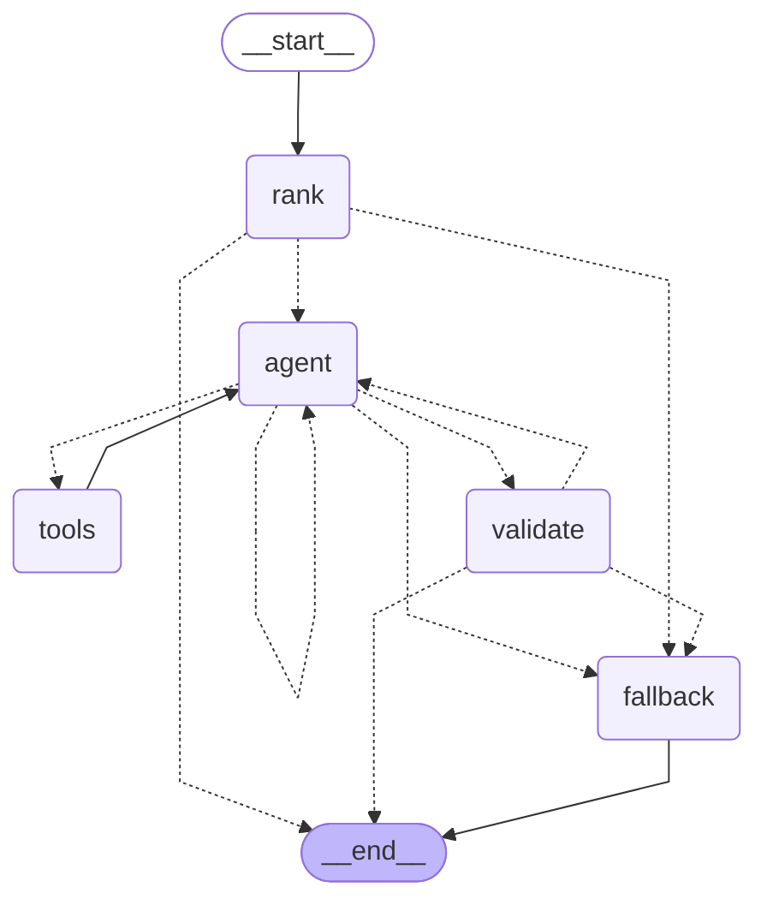

# faultline_langgraph: Faultline agents on LangGraph (opt-in)

A parallel, opt-in reimplementation of Faultline's agents on [LangGraph](https://github.com/langchain-ai/langgraph) and LangChain. Today it converts one agent, the **Planner**. Everything else is still the original code in `faultline/`.

The ground rules:

- **Same blackboard.** It reads the same `reports/` directory (`topology.json`, `baseline.json`, `experiments/*.json`) through the same `ReportStore`, and its output is an ordinary `ExperimentSpec`.
- **Same contract.** Every model it produces or accepts comes from `faultline.schemas` (`ExperimentSpec`, `Hypothesis`, `Baseline`). The schemas are imported, never redefined.
- **Same configuration.** The same `.env` LLM variables, resolved through `faultline.config` and the original `client_from_settings`.
- **`faultline` is unaffected.** Nothing in `faultline/` imports this package. `faultline plan`, `faultline run`, `faultline demo`, the dashboard and the control room behave exactly as before, whether or not the LangGraph dependencies are installed.
- **Separate command, no hidden switch.** You get the LangGraph planner only by running `python -m faultline_langgraph.cli`. No environment variable or flag makes `faultline` swap engines behind your back.

## Install and run

```bash
pip install -e '.[langgraph]'      # langgraph, langchain-core and the three provider packages
```

The `[langgraph]` group in `pyproject.toml` is used only by this package. The base install (`pip install -e .`, or `.[dev]`) never needs it: a no-extras install resolves to exactly the same package set as before this package existed.

```bash
python -m faultline_langgraph.cli plan [--no-llm] [--allow-protected] [--trace] [--json]
python -m faultline_langgraph.cli graph
```

| Command / flag | What it does |
|---|---|
| `plan` | Ranks the candidates and lets the planning agent pick the next experiment. Runs nothing, like `faultline plan`. |
| `--no-llm` | Deterministic plan only. Output is the same as `faultline plan --no-llm`. |
| `--allow-protected` | Same meaning as in `faultline`: lets protected services (MongoDB) get crash/stop/pause/partition candidates. |
| `--trace` | Prints the agent's steps: the ranking, each turn's tool calls, each validation (accepted or rejected, and why), and any fallback. |
| `--json` | Prints the `ExperimentSpec` as JSON on stdout; everything else goes to stderr. |
| `graph` | Prints the planner graph as Mermaid (the diagram below). |
| `--config FILE` | Settings yaml, default `config/settings.yaml`, as for `faultline`. |

If the optional dependencies are missing, the command exits with code 2 and tells you to install them.

### LLM configuration

There is no second configuration scheme. `LLM_PROVIDER`, `LLM_MODEL`, `LLM_BASE_URL`, `LLM_API_KEY` and `FAULTLINE_LLM` in `.env` are read exactly as for the original agents (same provider defaults, same availability probe: the Ollama model must be pulled, an API key must be present). Only the transport changes, in `faultline_langgraph/llm.py`:

| `LLM_PROVIDER` | LangChain class |
|---|---|
| `ollama` | `langchain_ollama.ChatOllama` |
| `openai` | `langchain_openai.ChatOpenAI` (any OpenAI-compatible endpoint: OpenAI, Groq, OpenRouter, ...) |
| `anthropic` | `langchain_anthropic.ChatAnthropic` |

Temperature is 0.2 and the timeout is the configured `llm_timeout_s`, both as in the original `LLMClient`. Provider packages are imported lazily, so only the one in use has to import cleanly. `FAULTLINE_LLM=false` or `--no-llm` removes the model entirely. The model label recorded in planner notes is `langgraph:<provider>:<model>`, so a report shows which engine planned it.

## The Planner agent

The original Planner (`faultline/planning/planner.py`) makes one LLM call. It shows the model the topology, the top 5 code-ranked candidates with their parameter bounds and the last 5 experiments, and asks for one JSON object. If the answer is unusable, it falls back to the deterministic top candidate. The model cannot ask a follow-up question, and it is never told what was wrong with a rejected answer.

The LangGraph Planner gets the same briefing, the same top 5 and the same rules. The difference is that it is an agent:

- **It investigates before it commits**, with five read-only tools (`planner/tools.py`):

  | Tool | What it returns |
  |---|---|
  | `inspect_service(service)` | role, image, criticality, direct and transitive dependents, dependencies, protection policy, whether it was the last target |
  | `experiment_history(service="")` | past experiments this session (last 10, optionally for one service): status, success rate during the fault, time to recover, whether the hypothesis held, findings |
  | `failure_type_info(failure_type)` | what the failure does, its parameters with bounds and defaults, degrade-only or not, typical error rate and recovery time |
  | `baseline_summary()` | steady-state success rate and p95, and the abort thresholds the safety layer enforces |
  | `preview_candidate(choice, parameters)` | a dry run: the parameters after clamping, the clamp notes, and the hypothesis code would predict by default |

  None of them can change anything. They read from the same `Planner` instance the ranking used, so the agent sees the same topology, policy and history.
- **It commits through one tool**, `submit_plan(choice, parameters, rationale, hypothesis)`, whose argument schema uses `faultline.schemas.Hypothesis`.
- **It corrects itself.** If code rejects the plan, the reason goes back to the agent as the tool result ("REJECTED: choice 7 is not a listed candidate ...") and it can submit again: up to **3 submissions** in total.
- **It has a budget**: at most **6 agent turns** (LLM calls) per plan. The first **3** are for investigation (several tool calls per turn are encouraged); from turn 4 the model is forced to call `submit_plan` (`tool_choice`, with the unforced binding as a fallback for providers that reject it), and each turn's system prompt tells it which turn it is on. When the budget or the submissions run out, or the model call fails (network, auth, a model without tool support), the deterministic plan runs.
- **It recovers from garbled tool calls.** Small models sometimes emit tool-call JSON the provider can't parse (Groq answers `400 tool_use_failed`). That is fed back to the model as a message, and it retries within the turn budget, instead of the whole plan falling back.
- **It is rate-limit aware**: an agent makes several calls per plan, so the provider SDKs retry 429s with backoff (`max_retries=3`, honouring `Retry-After`). The original single-call client does not retry.

Models that answer in text instead of calling `submit_plan` still work: the JSON object is pulled out of the reply (stripping `<think>` blocks and code fences), with the same leniency as `LLMClient.chat_json`.

### The graph

Output of `python -m faultline_langgraph.cli graph`. Dotted edges are conditional.



| Node | Runs | What it does | Goes to |
|---|---|---|---|
| `rank` | code | Calls the original `Planner.candidates()`, unchanged, and keeps the top 5. Binds the tools to the model and writes the briefing. | `END` if there are no candidates; `fallback` if there is no model; otherwise `agent` |
| `agent` | LLM | One chat-model call with the five investigation tools and `submit_plan` bound (forced to `submit_plan` after the investigation turns). | `tools` for investigation calls; `validate` when it calls `submit_plan` or answers in text; back to `agent` after a garbled tool call; `fallback` on a failed model call or a spent turn budget |
| `tools` | code | Executes the investigation tool calls (LangGraph `ToolNode`). | back to `agent` |
| `validate` | code | Checks the proposal against `PlanProposal`, then hands it to the original `Planner.plan_next()` (see Safety). Investigation calls made in the same turn are answered too; only the first `submit_plan` per turn counts. | `END` when accepted; `agent` with the rejection reason; `fallback` after 3 rejections or when the turn budget is spent |
| `fallback` | code | The original deterministic `Planner.plan_next()` with no LLM. If the agent was actually tried, adds the same "gave no usable answer ...; deterministic choice" note the original writes. | `END` |

An accepted plan gets two extra `planner_notes`: which tools the agent called, and how many rejections it needed before it was accepted.

## Safety: "LLM proposes, code disposes", by construction

The safety property is not re-implemented here. It is the original code, reached through a small adapter.

`_ProposalReplay` (`planner/graph.py`) is an object with the interface of `LLMClient`: `available()` returns true, `describe()` returns the label, and its single `chat_json()` returns the agent's proposal. `validate` makes a shallow copy of the original `Planner`, sets this object as its `llm` and calls the original `Planner.plan_next()`. That method then does what it always does with a model answer: index check against the top 5, parameter clamping into catalog bounds, filtering `expected_affected` to services that exist, clamping the error rate to 0-1 and the recovery time to 1-600 s, truncating the rationale, and building the spec with `_spec()` (container, criticality, `reproduce` commands). A proposal counts as accepted only if the original code returns a spec with `planned_by: llm`; anything else is a rejection.

So:

- The top-5 restriction, the clamping and the hypothesis sanitising are the lines in `faultline/planning/planner.py`, not a copy of them. A future change to those rules applies to the LangGraph Planner automatically.
- The deterministic fallback is the original deterministic path, called the same way, not a lookalike.
- The model never sees the safety monitor's inputs or outputs and cannot raise a threshold. The tools are read-only, and `baseline_summary` only reports the thresholds.
- The Planner is built with `faultline.cli._planner`, the helper `faultline plan` uses, with the original LLM client switched off (the agent proposes instead). Topology, policy, history, available helper images and `--allow-protected` are therefore identical inputs. This also makes it forward-compatible with extra ranking inputs added to `_planner`, such as the Weakness Scout's predicted weaknesses once that branch is merged: the ranking changes for both commands, and this package needs no change.

## Equivalence

The acceptance bar for this conversion:

1. **Schema validity.** Every spec is a valid `faultline.schemas.ExperimentSpec`, and every proposal is checked against `PlanProposal`, which uses `faultline.schemas.Hypothesis`.
2. **Exact deterministic match.** `python -m faultline_langgraph.cli plan --no-llm` produces the same spec as `faultline plan --no-llm` on the same blackboard: same target, failure type, parameters, rationale, hypothesis, `planned_by`, notes and `reproduce`. The only difference is `experiment_id`, which is a fresh random id in both implementations.
3. **Live side by side.** With the same model and the same blackboard, both planners choose from the same top 5 and both specs pass the same validation. The LangGraph Planner should investigate before it commits, and recover from rejections that make the original fall back to deterministic.

## Equivalence results

> TODO: fill in with measured numbers.

- TODO: schema validity, N specs checked, N valid.
- TODO: `--no-llm` match against `faultline plan --no-llm`, fields compared, result.
- TODO: live side by side, model, number of runs, picks agreed / differed, fallbacks per engine, tool calls per plan, rejections recovered, latency.
- TODO: test suite results (`faultline_langgraph/tests` and the base `pytest`).

## What is converted, and what is not

**Converted:** the Planner only.

**Not converted**, in the recommended order for future work:

1. **Injector + the safety lifecycle state machine** (`faultline/agents/injector.py`, `faultline/safety/`). Highest value: preflight, inject, observe, roll back, recover with escalation, write the report is a real state machine, and LangGraph's explicit nodes, edges and checkpointing fit it well. It also needs the most care. It drives the live Docker stack, the watchdog thread, the `ACTIVE_EXPERIMENT.json` lock and the STOP file, so idempotent rollback and the abort paths must stay exactly as they are. Treat it as a separate project with its own live test plan.
2. **Risk, Fix, Narrator** (`faultline/agents/risk.py`, `fix.py`, `narrator.py`). Moderate fit, lower risk. The scores and rule matches are deterministic code and should stay that way; the LLM only writes prose (Risk), up to two extras (Fix) or one closing paragraph (Narrator). The gain is mostly LangChain structured output straight into the existing schemas instead of hand-parsed JSON.
3. **Topology, Scorecard, Guardian.** Weak fit, low priority. Topology is deterministic parsing of compose files, env vars and nginx config; Scorecard is arithmetic; Guardian is a polling loop that deliberately trusts nobody. None of them makes a model call, and a graph adds nothing they need. Arguably not worth converting.

**Conventions every future conversion must follow:**

- **Layout:** one subpackage per agent, `faultline_langgraph/<agent>/`, like `faultline_langgraph/planner/`.
- **Reuse, don't re-derive:** import the models from `faultline.schemas` and call the original deterministic code (ranking, scoring, rule matching, clamping) instead of copying it.
- **Code disposes:** the decision about what the LLM may change belongs in a code node that runs the original validation, as `validate` and `_ProposalReplay` do for the Planner. The deterministic fallback must be the original deterministic path.
- **Separate command:** a new subcommand of `python -m faultline_langgraph.cli`. Never a flag or environment variable that switches `faultline` itself.
- **Separate tests:** in `faultline_langgraph/tests/`, outside the base `testpaths`, so `pytest` without the extras never collects them.
- **Same `.env`:** build models with `chat_model_from_settings` in `faultline_langgraph/llm.py`; do not add new configuration variables.
- **Nothing in `faultline/` imports `faultline_langgraph`.**

## Tests

```bash
.venv/bin/python -m pytest faultline_langgraph/tests -q
```

Offline, no Docker and no model: the agent is driven by a scripted fake chat model that plays back tool calls and answers. The base suite (`pytest`, with `testpaths = ["tests"]` in `pyproject.toml`) never collects these tests, so it passes without the `[langgraph]` extras installed.
