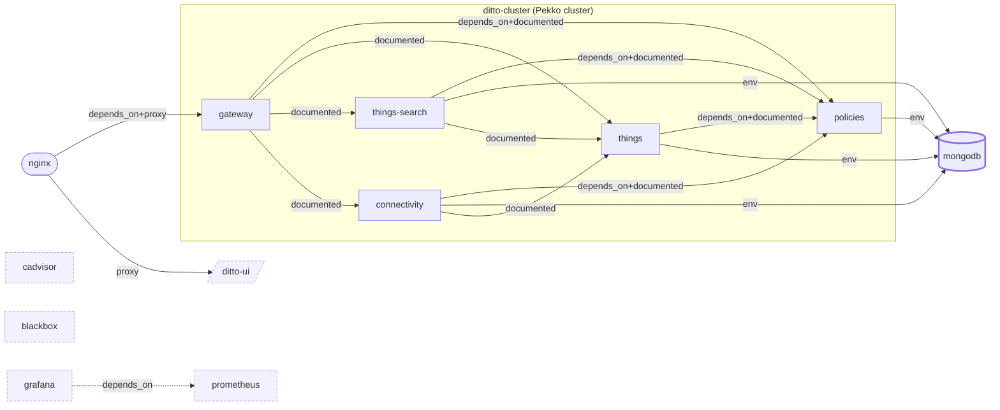

# Faultline topology — project `bosch-ditto`

Generated 2026-10-10 09:26:04 UTC · 12 services · 21 edges

## Services

| service | role | mem limit (MB) | health port | container | state | health | restart policy | chaos target |
|---|---|---|---|---|---|---|---|---|
| `mongodb` | datastore | 256 | - | bosch-ditto-mongodb-1 | running | - | always | yes |
| `policies` | app | 512 | 7626 | bosch-ditto-policies-1 | running | healthy | always | yes |
| `things` | app | 512 | 7626 | bosch-ditto-things-1 | running | healthy | always | yes |
| `things-search` | app | 512 | 7626 | bosch-ditto-things-search-1 | running | healthy | always | yes |
| `connectivity` | app | 768 | 7626 | bosch-ditto-connectivity-1 | running | healthy | always | yes |
| `gateway` | app | 512 | 7626 | bosch-ditto-gateway-1 | running | healthy | always | yes |
| `ditto-ui` | ui | 32 | - | bosch-ditto-ditto-ui-1 | running | - | always | no |
| `nginx` | proxy | 32 | - | bosch-ditto-nginx-1 | running | - | always | yes |
| `prometheus` | other | - | - | bosch-ditto-prometheus-1 | running | - | always | no |
| `cadvisor` | other | - | - | bosch-ditto-cadvisor-1 | running | - | always | no |
| `blackbox` | other | - | - | bosch-ditto-blackbox-1 | running | - | always | no |
| `grafana` | other | - | - | bosch-ditto-grafana-1 | running | - | always | no |

## Edges (src depends on dst)

| src | dst | kind | evidence |
|---|---|---|---|
| `connectivity` | `mongodb` | env | env MONGO_DB_HOSTNAME=mongodb |
| `connectivity` | `policies` | depends_on | depends_on |
| `connectivity` | `policies` | documented | connectivity enforces policies for inbound/outbound messages |
| `connectivity` | `things` | documented | connections publish to and subscribe from things |
| `gateway` | `connectivity` | documented | gateway forwards connection management to connectivity |
| `gateway` | `policies` | depends_on | depends_on |
| `gateway` | `policies` | documented | gateway asks policies to authorise every request (architecture-overview) |
| `gateway` | `things` | documented | gateway forwards thing commands to things over the Pekko cluster |
| `gateway` | `things-search` | documented | gateway forwards /search to things-search |
| `grafana` | `prometheus` | depends_on | depends_on |
| `nginx` | `ditto-ui` | proxy | proxy_pass → ditto-ui |
| `nginx` | `gateway` | depends_on | depends_on |
| `nginx` | `gateway` | proxy | proxy_pass → gateway |
| `policies` | `mongodb` | env | env MONGO_DB_HOSTNAME=mongodb |
| `things` | `mongodb` | env | env MONGO_DB_HOSTNAME=mongodb |
| `things` | `policies` | depends_on | depends_on |
| `things` | `policies` | documented | things enforces policies on every command |
| `things-search` | `mongodb` | env | env MONGO_DB_HOSTNAME=mongodb |
| `things-search` | `policies` | depends_on | depends_on |
| `things-search` | `policies` | documented | search results are filtered by policy enforcement |
| `things-search` | `things` | documented | search index is built from thing events (eventually consistent) |

## Criticality ranking

| rank | service | score | fan-in | transitive dependents | reasons |
|---|---|---|---|---|---|
| 1 | `mongodb` | 9.5 | 4 | connectivity, gateway, nginx, policies, things, things-search | 6 services depend on it transitively; holds state; no application health endpoint; single instance |
| 2 | `policies` | 5.0 | 4 | connectivity, gateway, nginx, things, things-search | 5 services depend on it transitively; single instance |
| 3 | `things` | 4.0 | 3 | connectivity, gateway, nginx, things-search | 4 services depend on it transitively; single instance |
| 4 | `grafana` | 3.5 | 0 | - | nothing depends on it; holds state; reachable from outside the sandbox; no application health endpoint; single instance |
| 5 | `prometheus` | 2.5 | 1 | grafana | 1 service depends on it transitively; reachable from outside the sandbox; no application health endpoint; single instance |
| 6 | `connectivity` | 2.0 | 1 | gateway, nginx | 2 services depend on it transitively; single instance |
| 7 | `things-search` | 2.0 | 1 | gateway, nginx | 2 services depend on it transitively; single instance |
| 8 | `nginx` | 1.5 | 0 | - | nothing depends on it; reachable from outside the sandbox; no application health endpoint; single instance |
| 9 | `ditto-ui` | 1.0 | 1 | nginx | 1 service depends on it transitively; single instance |
| 10 | `gateway` | 1.0 | 1 | nginx | 1 service depends on it transitively; single instance |
| 11 | `blackbox` | 0.5 | 0 | - | nothing depends on it; no application health endpoint; single instance |
| 12 | `cadvisor` | 0.5 | 0 | - | nothing depends on it; no application health endpoint; single instance |

## Findings

- mongodb: not referenced by any depends_on; 4 services reach it only via environment variables
